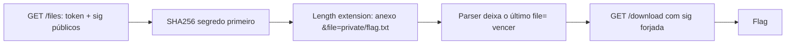

# Crumble Cookie | Fluid Attacks CTF 2026

`crypto` `length-extension` `sha256` `mac-forgery`

| | |
|---|---|
| **Plataforma / evento** | Fluid Attacks CTF 2026 (etapa 2, 04/07/2026) |
| **Categoria** | Cryptography |
| **Resolvido em** | 2026-07-04 |

## TL;DR

O serviço assina os tokens de download com `SHA256(SECRET_KEY + token)`. Isso é uma MAC montada da forma errada e cai direto num length extension attack: eu pego um token público já assinado (`action=download&file=public/notes.txt`), e, sem conhecer o segredo, estendo ele com `&file=private/flag.txt` gerando uma assinatura válida. Como o parser quebra em `&` e deixa o último `file=` vencer, o servidor devolve o conteúdo de `private/flag.txt`. O único parâmetro que eu precisava era o tamanho do segredo, e o próprio comentário no código dizia: 16 bytes.

> [!IMPORTANT]
> **Ideia-chave:** `SHA256(segredo || mensagem)` não é uma MAC segura. O estado interno do SHA-256 ao fim do hash é a própria assinatura, então dá pra continuar o hash de onde ele parou e assinar um sufixo escolhido por mim sem jamais ver o segredo.

## Enunciado

> SecureVault File Sharing API. Download links are cryptographically signed to ensure only authorized files can be retrieved.

**Arquivos / instância:** um `app.py` (Flask) e um endpoint remoto. Na minha instância o host era `9c3414f6c6555f5b.chal.ctf.ae` (HTTPS). O serviço expõe `/files` (lista arquivos com token + assinatura) e `/download` (baixa o arquivo se a assinatura bater).

## Dicas progressivas

<details><summary>Dica 1</summary>Como o token é assinado? Olhe a função <code>sign()</code> e repare na ordem: segredo primeiro, mensagem depois.</details>
<details><summary>Dica 2</summary><code>SHA256(secret || msg)</code> é o cenário clássico de length extension. Você não precisa do segredo, só do tamanho dele.</details>
<details><summary>Dica 3</summary>O comentário do código diz "16-character API key". O parser separa por <code>&</code> e a última ocorrência de <code>file=</code> sobrescreve as anteriores, então estenda com <code>&file=private/flag.txt</code>.</details>

## Ambiente

- **Máquina atacante:** Kali Linux, Python 3 (só a stdlib: `urllib`, `struct`, `hashlib`).
- Nenhuma ferramenta externa; implementei o SHA-256 "continuável" no próprio script pra deixar a conta transparente.

***INSERIR no terminal: Kali (atacante)

```bash
export TARGET=9c3414f6c6555f5b.chal.ctf.ae
```

Na minha instância era esse host. Use o da sua (o script lê a env var `TARGET`).

## Resolução

### 1. Reconhecimento: como os tokens são gerados

Primeiro peguei a cara da API e um token legítimo em `/files`:

***INSERIR no terminal: Kali (atacante)

```bash
curl -sk https://$TARGET/files | python3 -m json.tool
```

```text
{
  "files": [
    {
      "download": "/download?token=action%3Ddownload%26file%3Dpublic%2Fnotes.txt&sig=41f55a0b9d9266ada1dee2e3fe2fd236cc0491fff56c22700b4d2bc858ba6a66",
      "path": "public/notes.txt",
      "sig": "41f55a0b9d9266ada1dee2e3fe2fd236cc0491fff56c22700b4d2bc858ba6a66",
      "token": "action=download&file=public/notes.txt"
    },
    ...[snip]...
  ]
}
```

Então eu tenho, de graça, uma mensagem conhecida (`action=download&file=public/notes.txt`) e a assinatura dela. Guarde isso: é a matéria-prima do ataque.

### 2. Revisão do código: a assinatura é feita errada

#### `app.py`

As partes que importam:

```python
# Our 16-character API key secures all download tokens
SECRET_KEY = os.environ.get("SECRET_KEY", "????????????????")

def sign(message_bytes):
    """Sign a message using SHA256(SECRET_KEY + message)."""
    return hashlib.sha256(SECRET_KEY.encode() + message_bytes).hexdigest()

def parse_token_params(token_bytes):
    parts = {}
    token_str = token_bytes.decode("latin-1")
    for segment in token_str.split("&"):
        if "=" in segment:
            key, _, value = segment.partition("=")
            parts[key] = value   # chave repetida: a ÚLTIMA vence
    return parts
```

Três coisas me saltaram aos olhos:

1. A assinatura é `SHA256(SECRET_KEY + token)`. Segredo concatenado antes da mensagem é exatamente o que length extension explora.
2. O comentário entrega o tamanho do segredo: 16 caracteres. Esse é o único número que eu preciso adivinhar, e nem adivinhar precisei.
3. `parse_token_params` faz `split("&")` e sobrescreve chaves repetidas. Se eu conseguir injetar um segundo `file=private/flag.txt` depois do original, o último ganha.

E no `/download`, a checagem de autorização é só o `file`:

```python
if filepath == "private/flag.txt":
    return jsonify({"filename": "private/flag.txt", "content": FLAG})
```

Ou seja: se eu conseguir um token cujo `file` final seja `private/flag.txt` **com assinatura válida**, a flag sai.

> [!TIP]
> **Conceito: length extension attack (Merkle-Damgård).** SHA-256 processa a mensagem em blocos de 64 bytes e carrega um estado interno de 256 bits de um bloco pro outro. No fim, esse estado interno *é* o digest. Se eu conheço `H = SHA256(segredo || msg)` e o tamanho de `segredo || msg`, eu uso `H` como estado inicial, aplico o padding que o algoritmo teria colocado, e continuo o hash com os meus bytes (`ext`). O resultado é uma assinatura válida para `segredo || msg || padding || ext`, sem nunca ter visto o segredo. Referência: [Wikipedia: Length extension attack](https://en.wikipedia.org/wiki/Length_extension_attack).

### 3. Montando o ataque

A mensagem real que o servidor assina é `SECRET_KEY (16 bytes) + "action=download&file=public/notes.txt"`. O length extension me deixa anexar:

```
<padding do SHA-256 para 16+37 bytes> + "&file=private/flag.txt"
```

O padding vira bytes literais no meio do token (`\x80\x00...`), mas tudo bem: `parse_token_params` só se importa com os pedaços que têm `=`, e o `&file=private/flag.txt` no fim sobrescreve o `file` anterior. É por isso que a sobrescrita de chave repetida fecha o ataque.

Dois detalhes de implementação que me pegariam se eu não cuidasse:

- **Encoding.** O servidor faz `token.encode("latin-1")`. Então eu tenho que mandar os bytes do padding (ex.: `0x80`) de forma que o Flask os receba como `0x80`. Decodifico os bytes forjados como `latin-1` e deixo o `urlencode` cuidar do resto.
- **Tamanho do segredo.** O comentário diz 16. Se não dissesse, eu faria um brute force de 8 a 32 bytes, testando cada palpite contra o `/download` até um não dar 403.

Implementei o SHA-256 continuável à mão pra deixar a matemática explícita (dá pra fazer com `hashpumpy` ou `hlextend`, mas aí a conta fica escondida numa lib). Script completo, idêntico ao arquivo em `scripts/`:

#### `scripts/script1.py`

```python
#!/usr/bin/env python3
# -*- coding: utf-8 -*-

"""
Exploit para o desafio Crumble Cookie.

Falha explorada:
- A aplicação assina tokens usando SHA256(SECRET_KEY + token).
- Isso é vulnerável a length extension attack.
- O segredo tem 16 caracteres, conforme comentário no app.py.
- O parser aceita parâmetros repetidos e o último "file" sobrescreve o anterior.

Objetivo:
- Pegar um token público válido.
- Estender esse token com "&file=private/flag.txt".
- Gerar uma nova assinatura SHA256 válida sem conhecer SECRET_KEY.
- Baixar a flag.
"""

import json
import os
import re
import ssl
import struct
import sys
import urllib.parse
import urllib.request
import urllib.error


# Constantes oficiais do SHA-256.
K = [
    0x428a2f98, 0x71374491, 0xb5c0fbcf, 0xe9b5dba5,
    0x3956c25b, 0x59f111f1, 0x923f82a4, 0xab1c5ed5,
    0xd807aa98, 0x12835b01, 0x243185be, 0x550c7dc3,
    0x72be5d74, 0x80deb1fe, 0x9bdc06a7, 0xc19bf174,
    0xe49b69c1, 0xefbe4786, 0x0fc19dc6, 0x240ca1cc,
    0x2de92c6f, 0x4a7484aa, 0x5cb0a9dc, 0x76f988da,
    0x983e5152, 0xa831c66d, 0xb00327c8, 0xbf597fc7,
    0xc6e00bf3, 0xd5a79147, 0x06ca6351, 0x14292967,
    0x27b70a85, 0x2e1b2138, 0x4d2c6dfc, 0x53380d13,
    0x650a7354, 0x766a0abb, 0x81c2c92e, 0x92722c85,
    0xa2bfe8a1, 0xa81a664b, 0xc24b8b70, 0xc76c51a3,
    0xd192e819, 0xd6990624, 0xf40e3585, 0x106aa070,
    0x19a4c116, 0x1e376c08, 0x2748774c, 0x34b0bcb5,
    0x391c0cb3, 0x4ed8aa4a, 0x5b9cca4f, 0x682e6ff3,
    0x748f82ee, 0x78a5636f, 0x84c87814, 0x8cc70208,
    0x90befffa, 0xa4506ceb, 0xbef9a3f7, 0xc67178f2,
]


def rotr(x, n):
    """Rotação de bits para a direita, operação usada internamente pelo SHA-256."""
    return ((x >> n) | (x << (32 - n))) & 0xffffffff


def sha256_compress(chunk, h):
    """
    Processa um bloco de 64 bytes do SHA-256 a partir de um estado interno h.

    Isso é necessário porque no length extension attack nós continuamos o hash
    a partir do digest conhecido, como se o SHA-256 ainda estivesse processando dados.
    """
    w = list(struct.unpack(">16I", chunk)) + [0] * 48

    for i in range(16, 64):
        s0 = rotr(w[i - 15], 7) ^ rotr(w[i - 15], 18) ^ (w[i - 15] >> 3)
        s1 = rotr(w[i - 2], 17) ^ rotr(w[i - 2], 19) ^ (w[i - 2] >> 10)
        w[i] = (w[i - 16] + s0 + w[i - 7] + s1) & 0xffffffff

    a, b, c, d, e, f, g, hh = h

    for i in range(64):
        S1 = rotr(e, 6) ^ rotr(e, 11) ^ rotr(e, 25)
        ch = (e & f) ^ ((~e) & g)
        temp1 = (hh + S1 + ch + K[i] + w[i]) & 0xffffffff

        S0 = rotr(a, 2) ^ rotr(a, 13) ^ rotr(a, 22)
        maj = (a & b) ^ (a & c) ^ (b & c)
        temp2 = (S0 + maj) & 0xffffffff

        hh = g
        g = f
        f = e
        e = (d + temp1) & 0xffffffff
        d = c
        c = b
        b = a
        a = (temp1 + temp2) & 0xffffffff

    return [(x + y) & 0xffffffff for x, y in zip(h, [a, b, c, d, e, f, g, hh])]


def sha256_padding(message_len):
    """
    Gera o padding padrão do SHA-256 para uma mensagem de tamanho message_len.

    No servidor, a mensagem real assinada é:
    SECRET_KEY + token_original

    Como o SECRET_KEY tem 16 bytes, conseguimos calcular o padding exato usado
    após SECRET_KEY + token_original.
    """
    return (
        b"\x80"
        + b"\x00" * ((56 - (message_len + 1) % 64) % 64)
        + struct.pack(">Q", message_len * 8)
    )


def sha256_continue(data, initial_state, previous_len):
    """
    Continua o SHA-256 a partir de um estado interno já conhecido.

    previous_len é o tamanho já processado antes de adicionar data.
    """
    h = initial_state[:]

    final_data = data + sha256_padding(previous_len + len(data))

    if len(final_data) % 64 != 0:
        raise RuntimeError("Padding SHA-256 inválido. O tamanho final não fechou bloco de 64 bytes.")

    for i in range(0, len(final_data), 64):
        h = sha256_compress(final_data[i:i + 64], h)

    return "".join(f"{x:08x}" for x in h)


def length_extend_sha256(old_sig_hex, original_message, extension, secret_len):
    """
    Executa o length extension attack.

    Entrada:
    - old_sig_hex: SHA256(secret + original_message)
    - original_message: token público conhecido
    - extension: dados que queremos acrescentar
    - secret_len: tamanho conhecido do segredo

    Saída:
    - forged_message: token original + padding + extensão
    - forged_sig: assinatura válida para secret + forged_message
    """
    initial_state = list(struct.unpack(">8I", bytes.fromhex(old_sig_hex)))

    original_total_len = secret_len + len(original_message)
    glue_padding = sha256_padding(original_total_len)

    forged_message = original_message + glue_padding + extension

    previous_len = original_total_len + len(glue_padding)
    forged_sig = sha256_continue(extension, initial_state, previous_len)

    return forged_message, forged_sig


def http_get(url):
    """Faz uma requisição GET simples e retorna status e corpo."""
    req = urllib.request.Request(
        url,
        headers={
            "User-Agent": "ctf-length-extension-client/1.0"
        },
    )

    context = ssl._create_unverified_context()

    try:
        with urllib.request.urlopen(req, timeout=15, context=context) as response:
            body = response.read().decode("utf-8", errors="replace")
            return response.status, body
    except urllib.error.HTTPError as e:
        body = e.read().decode("utf-8", errors="replace")
        return e.code, body


def discover_base(target):
    """
    Descobre se o serviço responde em http ou https.

    A UI do desafio mostra HTTP, então normalmente será http://host.
    Mesmo assim testamos os dois para evitar perder tempo se houver TLS.
    """
    if target.startswith("http://") or target.startswith("https://"):
        candidates = [target.rstrip("/")]
    else:
        candidates = [
            "http://" + target.strip("/"),
            "https://" + target.strip("/"),
        ]

    for base in candidates:
        status, body = http_get(base + "/files")
        if status == 200 and "files" in body:
            return base, body

    print("[-] Não consegui acessar /files em http nem https.")
    for base in candidates:
        status, body = http_get(base + "/")
        print(f"[debug] {base}/ -> HTTP {status} -> {body[:200]!r}")

    sys.exit(1)


def main():
    target = os.environ.get("TARGET", "9c3414f6c6555f5b.chal.ctf.ae")
    secret_len = 16

    print(f"[*] Target: {target}")
    print(f"[*] Tamanho conhecido do SECRET_KEY: {secret_len} bytes")

    base, files_body = discover_base(target)

    print(f"[*] Base URL funcionando: {base}")
    print()
    print("=" * 80)
    print("RESPOSTA DE /files")
    print("=" * 80)
    print(files_body)

    data = json.loads(files_body)

    # Preferimos notes.txt, mas qualquer arquivo público assinado serve.
    chosen = None
    for item in data.get("files", []):
        if item.get("path") == "public/notes.txt":
            chosen = item
            break

    if chosen is None:
        chosen = data["files"][0]

    original_token = chosen["token"].encode("latin-1")
    original_sig = chosen["sig"]

    print()
    print("=" * 80)
    print("TOKEN PÚBLICO ESCOLHIDO")
    print("=" * 80)
    print(f"token: {chosen['token']}")
    print(f"sig:   {original_sig}")

    # Este parâmetro será interpretado depois do padding.
    # Como parse_token_params sobrescreve chaves repetidas, este file vence.
    extension = b"&file=private/flag.txt"

    forged_token_bytes, forged_sig = length_extend_sha256(
        old_sig_hex=original_sig,
        original_message=original_token,
        extension=extension,
        secret_len=secret_len,
    )

    # Importante:
    # A aplicação faz request.args.get("token") e depois token.encode("latin-1").
    # Por isso decodificamos os bytes como latin-1 e deixamos urlencode gerar UTF-8.
    # Assim bytes como 0x80 voltam corretamente para 0x80 no servidor.
    forged_token_str = forged_token_bytes.decode("latin-1")

    query = urllib.parse.urlencode({
        "token": forged_token_str,
        "sig": forged_sig,
    })

    exploit_url = base + "/download?" + query

    print()
    print("=" * 80)
    print("TOKEN FORJADO")
    print("=" * 80)
    print(f"forged_sig: {forged_sig}")
    print(f"forged_token_bytes: {forged_token_bytes!r}")
    print()
    print("[*] Enviando token forjado para /download...")

    status, body = http_get(exploit_url)

    print()
    print("=" * 80)
    print("RESPOSTA DO SERVIDOR")
    print("=" * 80)
    print(f"HTTP {status}")
    print(body)

    match = re.search(r"flag\{[^}\r\n]+\}", body, re.IGNORECASE)

    print()
    print("=" * 80)
    print("RESULTADO")
    print("=" * 80)

    if match:
        flag = match.group(0)
        print(f"[+] FLAG ENCONTRADA: {flag}")

        with open("flag.txt", "w", encoding="utf-8") as f:
            f.write(flag + "\n")

        print("[+] Flag salva em flag.txt")
        return 0

    print("[-] Flag não encontrada automaticamente.")
    print("[-] Se o HTTP foi 403, o problema pode ser encoding do token.")
    print("[-] Se o HTTP foi 500, provavelmente algum byte não chegou como latin-1.")
    return 1


if __name__ == "__main__":
    raise SystemExit(main())
```

***INSERIR no terminal: Kali (atacante)

```bash
python3 scripts/script1.py
```

```text
[*] Target: 9c3414f6c6555f5b.chal.ctf.ae
[*] Tamanho conhecido do SECRET_KEY: 16 bytes
[*] Base URL funcionando: https://9c3414f6c6555f5b.chal.ctf.ae
...[snip]...
================================================================================
TOKEN FORJADO
================================================================================
forged_sig: d0879064cb03ba2b82c21160ca5812fee87263a380c95c9c7cd7495aa8f75398
forged_token_bytes: b'action=download&file=public/notes.txt\x80\x00\x00\x00\x00\x00\x00\x00\x00\x01\xa8&file=private/flag.txt'

[*] Enviando token forjado para /download...

================================================================================
RESPOSTA DO SERVIDOR
================================================================================
HTTP 200
{"content":"flag{27b8ad22811XXXXX}","filename":"private/flag.txt"}
```

Repare no `forged_token_bytes`: o `\x80\x00...\x01\xa8` é o padding do SHA-256 (o `\x01\xa8` é `0x1a8 = 424 bits = 53 bytes`, que é `16 + 37`, o tamanho da mensagem original). Logo depois vem o meu `&file=private/flag.txt`, que o parser lê por cima do `file` legítimo. Assinatura válida, arquivo trocado, flag na mão.

## Cadeia de ataque



## Por que funciona

A suposição de segurança quebrada é tratar `SHA256(segredo || mensagem)` como se fosse uma MAC. Num hash Merkle-Damgård (MD5, SHA-1, SHA-256), o digest publicado é literalmente o estado interno da função no fim do processamento. Com o digest e o comprimento total, qualquer um retoma o cálculo e assina um sufixo escolhido, sem conhecer o segredo. A primitiva que isso me dá é forjar assinaturas válidas para mensagens que terminam em dados meus, e o parser com sobrescrita de chave transforma esse "dados no fim" em controle total do parâmetro `file`.

## Remediação

- Usar HMAC de verdade: `HMAC-SHA256(key, message)`. O HMAC foi desenhado exatamente para resistir a length extension (duas passagens de hash com padding interno/externo).
- Se por algum motivo mantiver hash puro, prefira um resistente a extensão (SHA-3 / família Keccak, ou SHA-512/256 truncado).
- No parser, rejeitar chaves duplicadas em vez de deixar a última vencer, e normalizar o caminho do arquivo antes da checagem de autorização.

## Lições e padrões

- **Sinais para reconhecer:** assinatura = `hash(secret + data)` com o segredo *na frente*, digest exposto ao cliente, e um comprimento de segredo conhecido ou brutável. Isso é length extension até prova em contrário.
- **Da próxima vez eu tentaria primeiro:** confirmar o algoritmo e a ordem da concatenação no código; se for `hash(secret + msg)`, já parto pro `hashpump`/implementação manual. Se o tamanho do segredo não estiver escrito, faço brute force do `secret_len` de 1 a ~40 testando contra o endpoint.

## Referências

- [Length extension attack (Wikipedia)](https://en.wikipedia.org/wiki/Length_extension_attack)
- [RFC 2104: HMAC](https://www.rfc-editor.org/rfc/rfc2104)

## Flag

```text
flag{27b8ad22811XXXXX}
```
