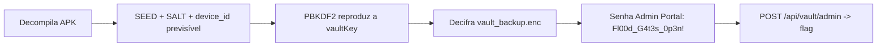

# Deadbolt | Fluid Attacks CTF 2026

`mobile` `android` `hardcoded-key` `pbkdf2` `aes-gcm` `reversing`

| | |
|---|---|
| **Plataforma / evento** | Fluid Attacks CTF 2026 (etapa 2, 04/07/2026) |
| **Categoria** | Mobile |
| **Resolvido em** | 2026-07-04 |

## TL;DR

O app FluidVault deriva a chave do cofre com PBKDF2, mas todos os ingredientes estão no código decompilado: o `SEED` é uma string fixa, o `SALT` é hardcoded, as iterações são 10000, e o "device ID" que entra na senha vem de `Build.SERIAL`, que num ambiente sem serial cai no fallback `DEFAULT_DEVICE_ID`. Reimplemento a derivação em Python, decifro o `vault_backup.enc` (AES-256-GCM) e leio o cofre em claro: o item "Admin Portal" tem a senha `Fl00d_G4t3s_0p3n!`. Mando essa senha no `POST /api/vault/admin` (endpoint que achei no `VaultApiClient.java`) e o servidor devolve a flag.

> [!IMPORTANT]
> **Ideia-chave:** se a chave de criptografia é derivada só de constantes que viajam dentro do APK, não existe segredo. O "biometric keystore" é fachada: a chave real nasce de `SEED + device_id` conhecidos.

## Enunciado

> FluidVault, a secure biometric password manager. Your secrets stay on your device.

**Arquivos / instância:** um bundle com o app decompilado (`com/fluidvault/...`), um `vault_backup.enc` (backup binário) e um helper `vault_decrypt.py` que documenta o layout do blob. Na minha instância o endpoint era `b36266e754204c82.chal.ctf.ae`.

## Dicas progressivas

<details><summary>Dica 1</summary>O keystore biométrico é distração. Como a <code>vaultKey</code> é realmente derivada em <code>CryptoManager.deriveVaultKey()</code>?</details>
<details><summary>Dica 2</summary>Tudo que entra no PBKDF2 (SEED, SALT, iterações, device_id) está no código. O <code>device_id</code> depende de <code>Build.SERIAL</code>, que sem device vira <code>DEFAULT_DEVICE_ID</code>.</details>
<details><summary>Dica 3</summary>Decifre <code>vault_backup.enc</code>, pegue a senha do "Admin Portal" e mande em <code>POST /api/vault/admin</code> com <code>{"master_password": "..."}</code>.</details>

## Ambiente

- **Máquina atacante:** Kali Linux, Python 3.
- **Bibliotecas:** `cryptography` (AES-GCM), `requests`. A derivação PBKDF2 usa o `hashlib` da stdlib.

***INSERIR no terminal: Kali (atacante)

```bash
export TARGET=b36266e754204c82.chal.ctf.ae
pip install cryptography requests
```

Na minha instância era esse host. Use o da sua (o `script2.py` lê `TARGET`).

## Resolução

### 1. Revisão do código: a chave está toda no APK

#### `com/fluidvault/crypto/CryptoManager.java`

```java
private static final String SEED = "fluidvault_master_seed_2026";
private static final byte[] SALT = hexToBytes("a915c3e00dbb5a55ba13d7cdaf3a126e");
private static final int ITERATIONS = 10000;
private static final int KEY_LENGTH = 256;
private static final String DEFAULT_DEVICE_ID = "DEFAULT_DEVICE_ID";

private SecretKey deriveVaultKey() throws Exception {
    String deviceId = getDeviceIdentifier();
    String passphrase = SEED + deviceId;                  // tudo conhecido
    KeySpec spec = new PBEKeySpec(passphrase.toCharArray(), SALT, ITERATIONS, KEY_LENGTH);
    byte[] keyBytes = SecretKeyFactory.getInstance("PBKDF2WithHmacSHA256")
                          .generateSecret(spec).getEncoded();
    return new SecretKeySpec(keyBytes, "AES");
}

private String getDeviceIdentifier() {
    String serial = Build.SERIAL;
    if (serial == null || serial.equals("unknown")) {
        serial = DEFAULT_DEVICE_ID;                       // fallback previsível
    }
    return Integer.toHexString(serial.hashCode());        // device_id = hex(hashCode)
}
```

A chave do cofre é `PBKDF2(SEED + device_id, SALT, 10000, 256)`. O único valor que não é literal é o `device_id`, mas ele vem de `Build.SERIAL.hashCode()`, e em qualquer ambiente moderno `Build.SERIAL` retorna `null`/`"unknown"` (o Android bloqueou o acesso ao serial faz tempo), então cai no fallback `DEFAULT_DEVICE_ID`. Ou seja: a chave é totalmente determinística e eu posso reproduzi-la fora do app.

> [!TIP]
> **Conceito: chave derivada de constantes do app (CWE-798 / CWE-321).** PBKDF2 serve pra transformar uma senha em chave, mas só agrega segurança se a senha for secreta. Quando a "senha" é `SEED` fixo mais um `device_id` previsível, o PBKDF2 vira só uma função pública: o atacante calcula a mesma chave. Salt e iterações hardcoded não ajudam, porque eles protegem contra rainbow tables, não contra quem tem o código. Referência: [CWE-798: Use of Hard-coded Credentials](https://cwe.mitre.org/data/definitions/798.html).

O `getDeviceIdentifier` usa `String.hashCode()` e `Integer.toHexString()` do Java, que eu reimplemento fielmente em Python (o hashCode é `31*h + c` truncado a 32 bits com sinal).

### 2. Derivando a chave e decifrando o backup

O helper `vault_decrypt.py` documenta o layout: `[12-byte IV][ciphertext][16-byte GCM tag]`. Script completo, idêntico ao arquivo em `scripts/`:

#### `scripts/script1.py`

```python
#!/usr/bin/env python3
import json
import re
import hashlib
from pathlib import Path

from cryptography.hazmat.primitives.ciphers.aead import AESGCM

# Constantes copiadas diretamente do CryptoManager.java.
SEED = "fluidvault_master_seed_2026"
SALT = bytes.fromhex("a915c3e00dbb5a55ba13d7cdaf3a126e")
ITERATIONS = 10000
KEY_LENGTH_BYTES = 32
IV_LENGTH = 12

BACKUP_PATH = Path("extracted/vault_backup.enc")
LOOT_DIR = Path("loot")


def java_string_hashcode(value: str) -> int:
    """
    Reimplementa String.hashCode() do Java.

    Fórmula Java:
        h = 31 * h + char

    O resultado é um inteiro assinado de 32 bits.
    """
    h = 0

    for ch in value:
        h = (31 * h + ord(ch)) & 0xFFFFFFFF

    # Converte para assinado, igual ao int do Java.
    if h & 0x80000000:
        h -= 0x100000000

    return h


def java_integer_to_hex_string(value: int) -> str:
    """
    Reimplementa Integer.toHexString(int) do Java.

    Para valores negativos, Java imprime o valor em complemento de dois
    como hexadecimal unsigned de 32 bits.
    """
    return format(value & 0xFFFFFFFF, "x")


def get_device_identifier(serial):
    """
    Reimplementa getDeviceIdentifier() do CryptoManager.java.

    Se Build.SERIAL for null ou "unknown", o app usa DEFAULT_DEVICE_ID.
    Depois calcula hashCode() e converte para hex.
    """
    if serial is None or serial == "unknown":
        serial = "DEFAULT_DEVICE_ID"

    java_hash = java_string_hashcode(serial)
    device_id = java_integer_to_hex_string(java_hash)

    return serial, java_hash, device_id


def derive_key(device_id: str) -> bytes:
    """
    Reimplementa PBKDF2WithHmacSHA256 usado pelo app.

    passphrase = SEED + deviceId
    salt = SALT hardcoded
    iterations = 10000
    key = 32 bytes para AES-256
    """
    passphrase = (SEED + device_id).encode("utf-8")

    return hashlib.pbkdf2_hmac(
        "sha256",
        passphrase,
        SALT,
        ITERATIONS,
        dklen=KEY_LENGTH_BYTES,
    )


def decrypt_backup(key: bytes, blob: bytes) -> bytes:
    """
    O vault_decrypt.py informa o layout:

        [ 12-byte IV ][ ciphertext ][ 16-byte GCM tag ]

    A biblioteca AESGCM espera ciphertext || tag junto.
    """
    iv = blob[:IV_LENGTH]
    ciphertext_and_tag = blob[IV_LENGTH:]

    return AESGCM(key).decrypt(iv, ciphertext_and_tag, None)


def main():
    LOOT_DIR.mkdir(exist_ok=True)

    if not BACKUP_PATH.exists():
        print(f"[-] Arquivo não encontrado: {BACKUP_PATH}")
        return 1

    blob = BACKUP_PATH.read_bytes()

    print("[*] Backup:", BACKUP_PATH)
    print("[*] Tamanho do backup:", len(blob), "bytes")

    # Candidatos coerentes com o código Java.
    # None e "unknown" ativam o fallback DEFAULT_DEVICE_ID.
    serial_candidates = [
        None,
        "unknown",
        "DEFAULT_DEVICE_ID",
    ]

    for serial_candidate in serial_candidates:
        real_serial, java_hash, device_id = get_device_identifier(serial_candidate)
        key = derive_key(device_id)

        print()
        print("=" * 80)
        print("[*] Testando candidato")
        print("=" * 80)
        print("[*] Build.SERIAL candidato:", repr(serial_candidate))
        print("[*] Serial usado pelo app:", real_serial)
        print("[*] Java hashCode:", java_hash)
        print("[*] Device ID hex:", device_id)
        print("[*] AES key hex:", key.hex())

        try:
            plaintext = decrypt_backup(key, blob)
        except Exception as exc:
            print("[-] Falhou:", type(exc).__name__)
            continue

        print()
        print("=" * 80)
        print("[+] DECRIPTAÇÃO OK")
        print("=" * 80)

        text = plaintext.decode("utf-8", errors="replace")
        print(text)

        Path("loot/script1_key.txt").write_text(key.hex() + "\n", encoding="utf-8")
        Path("loot/script1_plaintext.txt").write_text(text, encoding="utf-8")

        # Se for JSON, salva também formatado para leitura.
        try:
            parsed = json.loads(text)
            Path("loot/script1_plaintext.json").write_text(
                json.dumps(parsed, indent=2, ensure_ascii=False) + "\n",
                encoding="utf-8",
            )
        except Exception:
            pass

        flags = re.findall(r"flag\{[^}\r\n]+\}", text, re.IGNORECASE)

        if flags:
            print()
            print("=" * 80)
            print("[+] FLAG ENCONTRADA")
            print("=" * 80)

            for flag in flags:
                print(flag)

            Path("flag.txt").write_text(flags[0] + "\n", encoding="utf-8")
            print("[+] Primeira flag salva em flag.txt")
        else:
            print("[!] Decriptou, mas não achei flag automaticamente.")
            print("[*] Revise loot/script1_plaintext.txt")

        return 0

    print()
    print("=" * 80)
    print("[-] Nenhum candidato funcionou")
    print("=" * 80)
    print("[*] Próximo passo: analisar LoginActivity, VaultApiClient e ContentProvider.")
    return 1


if __name__ == "__main__":
    raise SystemExit(main())
```

***INSERIR no terminal: Kali (atacante)

```bash
python3 scripts/script1.py
```

```text
[*] Device ID hex: ...
[*] AES key hex: c70cf882eaf48e1da954f0105594fef19704aeae00e86756501957a033faa91a

================================================================================
[+] DECRIPTAÇÃO OK
================================================================================
{
  "version": 2,
  "entries": [
    { "id": 1, "name": "Admin Portal", "username": "admin",
      "password": "Fl00d_G4t3s_0p3n!", "notes": "Master admin - DO NOT SHARE" },
    { "id": 2, "name": "Corporate Email", "password": "Ema1l_2026!Secure", ...},
    { "id": 3, "name": "AWS Console", "password": "Aws!D3pl0y#Pr0d", ...}
  ]
}
```

O fallback `DEFAULT_DEVICE_ID` deu a chave certa de primeira (o GCM só decifra com a chave e o tag corretos, então a decifragem OK já confirma a chave). O cofre tem três senhas; a do "Admin Portal" é a que interessa.

### 3. Usando a senha no endpoint admin

O `VaultApiClient.java` mostra o endpoint e o formato do corpo:

```java
URL url = new URL(BASE_URL + "/api/vault/admin");  // POST
body.put("master_password", masterPassword);
```

Então mando as senhas recuperadas, começando pela do Admin Portal. Script completo, idêntico ao arquivo em `scripts/`:

#### `scripts/script2.py`

```python
#!/usr/bin/env python3
import json
import os
import re
from pathlib import Path

import requests
import urllib3

# Desativa warning de certificado em ambiente CTF.
urllib3.disable_warnings(urllib3.exceptions.InsecureRequestWarning)

# Host da instância do desafio.
TARGET = os.environ.get("TARGET", "b36266e754204c82.chal.ctf.ae").strip().rstrip("/")

LOOT_DIR = Path("loot")
LOOT_DIR.mkdir(exist_ok=True)

# Senhas recuperadas do vault descriptografado.
# A primeira é a candidata principal porque veio do item "Admin Portal".
PASSWORD_CANDIDATES = [
    "Fl00d_G4t3s_0p3n!",
    "Ema1l_2026!Secure",
    "Aws!D3pl0y#Pr0d",
]

# Testa HTTPS primeiro porque os desafios anteriores desse domínio normalmente usam TLS.
# Depois testa HTTP caso a instância esteja sem TLS.
BASE_URLS = [
    f"https://{TARGET}",
    f"http://{TARGET}",
]


def save_response(label: str, response: requests.Response) -> None:
    """
    Salva cada resposta bruta em loot para facilitar revisão e writeup.
    """
    safe_label = re.sub(r"[^a-zA-Z0-9_.-]+", "_", label)
    path = LOOT_DIR / f"script2_{safe_label}.txt"

    content = []
    content.append(f"URL: {response.url}")
    content.append(f"STATUS: {response.status_code}")
    content.append("HEADERS:")
    content.append(str(dict(response.headers)))
    content.append("")
    content.append("BODY:")
    content.append(response.text)

    path.write_text("\n".join(content), encoding="utf-8", errors="replace")
    print("[*] Salvo em:", path)


def show_response(label: str, response: requests.Response) -> bool:
    """
    Mostra status, corpo e procura flag.
    Retorna True se encontrar flag.
    """
    print()
    print("=" * 90)
    print(label)
    print("=" * 90)
    print("[*] URL:", response.url)
    print("[*] Status:", response.status_code)
    print("[*] Content-Type:", response.headers.get("Content-Type", ""))
    print("[*] Corpo:")
    print(response.text[:3000])

    save_response(label, response)

    flags = re.findall(r"flag\{[^}\r\n]+\}", response.text, re.IGNORECASE)

    if flags:
        print()
        print("=" * 90)
        print("[+] FLAG ENCONTRADA")
        print("=" * 90)

        for flag in flags:
            print(flag)

        Path("flag.txt").write_text(flags[0] + "\n", encoding="utf-8")
        print("[+] Primeira flag salva em flag.txt")
        return True

    return False


def try_base(base_url: str) -> bool:
    """
    Testa os endpoints encontrados no VaultApiClient.java.
    """
    session = requests.Session()
    session.headers.update({
        "Accept": "application/json",
        "User-Agent": "FluidVault/2.3.1 Android",
    })

    print()
    print("#" * 90)
    print("[*] Testando base:", base_url)
    print("#" * 90)

    # Primeiro consulta /api/vault/info porque o helper citava esse endpoint.
    try:
        response = session.get(
            f"{base_url}/api/vault/info",
            timeout=15,
            verify=False,
        )
        if show_response("GET_api_vault_info", response):
            return True
    except Exception as exc:
        print("[-] Falha no GET /api/vault/info:", repr(exc))

    # Depois envia a senha no formato exato do app:
    # {"master_password": "..."}
    for password in PASSWORD_CANDIDATES:
        print()
        print("[*] Testando master_password:", password)

        try:
            response = session.post(
                f"{base_url}/api/vault/admin",
                headers={"Content-Type": "application/json"},
                json={"master_password": password},
                timeout=15,
                verify=False,
            )

            if show_response(f"POST_api_vault_admin_{password}", response):
                return True

            # Se a resposta for JSON com token ou rota, mostra campos importantes.
            try:
                data = response.json()
                print("[*] JSON parseado:")
                print(json.dumps(data, indent=2, ensure_ascii=False))
            except Exception:
                pass

        except Exception as exc:
            print("[-] Falha no POST /api/vault/admin:", repr(exc))

    return False


def main() -> int:
    print("[*] Target:", TARGET)

    for base_url in BASE_URLS:
        if try_base(base_url):
            return 0

    print()
    print("=" * 90)
    print("[-] Flag não encontrada nessa rodada")
    print("=" * 90)
    print("[*] Próximo passo: revisar respostas em loot/script2_*.txt e testar rotas derivadas.")
    print("[*] Comando útil depois: grep -RniE 'flag|admin|token|secret|vault|error|password|master' loot")
    return 1


if __name__ == "__main__":
    raise SystemExit(main())
```

***INSERIR no terminal: Kali (atacante)

```bash
python3 scripts/script2.py
```

```text
[*] Testando master_password: Fl00d_G4t3s_0p3n!

==========================================================================================
POST_api_vault_admin_Fl00d_G4t3s_0p3n_
==========================================================================================
[*] Status: 200
[*] Corpo:
{"authenticated":true,"flag":"flag{4464da29832XXXXX}","role":"admin"}
```

## Cadeia de ataque



## Por que funciona

A suposição quebrada é que o cofre está protegido pelo hardware (keystore biométrico). Na prática a chave de verdade é derivada de `SEED + device_id`, ambos obteníveis do APK, e o `device_id` degenera no fallback `DEFAULT_DEVICE_ID` porque `Build.SERIAL` não é mais acessível. Com isso qualquer pessoa reconstrói a chave AES-256 fora do dispositivo e decifra o backup. A segunda parte é só confiança quebrada: o backend valida a `master_password` que estava dentro do cofre que eu acabei de abrir.

## Remediação

- Não derivar a chave do cofre de constantes do app. Usar uma chave do `AndroidKeyStore` ligada à autenticação do usuário (como o código finge fazer), sem um caminho paralelo que recria a chave a partir de `SEED`.
- Não exportar backups cifrados com chave previsível.
- Não embutir credenciais administrativas (nem "device seeds") no binário.

## Lições e padrões

- **Sinais para reconhecer:** `static final String SEED/KEY/SALT`, PBKDF2/AES com parâmetros hardcoded, `Build.SERIAL`/`ANDROID_ID` como "device binding". Decompile (`jadx`) e procure `SecretKeySpec`, `PBEKeySpec`, `Cipher.getInstance`.
- **Da próxima vez eu tentaria primeiro:** reimplementar a derivação de chave exatamente como no Java (cuidado com `String.hashCode` e sinal de 32 bits) e testar os valores de fallback de `Build.SERIAL` (`null`, `"unknown"`), que no AES-GCM confirmam a chave sozinhos (decifra ou falha o tag).

## Referências

- [CWE-798: Use of Hard-coded Credentials](https://cwe.mitre.org/data/definitions/798.html)
- [OWASP MASVS: Cryptography (MASVS-CRYPTO)](https://mas.owasp.org/MASVS/05-MASVS-CRYPTO/)

## Flag

```text
flag{4464da29832XXXXX}
```
