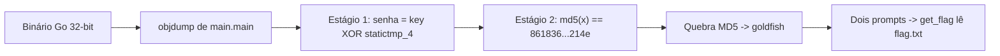

# gogo | picoCTF 2021 (CyLab Academy)

`reverse-engineering` `golang` `objdump` `xor` `md5` `static-analysis`

| | |
|---|---|
| **Plataforma / evento** | picoCTF 2021 (hoje CyLab Academy) |
| **Categoria** | Reverse Engineering |
| **Dificuldade / pontos** | Hard |
| **Autor do desafio** | thelshell |
| **Resolvido em** | 2026-11-02 |

## TL;DR

`enter_password` é um binário Go de 32 bits com **dois estágios**. No primeiro, `main.checkPassword` compara `senha[i] XOR chave[i]` com uma tabela fixa (`main.statictmp_4`); como a chave e a tabela estão embutidas, a senha sai de `chave XOR tabela` = `reverseengineericanbarelyforward`. No segundo, `main.ambush` pede uma "unhashed key" e exige que `md5(entrada)` seja igual a `861836f13e3d627dfa375bdb8389214e` — o **mesmo** valor que serviu de chave XOR no estágio 1 é, na verdade, um hash MD5. Quebrando ele (rockyou) sai `goldfish`. Com os dois, o `get_flag` (deferido) lê o `flag.txt` do servidor e imprime a flag.

> [!IMPORTANT]
> **Ideia-chave:** o valor `861836f13e3d627dfa375bdb8389214e` aparece **duas vezes** no binário — como chave de XOR (estágio 1) e como MD5-alvo (estágio 2). Reconhecer que esses 32 caracteres hex são um hash MD5 é o pulo do gato: o estágio 1 é reversível na hora, o estágio 2 é uma quebra de hash.

## Enunciado

> Hmmm this is a weird file....

**Dica oficial:**

> use go tool objdump or ghidra

**Arquivos:** `enter_password` (ELF 32-bit). **Instância:** serviço por socket que roda o binário e tem o `flag.txt` real.

## Dicas progressivas

<details><summary>Dica 1</summary>É um binário Go. <code>go tool objdump</code> ou Ghidra mostram <code>main.main</code>, <code>main.checkPassword</code>, <code>main.ambush</code> e <code>main.get_flag</code>. Repare que são DOIS prompts.</details>
<details><summary>Dica 2</summary><code>checkPassword</code> exige senha de 32 bytes e faz <code>input[i] XOR key[i] == statictmp_4[i]</code>. A chave são 8 imediatos de 32 bits; a tabela é <code>main.statictmp_4</code>. Senha = chave XOR tabela.</details>
<details><summary>Dica 3</summary>Passado o estágio 1, vem "What is the unhashed key?". <code>main.ambush</code> compara <code>md5(entrada)</code> com <code>861836f13e3d627dfa375bdb8389214e</code> — aquele mesmo valor da chave XOR é um MD5. Quebre o hash.</details>

## Ambiente

- **Máquina atacante:** Kali Linux, com `binutils`/Go (`objdump`, `go tool objdump`), `python3`, `nc` e uma wordlist (`rockyou.txt`).
- **Arquivo:** `enter_password` na raiz da pasta do desafio.

Gerei o disassembly uma vez e trabalhei em cima dele:

***INSERIR no terminal — Kali (atacante)

```bash
go tool objdump enter_password > objdump-go.txt
```

## Resolução

### 1. Que arquivo é esse

`file` mostra um ELF 32-bit estaticamente linkado, e as strings denunciam o runtime do Go (`/app/enter_password.go`, `go1.10.4`). É um binário Go, não stripado, então dá para ler pelos símbolos `main.*`.

```text
enter_password: ELF 32-bit LSB executable, Intel i386, statically linked, Go BuildID=..., not stripped
```

As funções do autor são cinco:

```text
main.main   main.checkPassword   main.ambush   main.get_flag   main.check
```

> [!TIP]
> **Conceito: reversing de Go.** Binários Go são grandes e têm runtime próprio, mas preservam nomes de função (`main.main`, `main.checkPassword`) e constantes do pacote (`main.statictmp_N`). `go tool objdump -s 'main\.'` isola o código do autor do ruído do runtime.

### 2. O fluxo em `main.main`

Lendo `main.main`, o programa tem **dois estágios** encadeados:

```text
enter_password.go:15  Printf("Enter Password: ")
enter_password.go:16  Scanf(&input1)
enter_password.go:17  checkPassword(input1)        ; se falso -> "Try again!" e sai
enter_password.go:18  Println("====...")
enter_password.go:19  Println("This challenge is interrupted by psociety")
enter_password.go:20  Println("What is the unhashed key?")
enter_password.go:22  Scanf(&input2)
enter_password.go:23  ambush(input2)               ; estágio 2
enter_password.go:24  defer get_flag()             ; lê flag.txt ao retornar
```

Ou seja: a senha correta no estágio 1 só te leva ao segundo prompt. O `get_flag` é **deferido** e só executa quando `main` retorna — o que exige passar também pelo `ambush`.

### 3. Estágio 1 — `main.checkPassword`

Três coisas saltam no disassembly:

**(a) exige 32 bytes.** Compara o tamanho da entrada com `0x20` e sai se for menor.

**(b) escreve uma chave fixa de 32 bytes** na stack, como 8 imediatos de 32 bits:

```text
MOVL $0x38313638, ...   MOVL $0x31663633, ...   MOVL $0x64336533, ...   MOVL $0x64373236, ...
MOVL $0x37336166, ...   MOVL $0x62646235, ...   MOVL $0x39383338, ...   MOVL $0x65343132, ...
```

Decodificando em little-endian, esses bytes formam a string ASCII `861836f13e3d627dfa375bdb8389214e` (32 caracteres hex — guarde isto, volta no estágio 2).

**(c) o laço de verificação.** Para `i` de 0 a 31, faz `input[i] XOR key[i]` e compara com `main.statictmp_4[i]`:

```text
MOVZX 0(CX)(AX*1), BP     ; BP = input[i]
MOVZX 0x4(SP)(AX*1), SI   ; SI = key[i]
XORL  SI, BP              ; input[i] XOR key[i]
MOVZX 0x24(SP)(AX*1), SI  ; SI = statictmp_4[i]
```

A condição é `input[i] XOR key[i] == statictmp_4[i]`. Isolando o `input`:

```text
senha[i] = key[i] XOR statictmp_4[i]
```

Tenho `key` (os imediatos) e `statictmp_4` (constante na `.rodata`, lida direto do binário).

### 4. Estágio 2 — `main.ambush`

O segundo prompt ("What is the unhashed key?") cai em `main.ambush`, que:

```text
enter_password.go:95   stringtoslicebyte(input2)
enter_password.go:96   crypto/md5.Sum(input2)            ; calcula MD5 da entrada
enter_password.go:103  MOVL $0x38313638, ...            ; monta de novo "861836...214e"
      ...              (os MESMOS 8 imediatos do estágio 1)
enter_password.go:134  hex.EncodeToString(md5)          ; hex do MD5
enter_password.go:134  CMPL CL, AL / JE ...             ; compara char a char
enter_password.go:135  os.Exit                          ; no primeiro byte diferente
```

Traduzindo: o estágio 2 exige uma string cujo **`md5(string)` seja `861836f13e3d627dfa375bdb8389214e`**. Aquele valor que no estágio 1 era a chave do XOR é, na verdade, um hash MD5 — e aqui o desafio pede o preimage. Errar um byte sequer chama `os.Exit` (sem flag).

### 5. Recuperando as duas respostas

O [`scripts/script1.py`](scripts/script1.py) faz os dois estágios: recupera a senha (XOR) e quebra o MD5 (rockyou).

```python
#!/usr/bin/env python3
import struct, subprocess, sys, hashlib

binpath  = sys.argv[1] if len(sys.argv) > 1 else "./enter_password"
wordlist = sys.argv[2] if len(sys.argv) > 2 else "/usr/share/wordlists/rockyou.txt"

KEY_DWORDS = [0x38313638, 0x31663633, 0x64336533, 0x64373236,
              0x37336166, 0x62646235, 0x39383338, 0x65343132]
key = b"".join(struct.pack("<I", d) for d in KEY_DWORDS)   # "861836...214e"

# Estágio 1: senha = key XOR statictmp_4 (statictmp_4 lido da .rodata)
syms = subprocess.run(["objdump", "-t", binpath], capture_output=True, text=True).stdout
addr = next(int(l.split()[0], 16) for l in syms.splitlines()
            if l.strip().endswith("main.statictmp_4"))
dump = subprocess.run(
    ["objdump", "-s", "--start-address", hex(addr), "--stop-address", hex(addr + 32), binpath],
    capture_output=True, text=True).stdout
cmp_bytes = b""
for line in dump.splitlines():
    cols = line.split()
    if len(cols) >= 2 and all(c in "0123456789abcdef" for c in cols[0]):
        for grp in cols[1:5]:
            if all(c in "0123456789abcdef" for c in grp):
                cmp_bytes += bytes.fromhex(grp)
cmp_bytes = cmp_bytes[:32]
password = bytes(k ^ c for k, c in zip(key, cmp_bytes))
print("estagio 1 (senha) =", password.decode())

# Estágio 2: quebrar o MD5 (a própria key é o hash-alvo)
target = key.decode()
unhashed = None
with open(wordlist, "rb") as f:
    for line in f:
        w = line.rstrip(b"\n")
        if hashlib.md5(w).hexdigest() == target:
            unhashed = w.decode(errors="replace"); break
print("estagio 2 (unhashed key) =", unhashed)
```

***INSERIR no terminal — Kali (atacante)

```bash
python3 scripts/script1.py ./enter_password
```

```text
estagio 1 (senha) = reverseengineericanbarelyforward
estagio 2 (unhashed key) = goldfish
```

### 6. Pegando a flag

Com as duas respostas, conecto na instância e respondo os dois prompts na ordem:

***INSERIR no terminal — Kali (atacante)

```bash
printf 'reverseengineericanbarelyforward\ngoldfish\n' | nc xebec.cylabacademy.net 23016
```

```text
Enter Password: =========================================
This challenge is interrupted by psociety
What is the unhashed key?
Flag is:  academy{p1kap1ka_p1c0182XXXXX}
```

## Cadeia de ataque



## Por que funciona

O estágio 1 não guarda a senha nem um hash dela: guarda a chave do XOR e o resultado esperado, ambos embutidos. XOR é sua própria inversa, então quem tem a chave e o resultado recupera a entrada offline. O estágio 2 reaproveita o mesmo material de outra forma — a "chave" era um MD5 o tempo todo, e basta quebrar o preimage (um valor fraco, presente na rockyou). O `flag.txt` só é lido pelo `get_flag` deferido quando `main` retorna, o que exige passar pelos dois estágios; errar o segundo chama `os.Exit` antes do defer rodar.

## Remediação

- Não validar segredos comparando contra constantes embutidas: tanto a tabela do XOR quanto o MD5-alvo estão no binário, e o MD5 (`goldfish`) é fraco/presente em wordlists.
- Ofuscação de binário não resolve: imediatos e símbolos continuam acessíveis; a lógica de validação não deveria viver no cliente.

## Lições e padrões

- **Sinais para reconhecer:** um laço de 32 iterações com `XOR`/`CMP` contra um buffer copiado de constante = "entrada XOR chave == alvo", reversível na hora. Uma string de 32 caracteres hex é quase sempre um MD5 — teste quebrar antes de assumir que é só "dado".
- **Da próxima vez eu tentaria primeiro:** desmontar `main.main` inteiro (não só `checkPassword`) para ver todos os estágios antes de concluir o fluxo.
- **Onde perdi tempo:** inicialmente só analisei o estágio 1 e achei que a senha já dava a flag — o binário tem um segundo prompt (`ambush`) que só aparece ao rodar/ler `main.main` por completo.

## Referências

- [Go — `cmd/objdump`](https://pkg.go.dev/cmd/objdump)
- [`crypto/md5`](https://pkg.go.dev/crypto/md5)
- picoCTF 2021 — gogo

## Flag

```text
academy{p1kap1ka_p1c0182XXXXX}
```
