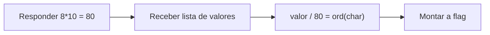

# Hidden Cipher 2 | picoCTF 2026

`reverse-engineering` `crypto-simples` `netcat` `python`

| | |
|---|---|
| **Plataforma / evento** | picoCTF 2026 |
| **Categoria** | Reverse Engineering |
| **Dificuldade / pontos** | Medium |
| **Autor do desafio** | Yahaya Meddy |
| **Resolvido em** | 2026-05-18 |

## TL;DR

O serviço faz uma pergunta de multiplicação (`8 * 10`) e, depois da resposta certa, cospe uma lista de números grandes. Cada número é `ord(caractere) * resposta`. Divido cada valor pela resposta (80) e reconstruo a flag caractere a caractere.

> [!IMPORTANT]
> **Ideia-chave:** a "resposta do probleminha de matemática" não é só um gate de acesso, ela é a própria chave do cipher. Cada byte da flag foi multiplicado por ela.

## Enunciado

> The flag is right in front of you... kind of. You just need to solve a basic math problem to see it. But to get the real flag, you'll have to understand how that math answer is used.

**Dicas oficiais:**

> 1. Focus on what the program does with your correct answer. Is it reused later?
> 2. Disassembling or decompiling tools (Ghidra, IDA) can help reveal the exact transformation on the flag.

**Instância:** serviço acessível por `nc` (host e porta gerados pelo picoCTF).

## Dicas progressivas

<details><summary>Dica 1</summary>Responda a conta e olhe os números que aparecem. Eles são grandes e todos múltiplos de um mesmo valor.</details>
<details><summary>Dica 2</summary>Esse valor em comum é a resposta da conta (80).</details>
<details><summary>Dica 3</summary><code>chr(valor // 80)</code> para cada número devolve um caractere ASCII.</details>

## Ambiente

- **Máquina atacante:** Kali Linux, com `nc` e `python3`.

Na minha instância o serviço estava em `crystal-peak.picoctf.net`, porta `62933`. Use o host e a porta da sua.

***INSERIR no terminal — Kali (atacante)

```bash
export TARGET_HOST=crystal-peak.picoctf.net TARGET_PORT=62933
```

## Resolução

### 1. Conversando com o serviço

Conecto e respondo a conta.

***INSERIR no terminal — Kali (atacante)

```bash
nc $TARGET_HOST $TARGET_PORT
```

```text
What is 8 * 10? 80
Encoded flag values:
8960, 8400, 7920, 8880, 5360, 6720, 5600, 9840, 8720, 4160, 9280, 8320, 7600, 7840, 4080, 8320, 3920, 8800, 8000, 7600, 7920, 3920, 8960, 8320, 4080, 9120, 7600, 8160, 4400, 4560, 4080, 8000, 3840, 8080, 3840, 10000
```

Reparo em duas coisas: a conta é `8 * 10 = 80`, e todos os valores da lista são múltiplos de 80 (8960/80 = 112, 8400/80 = 105, ...). 112 é `p`, 105 é `i`. Já dá para sentir o `pi...` de `picoCTF`.

> [!TIP]
> **Conceito: cipher multiplicativo.** Cada caractere virou `ord(c) * k`, com `k` sendo a resposta da conta. Como a multiplicação por uma constante conhecida é trivialmente reversível, basta dividir por `k` para recuperar o byte original. O "problema de matemática" é só uma forma de entregar a chave `k`.

### 2. Revertendo

Divido cada valor por 80 e converto para caractere. É exatamente a transformação que as dicas mandam entender: a resposta é reusada como multiplicador da flag.

#### `scripts/script1.py`

```python
#!/usr/bin/env python3
# Decodifica a flag do Hidden Cipher 2.
# Cada valor recebido = ord(caractere) * resposta_da_conta.

answer = 8 * 10  # a conta pedida pelo serviço

values = [
    8960, 8400, 7920, 8880, 5360, 6720, 5600, 9840,
    8720, 4160, 9280, 8320, 7600, 7840, 4080, 8320,
    3920, 8800, 8000, 7600, 7920, 3920, 8960, 8320,
    4080, 9120, 7600, 8160, 4400, 4560, 4080, 8000,
    3840, 8080, 3840, 10000,
]

flag = ''.join(chr(v // answer) for v in values)
print(flag)
```

***INSERIR no terminal — Kali (atacante)

```bash
python3 scripts/script1.py
```

```text
picoCTF{m4th_b3h1nd_c1ph3r_f793d0e0}
```

## Cadeia de ataque



## Por que funciona

Um cipher multiplicativo por uma constante `k` não tem difusão nem segredo real: se o atacante conhece `k` (e aqui o serviço entrega `k` como resposta da conta), a inversa é só `byte = valor / k`. A "proteção" é obscuridade, não criptografia.

## Remediação

- Não tratar uma transformação reversível e sem chave secreta como cifra. Para proteger dados, usar criptografia de verdade com chave que o cliente não conhece.

## Lições e padrões

- **Sinais para reconhecer:** uma lista de inteiros grandes todos divisíveis por um número pequeno e conhecido quase sempre é `ord(c) * k` ou `ord(c) + k`.
- **Da próxima vez eu tentaria primeiro:** calcular o `gcd` da lista para achar o multiplicador, mesmo sem saber qual era a conta.

## Referências

- picoCTF — Hidden Cipher 2 (General/Reverse)

## Flag

```text
picoCTF{m4th_b3h1nd_c1ph3r_f793d0e0}
```
