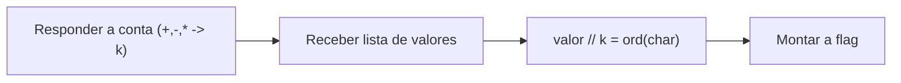

# Hidden Cipher 2 | picoCTF 2026 (CyLab Academy)

`reverse-engineering` `crypto-simples` `netcat` `python`

| | |
|---|---|
| **Plataforma / evento** | picoCTF 2026 |
| **Plataforma (hoje)** | CyLab Academy (`cylabacademy.net`) |
| **Categoria** | Reverse Engineering |
| **Dificuldade / pontos** | Medium |
| **Autor do desafio** | Yahaya Meddy |
| **Resolvido / revalidado em** | 2026-11-02 |

## TL;DR

O serviço faz uma pergunta de aritmética simples (ex.: `6 * 8`, `10 - 5`) e, depois da resposta certa, cospe uma lista de números grandes. Cada número é `ord(caractere) * resposta`. Divido cada valor pela resposta e reconstruo a flag caractere a caractere.

> [!IMPORTANT]
> **Ideia-chave:** a "resposta do probleminha de matemática" não é só um gate de acesso, ela é a própria **chave** do cipher. Cada byte da flag foi multiplicado por ela.

> [!WARNING]
> A operação da conta **muda a cada conexão**, pode ser `+`, `-` ou `*` (na mesma instância eu peguei `6 * 8` e depois `10 - 5`). O script resolve qualquer operador; não hardcode a conta. O sufixo da flag também muda por instância.

## Enunciado

> The flag is right in front of you... kind of. You just need to solve a basic math problem to see it. But to get the real flag, you'll have to understand how that math answer is used.

**Dicas oficiais:**

> 1. Focus on what the program does with your correct answer. Is it reused later?
> 2. Disassembling or decompiling tools (Ghidra, IDA) can help reveal the exact transformation on the flag.

**Arquivos:** `hiddencipher2.zip` (o programa). **Instância:** serviço acessível por `nc` (host e porta gerados pela plataforma). Dá para resolver só pela interação, sem abrir o binário.

## Dicas progressivas

<details><summary>Dica 1</summary>Responda a conta e olhe os números que aparecem. Eles são grandes e todos múltiplos de um mesmo valor.</details>
<details><summary>Dica 2</summary>Esse valor em comum é a resposta da conta (o <code>gcd</code> da lista também o revela, caso você não tenha anotado).</details>
<details><summary>Dica 3</summary><code>chr(valor // resposta)</code> para cada número devolve um caractere ASCII.</details>

## Ambiente

- **Máquina atacante:** Kali Linux, com `nc` e `python3`.

Na minha instância o serviço estava em `xebec.cylabacademy.net`, porta `48109`. Use o host e a porta da sua.

***INSERIR no terminal: Kali (atacante)

```bash
export TARGET_HOST=xebec.cylabacademy.net TARGET_PORT=48109
```

## Resolução

### 1. Conversando com o serviço

Conecto e respondo a conta. A operação varia; neste exemplo veio uma multiplicação.

***INSERIR no terminal: Kali (atacante)

```bash
nc $TARGET_HOST $TARGET_PORT
```

```text
What is 6 * 8? 48
Encoded flag values:
4656, 4752, 4656, 4800, 4848, 5232, 5808, 5904, 5232, 2496, 5568, 4992, 4560, 4704, 2448, 4992, 2352, 5280, 4800, 4560, 4752, 2352, 5376, 4992, 2448, 5472, 4560, 4848, 2400, 4656, 4752, 4752, 4848, 4704, 4752, 6000
```

A conta é `6 * 8 = 48`, e todos os valores da lista são múltiplos de 48 (4656/48 = 97, 4752/48 = 99, ...). 97 é `a`, 99 é `c`: já dá para sentir o `ac...` de `academy`.

> [!TIP]
> **Conceito: cipher multiplicativo.** Cada caractere virou `ord(c) * k`, com `k` sendo a resposta da conta. Como a multiplicação por uma constante conhecida é trivialmente reversível, basta dividir por `k` para recuperar o byte original. O "problema de matemática" é só uma forma de entregar a chave `k`, e se você não anotou `k`, o `gcd` de todos os valores devolve ele.

### 2. Revertendo

O script conecta, resolve a conta (qualquer que seja o operador), lê os valores e divide cada um pela resposta. É exatamente a transformação que as dicas mandam entender: a resposta é reusada como multiplicador da flag.

#### `scripts/script1.py`

```python
#!/usr/bin/env python3
# Hidden Cipher 2: o serviço pede uma conta de aritmética (a operação VARIA
# entre instâncias: +, - ou *), e a RESPOSTA dessa conta é a chave do cipher:
# cada caractere da flag foi codificado como ord(c) * resposta.
# Então eu respondo a conta, leio a lista de valores e divido cada um pela
# resposta para recuperar os bytes da flag.
#
# Uso: TARGET_HOST=host TARGET_PORT=porta python3 scripts/script1.py

import socket, os, re, time

HOST = os.environ.get("TARGET_HOST", "xebec.cylabacademy.net")
PORT = int(os.environ.get("TARGET_PORT", "48109"))

def recv_all(s, wait=0.7):
    time.sleep(wait)
    s.settimeout(3)
    out = b""
    try:
        while True:
            d = s.recv(65535)
            if not d:
                break
            out += d
            if len(d) < 4096:
                break
    except Exception:
        pass
    return out.decode(errors="replace")

s = socket.create_connection((HOST, PORT), timeout=15)

# 1) Lê a pergunta e resolve a conta (operador qualquer).
q = recv_all(s)
print("Pergunta:", q.strip())
a, op, b = re.search(r"(\d+)\s*([*+\-/x])\s*(\d+)", q).groups()
a, b = int(a), int(b)
answer = {"+": a + b, "-": a - b, "*": a * b, "x": a * b, "/": a // b if b else 0}[op]
print("Resposta:", answer)

# 2) Envia a resposta e recebe os valores cifrados.
s.sendall(str(answer).encode() + b"\n")
resp = recv_all(s)

# 3) Cada valor = ord(char) * answer  ->  char = chr(valor // answer).
values = [int(x) for x in re.findall(r"\d+", resp.split("values", 1)[-1])]
flag = "".join(chr(v // answer) for v in values)
print(flag)
s.close()
```

***INSERIR no terminal: Kali (atacante)

```bash
python3 scripts/script1.py
```

```text
Pergunta: What is 10 - 5?
Resposta: 5
academy{m4th_b3h1nd_c1ph3r_e2aXXXXX}
```

(A conta aqui veio diferente, `10 - 5`, mas o script resolve igual, e a flag é a mesma da instância.)

## Cadeia de ataque



## Por que funciona

Um cipher multiplicativo por uma constante `k` não tem difusão nem segredo real: se o atacante conhece `k` (e aqui o serviço entrega `k` como resposta da conta), a inversa é só `byte = valor / k`. Mesmo sem saber `k`, o `gcd` da lista o revela. A "proteção" é obscuridade, não criptografia.

## Remediação

- Não tratar uma transformação reversível e sem chave secreta como cifra. Para proteger dados, usar criptografia de verdade com chave que o cliente não conhece.

## Lições e padrões

- **Sinais para reconhecer:** uma lista de inteiros grandes todos divisíveis por um número pequeno e conhecido quase sempre é `ord(c) * k` ou `ord(c) + k`.
- **Da próxima vez eu tentaria primeiro:** calcular o `gcd` da lista para achar o multiplicador, assim nem dependo de ter anotado a conta, e funciona mesmo se o operador mudar.

## Referências

- picoCTF, Hidden Cipher 2 (Reverse)

## Flag

```text
academy{m4th_b3h1nd_c1ph3r_e2aXXXXX}
```
