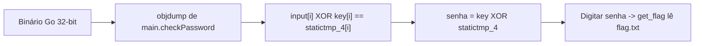

# gogo | picoCTF 2021

`reverse-engineering` `golang` `objdump` `xor` `static-analysis`

| | |
|---|---|
| **Plataforma / evento** | picoCTF 2021 |
| **Categoria** | Reverse Engineering |
| **Dificuldade / pontos** | Hard |
| **Autor do desafio** | thelshell |
| **Resolvido em** | 2026-05-18 |

## TL;DR

`enter_password` é um binário Go de 32 bits que pede uma senha e, se ela estiver certa, lê e imprime o `flag.txt` do servidor. Desmontando `main.checkPassword` com `go tool objdump`, vejo que ele compara `senha[i] XOR chave[i]` com uma tabela fixa (`main.statictmp_4`). A chave e a tabela estão embutidas no binário, então a senha é só `chave XOR tabela` = `reverseengineericanbarelyforward`. Digito isso no serviço e ele devolve a flag.

> [!IMPORTANT]
> **Ideia-chave:** em binário Go stripado o fluxo some, mas os símbolos `main.*` e os imediatos continuam lá. A verificação era um XOR byte a byte contra constantes embutidas, e XOR com material conhecido é reversível na hora.

## Enunciado

> Hmmm this is a weird file....

**Dica oficial:**

> use go tool objdump or ghidra

**Arquivos:** `enter_password` (ELF 32-bit). **Instância:** serviço por socket que roda o binário e tem o `flag.txt` real.

## Dicas progressivas

<details><summary>Dica 1</summary>É um binário Go. <code>go tool objdump</code> ou Ghidra mostram <code>main.main</code>, <code>main.checkPassword</code> e <code>main.get_flag</code>.</details>
<details><summary>Dica 2</summary><code>checkPassword</code> exige senha de 32 bytes e faz um laço comparando <code>input[i] XOR algo</code> com uma tabela.</details>
<details><summary>Dica 3</summary>A chave do XOR são 8 imediatos de 32 bits; a tabela é <code>main.statictmp_4</code>. Senha = chave XOR tabela.</details>

## Ambiente

- **Máquina atacante:** Kali Linux, com `binutils` (`objdump`), `python3` e `nc`.
- **Arquivo:** `enter_password` na raiz da pasta do desafio.

Gerei o disassembly uma vez e trabalhei em cima dele:

***INSERIR no terminal — Kali (atacante)

```bash
objdump -d enter_password > objdump-main.txt
```

## Resolução

### 1. Que arquivo é esse

`file` mostra um ELF 32-bit, e as strings denunciam o runtime do Go (caminhos `/usr/lib/go-1.10/...`, `enter_password.go`). Então é um binário Go, e o jeito mais limpo de ler é pelos símbolos `main.*`, que o Go mantém.

> [!TIP]
> **Conceito: reversing de Go.** Binários Go são grandes e têm um runtime próprio, mas preservam nomes de função (`main.main`, `main.checkPassword`) e constantes do pacote (`main.statictmp_N`). `go tool objdump -s main.` ou `objdump -d` já isolam o código do autor do ruído do runtime.

### 2. Lendo `main.checkPassword`

No disassembly (arquivo completo em [`files/checkPassword.objdump.txt`](files/checkPassword.objdump.txt)), três coisas saltam:

**(a) exige 32 bytes.** Logo no começo compara o tamanho da entrada com `0x20` e sai se for menor:

```text
enter_password.go:31  CMPL CX, $0x20        ; len < 32 ?
enter_password.go:31  JL   0x80d4b51        ; -> os.Exit
```

**(b) escreve uma chave fixa de 32 bytes** na stack, como 8 imediatos de 32 bits:

```text
MOVL $0x38313638, 0x4(SP)
MOVL $0x31663633, 0x8(SP)
MOVL $0x64336533, 0xc(SP)
MOVL $0x64373236, 0x10(SP)
MOVL $0x37336166, 0x14(SP)
MOVL $0x62646235, 0x18(SP)
MOVL $0x39383338, 0x1c(SP)
MOVL $0x65343132, 0x20(SP)
```

Decodificando em little-endian, esses bytes formam a string ASCII `861836f13e3d627dfa375bdb8389214e` (parece um hash hex de 32 caracteres).

**(c) o laço de verificação.** Copia `main.statictmp_4` para outro buffer e, para `i` de 0 a 31, faz `input[i] XOR key[i]` e compara com `statictmp_4[i]`, contando acertos. Se todos os 32 baterem, retorna verdadeiro:

```text
MOVZX 0(CX)(AX*1), BP     ; BP = input[i]
MOVZX 0x4(SP)(AX*1), SI   ; SI = key[i]
XORL  SI, BP              ; input[i] XOR key[i]
MOVZX 0x24(SP)(AX*1), SI  ; SI = statictmp_4[i]
CMPL  AL, BL              ; compara
```

Ou seja: a condição é `input[i] XOR key[i] == statictmp_4[i]` para todo `i`. Isolando o `input`:

```text
senha[i] = key[i] XOR statictmp_4[i]
```

Tenho `key` (os imediatos). Falta `statictmp_4`, que é uma constante na `.rodata` — leio direto do binário.

### 3. Recuperando a senha

O script localiza o endereço de `main.statictmp_4` pela tabela de símbolos, lê os 32 bytes e faz o XOR com a chave.

#### `scripts/script1.py`

```python
#!/usr/bin/env python3
# senha[i] = key[i] XOR statictmp_4[i]
import struct, subprocess, sys

binpath = sys.argv[1] if len(sys.argv) > 1 else "./enter_password"

KEY_DWORDS = [0x38313638, 0x31663633, 0x64336533, 0x64373236,
              0x37336166, 0x62646235, 0x39383338, 0x65343132]
key = b"".join(struct.pack("<I", d) for d in KEY_DWORDS)

syms = subprocess.run(["objdump", "-t", binpath], capture_output=True, text=True).stdout
addr = next(int(l.split()[0], 16) for l in syms.splitlines()
            if l.strip().endswith("main.statictmp_4"))

dump = subprocess.run(
    ["objdump", "-s", "--start-address", hex(addr), "--stop-address", hex(addr + 32), binpath],
    capture_output=True, text=True).stdout
cmp_bytes = b""
for line in dump.splitlines():
    cols = line.split()
    if len(cols) >= 2 and all(c in "0123456789abcdef" for c in cols[0]):
        for grp in cols[1:5]:
            if all(c in "0123456789abcdef" for c in grp):
                cmp_bytes += bytes.fromhex(grp)
cmp_bytes = cmp_bytes[:32]

password = bytes(k ^ c for k, c in zip(key, cmp_bytes))
print("key  =", key.decode())
print("senha=", password.decode())
```

***INSERIR no terminal — Kali (atacante)

```bash
python3 scripts/script1.py ./enter_password
```

```text
key  = 861836f13e3d627dfa375bdb8389214e
senha= reverseengineericanbarelyforward
```

### 4. Pegando a flag

Com a senha, o serviço passa pelo `checkPassword` e cai em `main.get_flag`, que faz `ioutil.ReadFile("flag.txt")` e imprime o conteúdo. Digito a senha na instância:

***INSERIR no terminal — Kali (atacante)

```bash
nc <host-da-instância> <porta>
```

Depois do prompt `Enter Password:`, envio `reverseengineericanbarelyforward` e o serviço responde com `Flag is: picoCTF{vr00m_vr00m_8011dd6c979cd7e6}`.

## Cadeia de ataque



## Por que funciona

A verificação de senha não guarda a senha nem um hash dela: guarda a chave do XOR e o resultado esperado, ambos embutidos no binário. XOR é sua própria inversa, então quem tem a chave e o resultado recupera a entrada diretamente — não há força bruta nem segredo no servidor. O `flag.txt` só é lido depois que a comparação passa, mas a comparação é inteiramente reversível offline.

## Remediação

- Não validar segredos comparando contra constantes embutidas. Usar hash forte com sal e comparar hashes (ainda assim, um CTF de RE expõe o mecanismo; em produção a validação deve ser do lado do servidor, sem a lógica no cliente).
- Ofuscação de binário não resolve: os imediatos e símbolos continuam acessíveis.

## Lições e padrões

- **Sinais para reconhecer:** um laço de 32 iterações com `XOR` e `CMP` contra um buffer copiado de uma constante é "entrada XOR chave == alvo" — reversível na hora.
- **Da próxima vez eu tentaria primeiro:** em binário Go, listar `main.*` e dar uma olhada em `checkPassword`/`get_flag` antes de abrir o Ghidra inteiro.

## Referências

- [Go — `cmd/objdump`](https://pkg.go.dev/cmd/objdump)
- picoCTF 2021 — gogo

## Flag

```text
picoCTF{vr00m_vr00m_8011dd6c979cd7e6}
```
